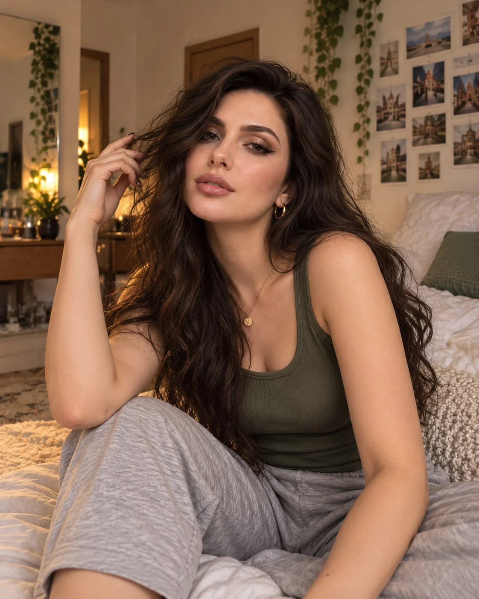

# Olive Tank Top Portrait from a Reference Girl

**中文标题：** 参考人物→橄榄绿背心写真  
**ID:** `gi25-x-1007` · **Mode:** `edit`  
**Categories:** `character-consistency`, `edit-change-preserve`  
**Tags:** `x-twitter`, `community`, `gpt-image-2.5`, `x-direct`, `en`



### Olive Tank Top Portrait from a Reference Girl

```text
Create an ultra-realistic portrait of the same girl from the reference photo, preserving her exact facial identity, hazel eyes, natural freckles, rosy skin, glossy pink lips, and long, voluminous dark-brown hair. She wears a modest olive-green ribbed tank top, delicate gold hoop earrings, and a fine pendant necklace.

Capture two candid poses in a cozy bedroom: first, gently resting her fingers against her cheek while gazing into the camera; second, casually playing with her hair while leaning against soft pillows. Include warm beige walls, photo collages, cream bedding, and subtle greenery.

Warm, diffused lighting, natural skin texture, realistic hair strands, soft background blur, earthy tones, authentic smartphone photography, and an intimate editorial aesthetic. Keep both poses natural, with consistent facial features, clothing, and accessories. No excessive retouching, distorted hands, or revealing clothing.
```

- **Recommended model:** `gpt-image-2.5-sunburst`
- **Settings:** _(defaults)_
- **Source:** [community](https://x.com/mehvishs25/status/2113291734042202422) — @mehvishs25
- **License note:** Original public X post; quoted with attribution — remix with attribution
- **Notes:** Collected directly from X; original post https://x.com/mehvishs25/status/2113291734042202422; post text names GPT Image 2.5; discovered via Bin0754/gpt-image-gallery index, prompt re-verified against the original X post via api.fxtwitter.com; verified=True
- **Preview:** `previews/gi25-x-1007.webp`
