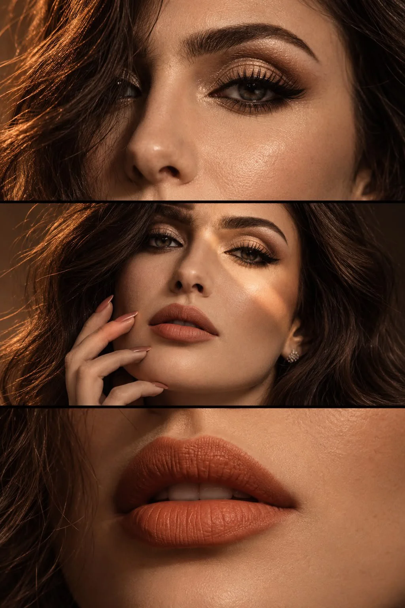

# Three-Panel Macro Beauty Triptych from a Reference

**中文标题：** 参考人物→三联微距美妆特写  
**ID:** `gi25-x-1014` · **Mode:** `edit`  
**Categories:** `character-consistency`, `edit-change-preserve`  
**Tags:** `x-twitter`, `community`, `gpt-image-2.5`, `x-direct`, `en`



### Three-Panel Macro Beauty Triptych from a Reference

```text
Create a photorealistic, cinematic beauty triptych featuring the same girl from the reference photo, preserving her exact facial identity, eye color, eyebrow shape, nose, lips, skin tone, and natural skin texture.

Composition: Three equal horizontal macro portraits stacked vertically, separated by thin black lines, with a luxurious amber-bronze color palette and dramatic shadows.

Top panel: One eye gazing directly into the camera, framed by defined brows, long curled lashes, and shimmering golden-bronze eyeshadow. Warm highlights illuminate her cheek and nose, while loose hair catches a subtle reddish-gold glow. The opposite side fades into darkness.

Middle panel: Her face slightly tilted, one eye sharply illuminated by a narrow diagonal beam of warm light. Long nude-pink manicured nails gently touch her cheek and near her lips. The remaining face disappears into deep, cinematic shadows.

Bottom panel: An extreme close-up of her softly parted lips with matte terracotta-orange lipstick, revealing natural lip creases, delicate skin pores, and a subtle glimpse of her teeth.

Lighting & Style: Hard directional light from the upper left, glowing golden highlights, rich bronze tones, deep blacks, and striking chiaroscuro contrast. Ultra-sharp macro details, realistic skin texture, sophisticated luxury beauty editorial, shot on Sony A7R IV with a 100mm macro lens.

Maintain perfect facial consistency across all three panels. Vivid warm colors, crisp focus, natural proportions, 8K photorealism, no text, no watermark, no artificial skin smoothing, no AI artifacts.
```

- **Recommended model:** `gpt-image-2.5-sunburst`
- **Settings:** _(defaults)_
- **Source:** [community](https://x.com/mehvishs25/status/2113637254447165517) — @mehvishs25
- **License note:** Original public X post; quoted with attribution — remix with attribution
- **Notes:** Collected directly from X; original post https://x.com/mehvishs25/status/2113637254447165517; post text names GPT Image 2.5; discovered via Bin0754/gpt-image-gallery index, prompt re-verified against the original X post via api.fxtwitter.com; verified=True
- **Preview:** `previews/gi25-x-1014.webp`
