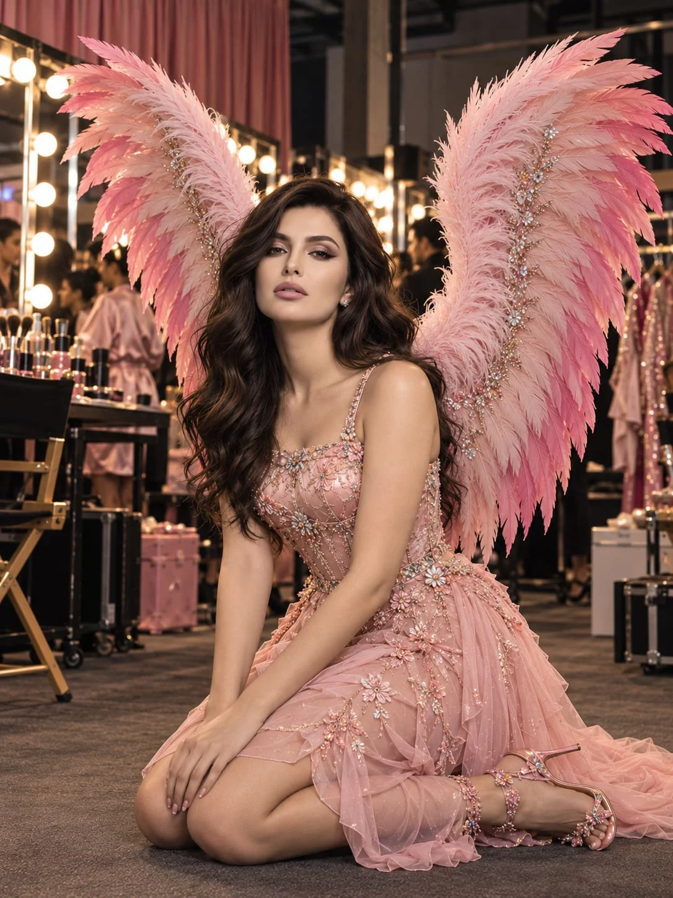

# Backstage Fashion Editorial from a Reference

**中文标题：** 参考人物→后台时装大片  
**ID:** `gi25-x-1018` · **Mode:** `edit`  
**Categories:** `character-consistency`, `edit-change-preserve`  
**Tags:** `x-twitter`, `community`, `gpt-image-2.5`, `x-direct`, `en`



### Backstage Fashion Editorial from a Reference

```text
Create an ultra-photorealistic, cinematic backstage fashion editorial featuring the same adult woman from the reference image. Preserve her recognizable facial identity, eye color, facial proportions, skin tone, and distinctive features.

COMPOSITION & POSE: Vertical 3:4 portrait, full-body framing. Show her entire figure, director’s chair, both shoes, and both wings completely within the frame, with comfortable margins. She is seated elegantly in a black-and-gold director’s chair, legs crossed naturally at the ankles, torso turned slightly toward the camera. One hand rests gently near her chin while the other rests on the chair arm. Her posture is relaxed, poised, and confident, with a sophisticated runway-model expression.

COUTURE OUTFIT: A luxurious blush-pink and champagne-gold couture ensemble with a structured, fully tailored bodice, a moderately high sweetheart neckline with tasteful coverage, delicate embellished shoulder straps, intricate crystal embroidery, and a sculpted waist. The bodice must cover the bust securely without cleavage or a plunging neckline. A flowing, knee-covering layered chiffon skirt features delicate floral appliqués, subtle shimmer, and elegant translucent outer layers over opaque lining. The skirt drapes naturally over her crossed legs, providing substantial coverage. Add elegant rose-gold strappy heels with crystal floral details, small sparkling earrings, and refined accessories. The overall styling should feel luxurious, feminine, graceful, and fashion-forward rather than revealing.

DRAMATIC PINK FEATHER WINGS: Two enormous, separate, physically realistic feathered wings attached to a concealed harness behind her shoulders. They extend upward and outward in a dramatic V-shaped silhouette. Each wing has an independent curved outline, fluffy pale-blush feathers near the base, and meticulously layered flight feathers transitioning from soft blush pink to rich fuchsia at the tips. Fine feather shafts, delicate barbs, subtle crystal embellishments, and realistic depth are clearly visible. Keep both wings distinct from the chair, body, and background, entirely inside the frame, and elevated above the floor.

HAIR & MAKEUP: Voluminous, softly tousled brunette waves cascading over her shoulders. Refined champagne and rose-pink eyeshadow, delicate eyeliner, natural-looking lashes, peach blush, luminous skin with visible natural texture, and glossy nude-pink lipstick. Preserve the facial identity of the reference image without excessive retouching.

BACKSTAGE ENVIRONMENT: A luxurious fashion-show dressing room with illuminated vanity mirrors, warm round bulbs, makeup palettes, pink velvet curtains, clothing racks filled with couture garments, makeup stations, director’s chairs, and softly blurred stylists and models in elegant satin robes. Create an authentic early-2000s high-fashion backstage atmosphere with subtle background activity and realistic environmental details.

LIGHTING & PHOTOGRAPHY: Warm vanity lighting mixed with subtle direct-camera flash, natural skin highlights, realistic shadows, detailed satin and chiffon textures, sparkling crystal reflections, shallow depth of field, subtle 35mm film grain, and sophisticated rose-pink, champagne-gold, and silver color grading. Camera positioned around seated eye level, using a professional 50mm editorial portrait lens.

STRICT REQUIREMENTS: Modest, elegant neckline; no visible cleavage; skirt covering the knees; no high slit, exposed upper thighs, or revealing cutouts. Natural seated anatomy, correctly formed hands, realistic proportions, detailed feathers, accurate chair structure, consistent facial identity, and fully visible wings and shoes. Genuine photographic realism, not illustration or CGI. No plastic skin, exaggerated body proportions, distorted limbs, cropped accessories, or artificial-looking textures.
```

- **Recommended model:** `gpt-image-2.5-sunburst`
- **Settings:** _(defaults)_
- **Source:** [community](https://x.com/mehvishs25/status/2113985827340730840) — @mehvishs25
- **License note:** Original public X post; quoted with attribution — remix with attribution
- **Notes:** Collected directly from X; original post https://x.com/mehvishs25/status/2113985827340730840; post text names GPT Image 2.5; discovered via Bin0754/gpt-image-gallery index, prompt re-verified against the original X post via api.fxtwitter.com; verified=True
- **Preview:** `previews/gi25-x-1018.webp`
