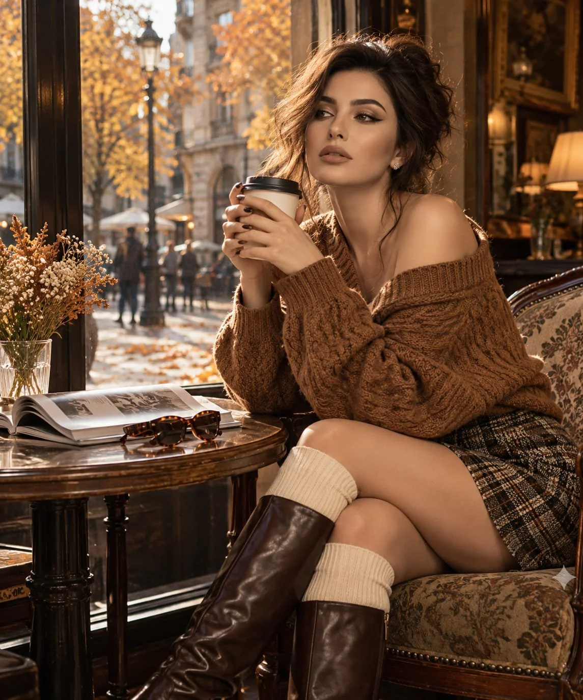

# Cinematic Autumn Fashion Portrait from a Reference

**中文标题：** 参考人物→电影感秋日时装人像  
**ID:** `gi25-x-1024` · **Mode:** `edit`  
**Categories:** `character-consistency`, `edit-change-preserve`  
**Tags:** `x-twitter`, `community`, `gpt-image-2.5`, `x-direct`, `en`



### Cinematic Autumn Fashion Portrait from a Reference

```text
Create a cinematic autumn fashion portrait using the provided reference photo strictly for facial identity. Preserve her recognizable likeness with maximum accuracy, keeping the same face shape, eyes, eyebrows, nose, lips, and natural skin texture without altering her identity.

Scene & Composition: A young woman sits sideways on a vintage upholstered armchair beside a tall arched window in an elegant European-style café. Her hair is loosely pinned into a slightly messy bun, with a few soft strands framing her face. She gazes thoughtfully toward the street while holding a warm takeaway coffee cup with both hands.

Outfit & Styling: An oversized caramel-brown cable-knit sweater slipping casually off one shoulder, a tailored charcoal-and-tan plaid mini skirt, creamy ribbed knee-high socks, and polished chocolate-brown leather knee-high boots. Her styling feels effortlessly chic, cozy, and naturally sophisticated.

Environment & Details: Outside the window, an old-world city street glows with amber and copper autumn foliage. Fallen leaves scatter across the pavement as blurred pedestrians pass in the distance. A small round walnut table holds a delicate bouquet of dried wildflowers, a half-open photography book, and vintage tortoiseshell sunglasses. Subtle reflections on the glass add depth and atmosphere.

Lighting & Mood: Late-afternoon sunlight streams through the window, casting soft golden highlights across her hair, knitwear, and face. Rich earthy tones, gentle shadows, natural skin detail, shallow depth of field, and an intimate, nostalgic autumn atmosphere.

Photography Style: Luxury lifestyle editorial, candid composition, shot on an 85mm portrait lens, f/1.8, realistic fabric textures, delicate film grain, natural color grading, exceptional detail, photorealistic 8K quality. The final image should resemble an authentic high-end fashion magazine photograph, never an artificial-looking render.
```

- **Recommended model:** `gpt-image-2.5-sunburst`
- **Settings:** _(defaults)_
- **Source:** [community](https://x.com/mehvishs25/status/2112899640572145834) — @mehvishs25
- **License note:** Original public X post; quoted with attribution — remix with attribution
- **Notes:** Collected directly from X; original post https://x.com/mehvishs25/status/2112899640572145834; post text names GPT Image 2.5; discovered via Bin0754/gpt-image-gallery index, prompt re-verified against the original X post via api.fxtwitter.com; verified=True
- **Preview:** `previews/gi25-x-1024.webp`
