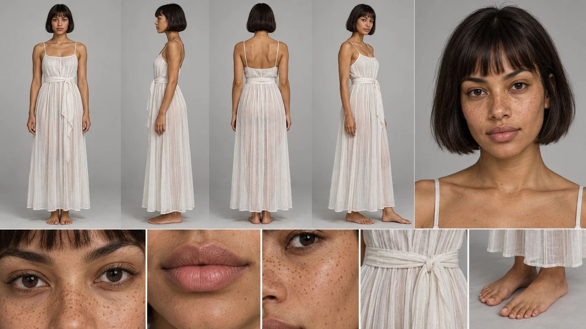

# Character Reference Sheet (Turnaround + Expressions)

**中文标题：** 角色设定表（多视图+表情）  
**ID:** `gi25-x-1036` · **Mode:** `generate`  
**Categories:** `character-consistency`  
**Tags:** `x-twitter`, `community`, `gpt-image-2.5`, `x-direct`, `en`



### Character Reference Sheet (Turnaround + Expressions)

```text
Professional character reference sheet of one young woman on a plain light grey studio background, consistent identity across every view. Top row: four full-body views of the same woman standing in a neutral pose (front, left side profile, back, right three-quarter), plus one large head-and-shoulders close-up of her face on the right. Bottom strip: detail crops of her eyes, lips, freckles on her cheek and nose, the gathered waist sash, and her bare feet.

Character: a woman in her late twenties with warm medium-brown skin covered in natural freckles across her nose and cheeks, a short sleek dark brown bob cut at the jaw with straight blunt bangs, dark brown eyes, full natural lips, calm confident expression. Completely bare face: no makeup, no eyeliner, no jewelry, no earrings, no headpiece. She wears a long sheer white pleated linen gown with fine vertical pleats, a soft gathered sash tied at the natural waist, thin straps, the hem falling to the ankles. Barefoot.

Even soft studio lighting, realistic skin texture with visible pores, photorealistic, high detail, fashion lookbook style character sheet. No text, no labels, no watermark. 16:9.

__________________________________

prompt 2:

Professional character reference sheet of one young woman on a plain light grey studio background, consistent identity across every view. Top row: four full-body views of the same woman standing in a neutral pose (front, left side profile, back, right three-quarter), plus one large head-and-shoulders close-up on the right. Bottom strip: detail crops of the headpiece medallion, the gold collar, the scarab belt, an arm cuff, a wrist cuff, and the laced sandals.

Character: same woman as the face reference, warm medium-brown skin, dark brown hair with blunt bangs falling past the jaw, black winged kohl liner, glossy lips, gold grillz with capped canines. Wardrobe: a gold coin and chain headpiece with rows of small hammered gold coins and fine chains over the forehead, a round turquoise medallion set at the center of the brow. A wide hammered gold collar resting on the shoulders and upper chest. A long sheer ivory pleated linen gown with fine vertical pleats and high slits up both legs. A gold scarab belt at the waist with a central carved scarab. Engraved gold cuffs on both upper arms and both wrists. Gold sandals with thin straps laced up the calves.

Even soft studio lighting, photorealistic, realistic skin and metal textures, high detail fashion lookbook sheet. No text, no labels, no watermark. 16:9.
```

- **Recommended model:** `gpt-image-2.5-sunburst`
- **Settings:** _(defaults)_
- **Source:** [community](https://x.com/abxxai/status/2113991711294955661) — @abxxai
- **License note:** Original public X post; quoted with attribution — remix with attribution
- **Notes:** Collected directly from X; original post https://x.com/abxxai/status/2113991711294955661; post text names GPT Image 2.5; discovered via Bin0754/gpt-image-gallery index, prompt re-verified against the original X post via api.fxtwitter.com; verified=True; step 1 of the author's character-and-car workflow thread
- **Preview:** `previews/gi25-x-1036.webp`
