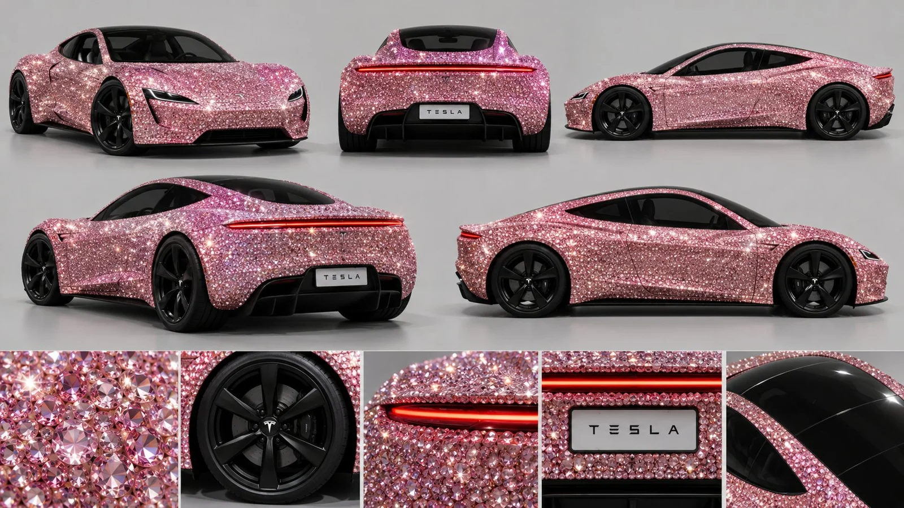

# Vehicle Reference Sheet (Multi-View)

**中文标题：** 车辆设定参考表（多视图）  
**ID:** `gi25-x-1041` · **Mode:** `generate`  
**Categories:** `character-consistency`  
**Tags:** `x-twitter`, `community`, `gpt-image-2.5`, `x-direct`, `en`



### Vehicle Reference Sheet (Multi-View)

```text
Professional vehicle reference sheet of one car on a plain light grey studio background, consistent design across every view. Top row: front three-quarter view, direct rear view, left side profile. Second row: rear-left three-quarter view and right side profile. Bottom strip: detail crops of the crystal surface texture, a black six-spoke wheel, the full-width rear light bar, the rear licence plate, and the black glass roof.

Car: a second-generation Tesla Roadster two-door sports car whose entire body is fully encrusted with thousands of small faceted pink diamonds and crystals, closely set like a jewelled mosaic, catching sharp sparkling highlights. Glossy black glass roof and black tinted windows. Black six-spoke alloy wheels with low-profile tyres. A thin full-width glowing red light bar across the rear. A rear licence plate that reads TESLA. Low, wide, smooth aerodynamic shape.

Bright even studio lighting that makes the crystals glitter, photorealistic automotive photography, high detail. No people, no extra text, no watermark. 16:9.
```

- **Recommended model:** `gpt-image-2.5-sunburst`
- **Settings:** _(defaults)_
- **Source:** [community](https://x.com/abxxai/status/2113991749995839987) — @abxxai
- **License note:** Original public X post; quoted with attribution — remix with attribution
- **Notes:** Collected directly from X; original post https://x.com/abxxai/status/2113991749995839987; post text names GPT Image 2.5; discovered via Bin0754/gpt-image-gallery index, prompt re-verified against the original X post via api.fxtwitter.com; verified=True; step 2 of the author's character-and-car workflow thread
- **Preview:** `previews/gi25-x-1041.webp`
