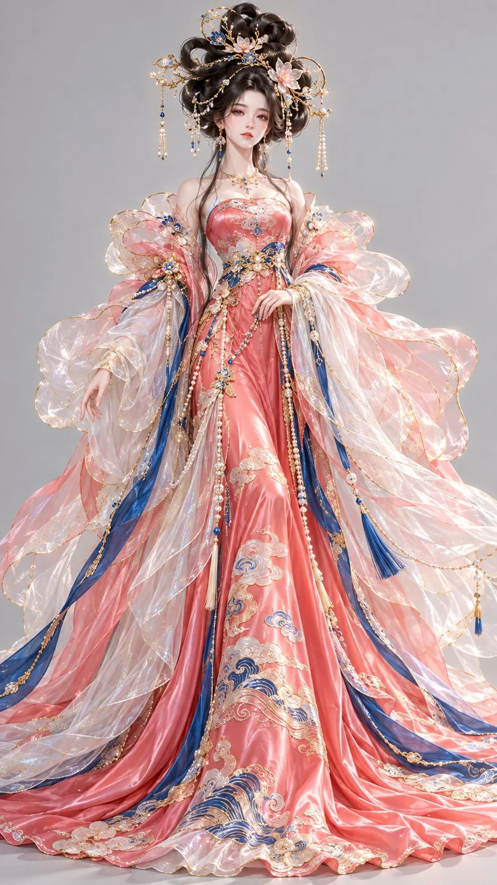

# Sea-and-Sky Oriental Fantasy 3D Character

**中文标题：** 海天流光东方幻想 3D 角色  
**ID:** `gi25-x-1042` · **Mode:** `generate`  
**Categories:** `character-consistency`  
**Tags:** `x-twitter`, `community`, `gpt-image-2.5`, `x-direct`, `zh`



### Sea-and-Sky Oriental Fantasy 3D Character

```text
9:16竖版，高精度风格化3D东方幻想女性角色原型，high-end stylized 3D oriental fantasy character design，电影级CG渲染，鲜艳明亮的中国色配色，华丽梦幻高级定制服装质感。
一位24–28岁的成年东方幻想女性，五官精致明艳，细长清亮的杏眼，柔和小鹅蛋脸，鼻唇秀丽自然，肌肤白皙通透且具有生命感，神情安静而华贵。颈部修长，身形纤细优雅。
发型雕塑： 乌黑浓密长发在头顶塑造成巨大的流霞式高髻，发束向上与两侧舒展，形成如云霞翻卷般的夸张轮廓。发髻间嵌有细长碎金枝簪、群青珐琅小片、珍珠流苏与少量半透明琉璃花片。
服饰设计： 身穿海天霞色为主的东方幻想华服，内层主裙为高光真丝缎，布面具有流动的柔亮反射和厚实垂坠感。外层覆盖多层月白色半透明珠光轻纱，纱料极轻、边缘透光、层层叠叠，像被霞光照亮的薄雾。肩部与上臂延展出宽大的幻彩欧根纱花瓣披帛，纱层边缘滚以细金线。裙摆外层使用群青色局部衬底，和海天霞主裙形成鲜明撞色。衣身与裙摆绣有精细海浪纹、霞云纹和少量立体珠绣。
色彩与材质控制： 海天霞用于最大面积主裙，群青用于局部层次与边饰，月白用于梦幻纱层和留白缓冲，碎金用于刺绣、发饰、描边与珠链细节。整体鲜艳明亮，重点表现丝缎高光、轻纱透光、细密金绣、珍珠与琉璃的华贵梦幻感。
高精度3D建模，真实发丝，柔亮真丝缎，珠光纱层，精工刺绣，珐琅与珠饰细节，明亮柔和影棚光，中性浅灰背景，正面全身完整展示。避免人偶感、塑料材质、普通古装、廉价仙侠风、文字和水印。
```

- **Recommended model:** `gpt-image-2.5-sunburst`
- **Settings:** _(defaults)_
- **Source:** [community](https://x.com/liyue_ai/status/2113304110833488218) — @liyue_ai
- **License note:** Original public X post; quoted with attribution — remix with attribution
- **Notes:** Collected directly from X; original post https://x.com/liyue_ai/status/2113304110833488218; post text names GPT Image 2.5; discovered via Bin0754/gpt-image-gallery index, prompt re-verified against the original X post via api.fxtwitter.com; verified=True
- **Preview:** `previews/gi25-x-1042.webp`
