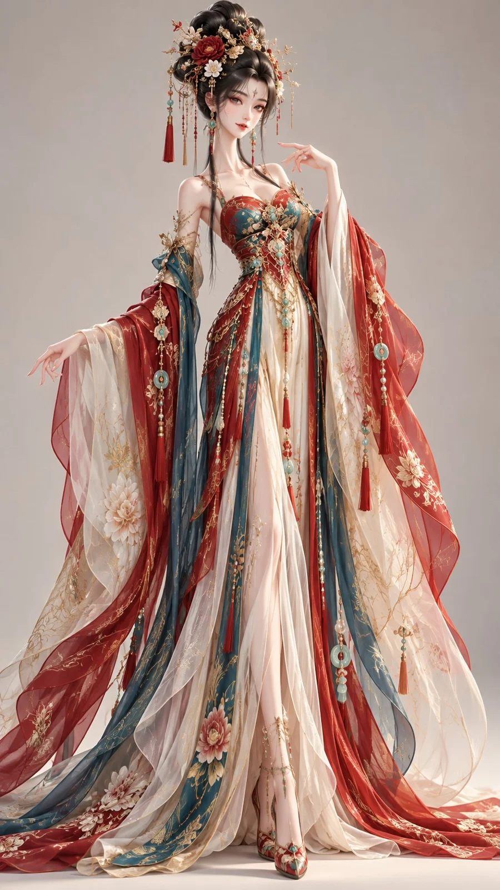

# Elongated Oriental Animated Fantasy Character

**中文标题：** 修长比例东方动画幻想角色  
**ID:** `gi25-x-1045` · **Mode:** `generate`  
**Categories:** `character-consistency`  
**Tags:** `x-twitter`, `community`, `gpt-image-2.5`, `x-direct`, `zh`



### Elongated Oriental Animated Fantasy Character

```text
一位年轻成年东方女性，整体人物比例明显超现实化，身形异常纤细修长，脖颈特别细长，肩部窄而柔和，四肢纤长，整体呈现强烈的纵向延伸感，明显区别于普通真人比例。
人物五官采用高端动画电影式东方美型卡通脸：面部小巧，柔和心形鹅蛋脸，下巴精致圆润；眼睛为横向拉长的清亮杏眼，外眼角微微上挑，眼神灵动、聪明、略带俏皮感；鼻梁小巧纤细，鼻尖精致；嘴巴小巧，唇形柔软，嘴角轻微上扬。整体不是写实真人脸，不是普通国漫脸，也不是幼态娃娃脸，而是精致、轻俏、鲜活的东方动画角色五官。
发型为具有雕塑感和体量感的东方幻想发型，黑发高束或盘起，发型整体轮廓明显大于普通古装发型，搭配少量精致东方发饰、金属簪饰、玉饰或花形装饰。
服装采用东方幻想风高级礼服，不是普通汉服，不是影视古装，而是在东方服装基础上进行理想化和艺术化重构。服装具有修长的裙身、轻盈的大袖或披帛、层叠半透明薄纱、细密丝绸褶皱、精致刺绣与流苏点缀，整体轮廓轻盈、飘逸、梦幻，能够强化人物细长优雅的纵向气质。
整体呈现高端 stylized 3D character art，真实细密发丝、柔和风格化皮肤、精致丝绸与薄纱材质，柔和明亮影棚光，简洁干净背景，角色具有鲜明生命感与高级角色原型感。
避免：普通汉服、普通电视剧古装、写实真人脸、短脖子、正常人体比例、幼态大圆眼、廉价仙侠感、厚重臃肿服装、普通 cosplay 感。
补充服装描述
朱砂红、孔雀蓝、暖金、米白配色，宽大层叠外袍与高腰长裙相结合，袖摆与裙摆体量更大，面料为丝绸、纱罗与刺绣锦缎混合，局部点缀金属流苏、珠玉与花形装饰，整体华丽但仍保持细长比例。
```

- **Recommended model:** `gpt-image-2.5-sunburst`
- **Settings:** _(defaults)_
- **Source:** [community](https://x.com/liyue_ai/status/2112917664725455184) — @liyue_ai
- **License note:** Original public X post; quoted with attribution — remix with attribution
- **Notes:** Collected directly from X; original post https://x.com/liyue_ai/status/2112917664725455184; post text names GPT Image 2.5; discovered via Bin0754/gpt-image-gallery index, prompt re-verified against the original X post via api.fxtwitter.com; verified=True
- **Preview:** `previews/gi25-x-1045.webp`
