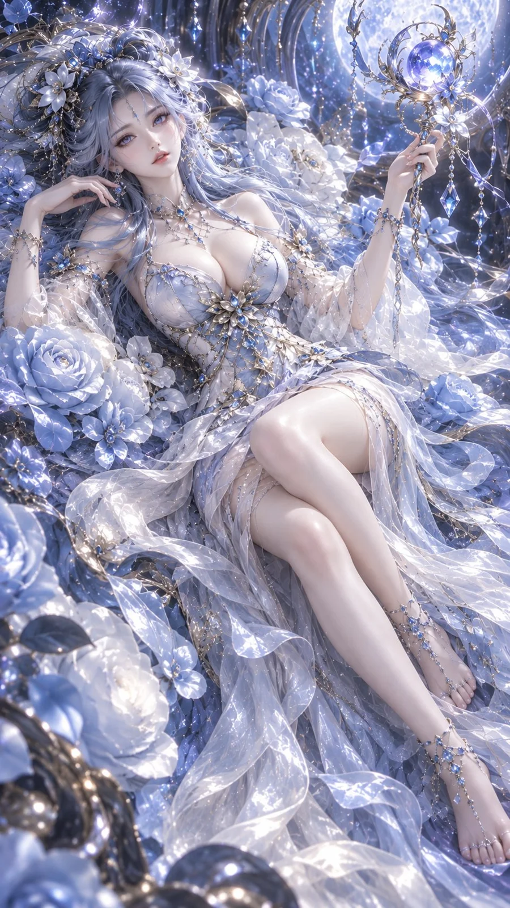

# Ice-Crystal Flower Spirit 3D CG Poster

**中文标题：** 冰晶仙姬 3D CG 海报  
**ID:** `gi25-x-1047` · **Mode:** `generate`  
**Categories:** `character-consistency`  
**Tags:** `x-twitter`, `community`, `gpt-image-2.5`, `x-direct`, `zh`



### Ice-Crystal Flower Spirit 3D CG Poster

```text
9:16 竖版，高精度风格化 3D CG 东方幻想女性角色海报，semi-realistic anime-style 3D character render，high-end oriental fantasy flower spirit character design，premium cinematic CG portrait。
画面主体是一位明确成年的东方幻想女性，视觉年龄约 24–27 岁，身份如同月华花海中诞生的高贵花灵 / 灵姬。整体气质梦幻、优雅、轻盈、神秘、华美，带有安静而迷人的高级幻想感。整体不是普通二次元插画，也不是人偶或手办，而是具有生命感的高精度风格化 3D CG 东方幻想角色原型。
人物拥有精致柔美的东方动漫化五官，小巧流畅的鹅蛋脸，肤色冷白通透，皮肤细腻柔和，带高级次表面散射。眼睛清澈明亮，眼尾略微拉长，睫毛纤长，眼神柔和含笑，神态从容轻盈。鼻梁秀气挺直，嘴唇小巧柔润，唇色为淡粉冷调。五官精致但不过度网红化，保持高级、通透、空灵的东方幻想美感。
人物拥有大量冰蓝色、月光蓝与银雾蓝交织的超长发，发型为双侧云团髻 / 双侧盘发结构，发间带精致的银饰、花形发扣与细小宝石装饰。长发如水流、月光与丝带般大面积铺展在身体四周，发丝层层卷曲、轻盈飘散，形成华丽而柔美的流动曲线。头发边缘具有柔和的透光感与细腻高光。
服装为高精度 3D CG 东方幻想花灵礼装，整体以月白色、冰蓝色和极浅雾蓝色为主。上身为修身塑形的东方幻想礼服结构，融合轻微立领、东方纹饰拼接与精致收腰设计，肩部与手臂搭配半透明轻纱袖套，胸前、腰间和裙身点缀银色金属扣件、花枝纹装饰、宝石镶嵌与细链流苏。下身为层层叠叠的大面积薄纱与褶皱裙摆，质感轻盈、通透、梦幻，形成如花瓣般绽放的体积感。整体服装材质为丝绸、雪纺、欧根纱、薄纱与少量晶体饰件，具有高级柔光反射。
人物躺卧在一片由巨大月白玫瑰、冰蓝花瓣和发光花海构成的梦幻祭坛之中，花朵层层堆叠，形成柔软而华美的背景与承托结构。玫瑰并非普通写实花束，而是带有东方幻想神域气息的巨大灵花，花心隐约散发冷白月光。花海之间弥漫轻薄雾气与柔和辉光，形成静谧、圣洁、梦境般的空间氛围。
人物采用全身斜躺构图，镜头从上方偏左俯视。头部位于画面左上区域，腿部优雅地向画面右下延伸，身体整体形成流畅的 S 型曲线。她一只手轻抬，举起一把华丽的东方幻想灵钥 / 星月法器，法器采用银黑金属与冰蓝发光晶石结构，造型精致镂空，融合羽翼、花瓣、新月与古老神纹元素，具有神秘仪式感。另一只手自然放松，姿态轻盈，整体动作优雅稳定。
人物头发、裙摆、花瓣与薄纱共同形成环绕式流动构图，大量曲线向四周铺展，营造出梦幻、沉浸、包裹式的视觉效果。
光影采用电影级梦幻柔光设计：主要光源来自画面上方与花海内部的冷白月光，照亮人物脸部、肩颈、胸前、手臂和腿部；四周花海与薄纱形成柔和反射光，使阴影区域保持清晰层次；头发边缘、肩线、手臂和腿部轮廓带有细腻的银蓝轮廓光。整体高光柔和扩散，带轻微 bloom 和 halation，光效梦幻但不失清晰度。
色彩采用统一的冷色高级幻想体系：冰蓝、月白、雾蓝、浅紫蓝为主色，少量银色与极少量淡金用于饰品点缀。整体色调纯净、通透、华美，不发灰、不发脏，不出现明显暖橙色和高饱和杂色。人物肌肤始终保持冷白、柔亮、干净。
空气中可漂浮少量微小发光粒子、花瓣碎片、灵气光点与细小悬浮装饰，数量克制，增强梦境氛围而不显廉价。画面整体呈现高级、唯美、沉浸式的东方幻想 3D CG 角色海报质感。
high-density hair strands, subsurface scattering skin, translucent chiffon, layered fantasy costume, moonlit flower sanctuary, luminous roses, elegant reclined pose, premium game character render, cinematic fantasy lighting, ultra-detailed 3D CG, no text, no logo, no watermark
```

- **Recommended model:** `gpt-image-2.5-sunburst`
- **Settings:** _(defaults)_
- **Source:** [community](https://x.com/liyue_ai/status/2114009330387431530) — @liyue_ai
- **License note:** Original public X post; quoted with attribution — remix with attribution
- **Notes:** Collected directly from X; original post https://x.com/liyue_ai/status/2114009330387431530; post text names GPT Image 2.5; discovered via Bin0754/gpt-image-gallery index, prompt re-verified against the original X post via api.fxtwitter.com; verified=True
- **Preview:** `previews/gi25-x-1047.webp`
