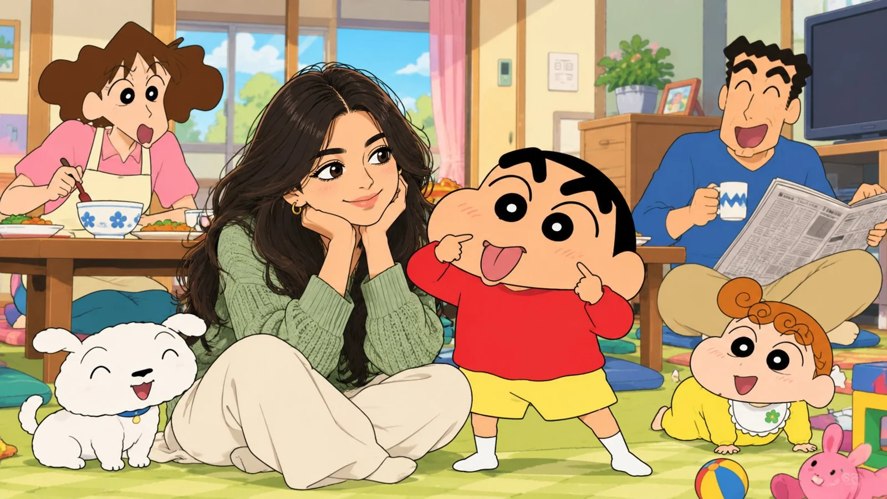

# Me in the Crayon Shin-chan Cartoon World

**中文标题：** 照片→蜡笔小新卡通世界里的我  
**ID:** `gi25-x-1064` · **Mode:** `edit`  
**Categories:** `character-consistency`, `edit-change-preserve`  
**Tags:** `x-twitter`, `community`, `gpt-image-2.5`, `x-direct`, `en`



### Me in the Crayon Shin-chan Cartoon World

```text
Me in the Shinchan Cartoon World 🎨✨

Using my uploaded photo as the facial reference, transform me into a charming 2D anime character in the classic Crayon Shin-chan cartoon universe, preserving my recognizable facial features, long dark-brown hair, skin tone, and gold hoop earrings while adapting my appearance to the show's simple, expressive cartoon design; place me sitting beside Shinchan in the Nohara family's cozy Japanese living room, wearing my sage-green knitted sweater and cream trousers, while Shinchan wears his iconic red shirt and yellow shorts and makes his hilarious signature silly face, with Misae looking surprised in the background, Hiroshi laughing with his newspaper, baby Himawari playing with colorful toys, and adorable white dog Shiro sitting beside us. Use bold black outlines, expressive faces, vibrant colors, smooth 2D cel shading, warm afternoon sunlight, traditional Japanese home furnishings, a low wooden table, floor cushions, and a nostalgic Japanese TV-animation aesthetic; compose the scene in a horizontal 16:9 frame, with me and Shinchan prominently featured in the foreground and every character fully visible, maintaining consistent cartoon proportions, natural interactions, and a cheerful comedic atmosphere, with no photorealism, no 3D rendering, no distorted anatomy, no text, no logos, and no watermarks.
```

- **Recommended model:** `gpt-image-2.5-sunburst`
- **Settings:** _(defaults)_
- **Source:** [community](https://x.com/Rose5303508870/status/2112831731229458929) — @Rose5303508870
- **License note:** Original public X post; quoted with attribution — remix with attribution
- **Notes:** Collected directly from X; original post https://x.com/Rose5303508870/status/2112831731229458929; post text names GPT Image 2.5; discovered via Bin0754/gpt-image-gallery index, prompt re-verified against the original X post via api.fxtwitter.com; verified=True
- **Preview:** `previews/gi25-x-1064.webp`
