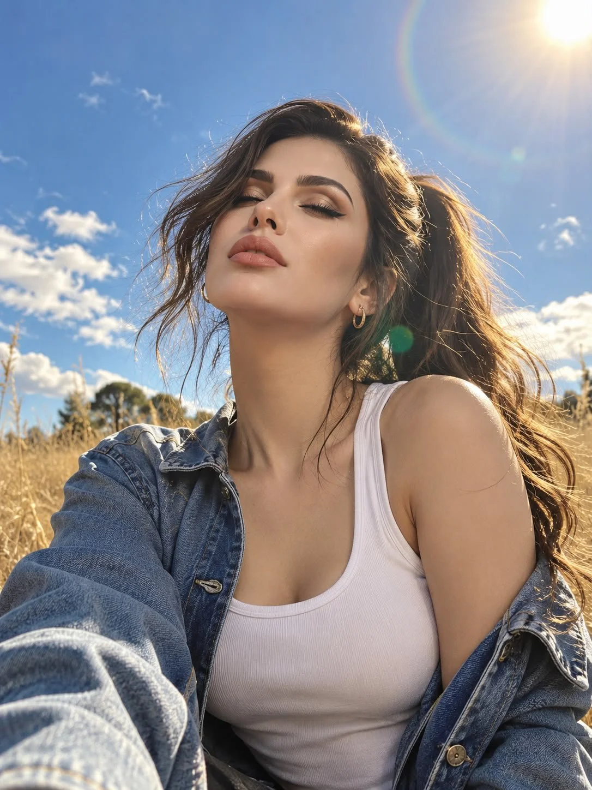

# Golden-Hour Sun Portrait of the Same Person from a Reference

**中文标题：** 参考图同一人物·落日金光人像  
**ID:** `gi25-x-1081` · **Mode:** `edit`  
**Categories:** `character-consistency`, `edit-change-preserve`  
**Tags:** `x-twitter`, `community`, `gpt-image-2.5`, `x-direct`, `en`



### Golden-Hour Sun Portrait of the Same Person from a Reference

```text
Create a photorealistic portrait of the same girl from the reference image, preserving her exact facial features and identity. Shot on an iPhone 16 Pro from a low angle, her head tilted slightly backward, eyes closed, face turned toward the sun, and lips gently closed in a peaceful expression.

Her long, dark-brown hair is tied in a high ponytail, with loose strands blowing in the wind and glowing golden in the sunlight. She wears gold hoop earrings, a fitted white sleeveless tank top, and an oversized blue denim shirt.

Background: An open field of dry golden grass beneath a deep blue sky, delicate clouds, and a bright sun surrounded by a subtle rainbow halo and soft green lens flare.

Lighting & Makeup: Bright natural sunlight, warm skin tones, luminous cheekbones, softly defined brows, wispy lashes, delicate eyeliner, and dusty-pink lips.

Style: Ultra-realistic iPhone photography, vibrant colors, cinematic sun flare, natural skin texture, detailed hair and denim, subtle film grain, authentic candid Instagram aesthetic.

Negative prompt: Changed facial features, plastic skin, excessive retouching, CGI, studio lighting, distorted anatomy, extra fingers, blurry face, overexposed sky, excessive glare, text, watermarks, or social media icons.
```

- **Recommended model:** `gpt-image-2.5-sunburst`
- **Settings:** _(defaults)_
- **Source:** [community](https://x.com/mehvishs25/status/2114733359364804730) — @mehvishs25
- **License note:** Original public X post; quoted with attribution — remix with attribution
- **Notes:** Collected directly from X; original post https://x.com/mehvishs25/status/2114733359364804730; post text names GPT Image 2.5; discovered via Bin0754/gpt-image-gallery index, prompt re-verified against the original X post via api.fxtwitter.com; verified=True
- **Preview:** `previews/gi25-x-1081.webp`
