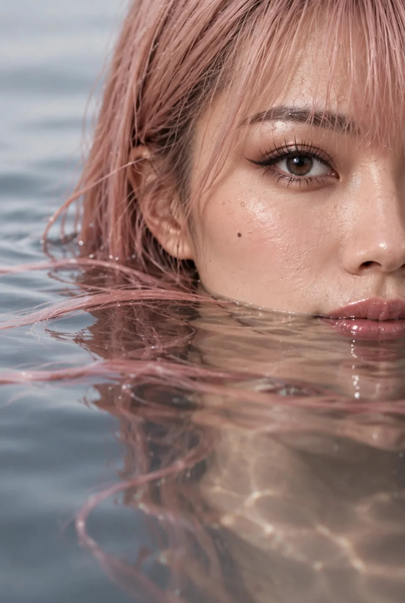

# Half-Submerged Ethereal Water Portrait (Face Reference)

**中文标题：** 半身入水空灵人像（参考面容）  
**ID:** `gi25-x-1088` · **Mode:** `edit`  
**Categories:** `character-consistency`, `edit-change-preserve`  
**Tags:** `x-twitter`, `community`, `gpt-image-2.5`, `x-direct`, `en`



### Half-Submerged Ethereal Water Portrait (Face Reference)

```text
Close-up portrait of a woman, half-submerged in still water. The camera frames only the upper half of her face resting on the water surface — one eye, eyebrow, part of her nose and lips visible above the waterline, the rest of her face and body submerged and gently distorted beneath the surface. Soft natural lighting, water droplets on her skin and floating strands of pink hair, serene and ethereal expression, high detail, photorealistic
```

- **Recommended model:** `gpt-image-2.5-flare`
- **Settings:** _(defaults)_
- **Source:** [community](https://x.com/LoveAiko2003/status/2114557081860833571) — @LoveAiko2003
- **License note:** Original public X post; quoted with attribution — remix with attribution
- **Notes:** Collected directly from X; original post https://x.com/LoveAiko2003/status/2114557081860833571; post text names GPT Image 2.5; discovered via Bin0754/gpt-image-gallery index, prompt re-verified against the original X post via api.fxtwitter.com; verified=True; comparison post; image 1 is GPT Image 2.5 Flare
- **Preview:** `previews/gi25-x-1088.webp`
