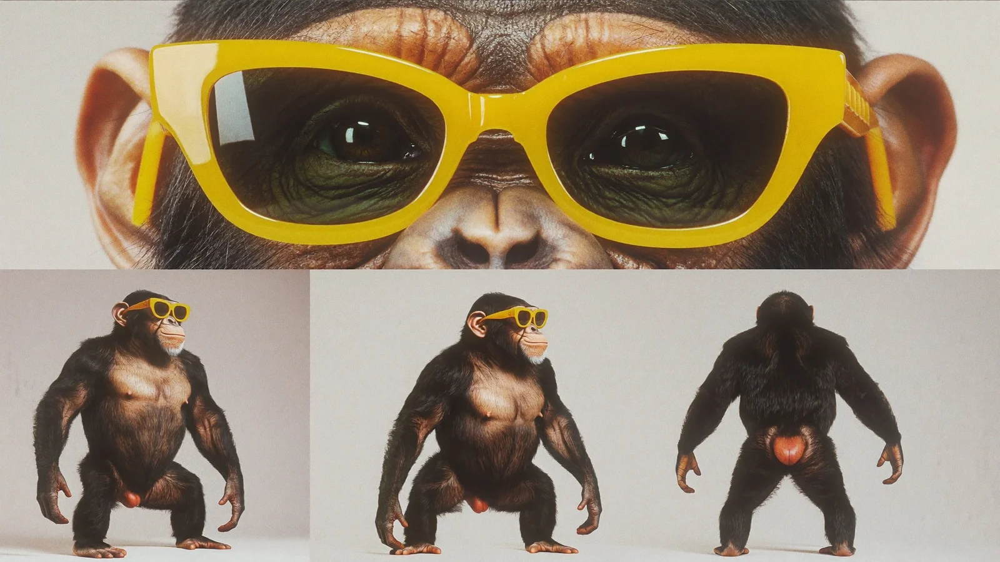

# Photoreal Chimpanzee Character Reference Sheet

**中文标题：** 写实黑猩猩角色设定参考图  
**ID:** `gi25-x-1091` · **Mode:** `generate`  
**Categories:** `character-consistency`  
**Tags:** `x-twitter`, `community`, `gpt-image-2.5`, `x-direct`, `en`



### Photoreal Chimpanzee Character Reference Sheet

```text
character reference sheet on a plain off-white studio background, 16:9, photorealistic. a huge close-up of the face across the top, then front, three-quarter and back full-body views below. an adult chimpanzee with dark coarse fur, a pale wrinkled face and chunky glossy yellow plastic sunglasses. real fur texture, real wrinkled skin, real moist eyes. no text.
```

- **Recommended model:** `gpt-image-2.5-sunburst`
- **Settings:** _(defaults)_
- **Source:** [community](https://x.com/abxxai/status/2114723962345435152) — @abxxai
- **License note:** Original public X post; quoted with attribution — remix with attribution
- **Notes:** Collected directly from X; original post https://x.com/abxxai/status/2114723962345435152; post text names GPT Image 2.5; discovered via Bin0754/gpt-image-gallery index, prompt re-verified against the original X post via api.fxtwitter.com; verified=True
- **Preview:** `previews/gi25-x-1091.webp`
