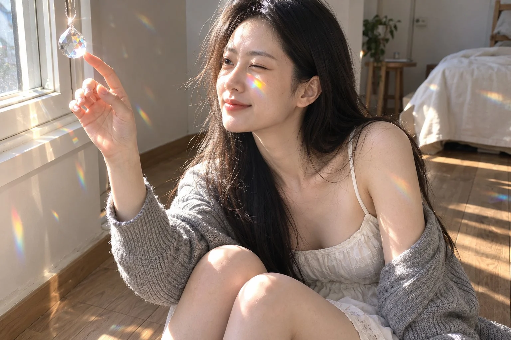

# Afternoon Rainbow-Prism Light Portrait (Same Person)

**中文标题：** 午后彩虹光影人像（同一人物）  
**ID:** `gi25-x-1115` · **Mode:** `edit`  
**Categories:** `character-consistency`, `edit-change-preserve`  
**Tags:** `x-twitter`, `community`, `gpt-image-2.5`, `x-direct`, `zh`



### Afternoon Rainbow-Prism Light Portrait (Same Person)

```text
与参考图为同一人物，保持面容一致，只参考面容，不参考服装、发型和背景。一张光影创意人像：午后，她坐在窗边的木地板上，窗台上挂着一颗透明的水晶棱镜，阳光穿过棱镜，在她的脸颊和颧骨上投下一道小小的、清晰的彩虹光斑。她微微侧过脸，闭着一只眼睛，伸出一只手到彩虹光斑前，好像想用指尖接住这道彩虹，嘴角带着轻松的笑。她穿一件白色细吊带棉质连衣裙，外面松松地搭着一件浅灰色针织开衫，从一侧肩膀滑落，长发随意披着，几缕碎发被阳光照亮。房间里是明亮柔和的自然光，白墙上也有几道小彩虹光斑。光源只有一个：从窗户斜照进来的阳光，所有光斑方向一致。真实照片质感，像用手机随手拍下的，未修图：真实的皮肤纹理，能看到毛孔、细小的瑕疵和淡淡的雀斑。不磨皮、不美颜、不要AI感、不要过度饱和的调色。无文字，无水印。
```

- **Recommended model:** `gpt-image-2.5-sunburst`
- **Settings:** _(defaults)_
- **Source:** [community](https://x.com/Adam38363368936/status/2114665717136310552) — @Adam38363368936
- **License note:** Original public X post; quoted with attribution — remix with attribution
- **Notes:** Collected directly from X; original post https://x.com/Adam38363368936/status/2114665717136310552; post text names GPT Image 2.5; discovered via X search, prompt re-verified against the original X post via api.fxtwitter.com; verified=True
- **Preview:** `previews/gi25-x-1115.webp`
