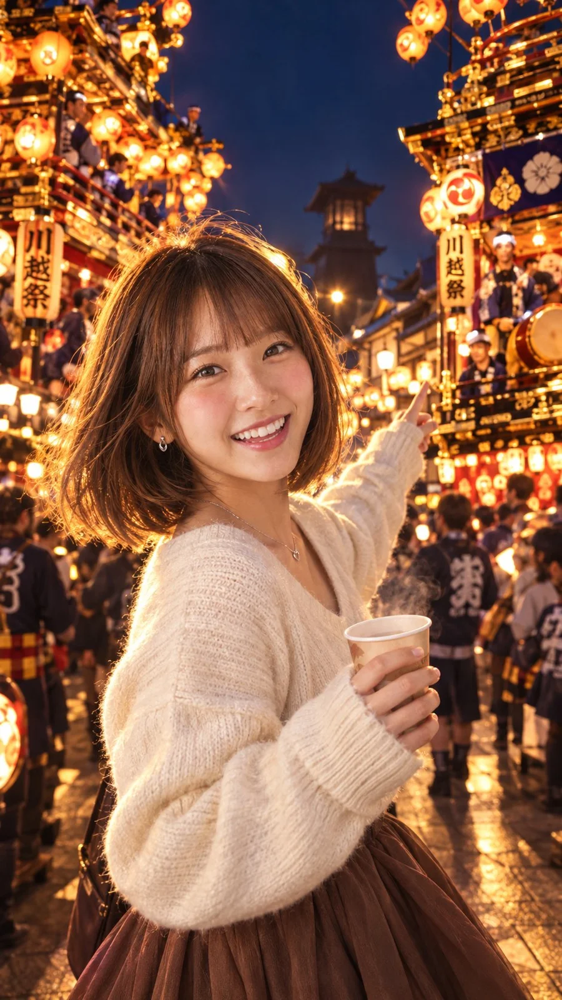

# Local Festival Lantern Night Selfie (Face Reference)

**中文标题：** 地方祭典灯笼夜自拍（参考面容）  
**ID:** `gi25-x-1116` · **Mode:** `edit`  
**Categories:** `character-consistency`, `edit-change-preserve`  
**Tags:** `x-twitter`, `community`, `gpt-image-2.5`, `x-direct`, `ja`



### Local Festival Lantern Night Selfie (Face Reference)

```text
※お顔の写真を添付してね。

顔・髪: 添付の顔写真に準拠（ブラウンカラーのボブヘア、自然な前髪）
髪の状態: 夜風にふわっと軽やかに揺れ、提灯の光を受けて髪の輪郭がゴールドに輝く（リムライト効果のある）ナチュラルで整った状態
表情: 山車同士の競演（曳っかわせ）の迫力と祭りの熱気に目を輝かせ、臨場感に感動しながらカメラ（撮影者）に弾けるような笑顔を見せる瞬間（歯が見える明るく親しみやすい笑顔）
トップス: 秋の夜祭りに合わせた上品でカジュアルなアイボリーのVネックニットセーター（少し萌え袖気味）
ボトムス: ハイウエストのロングフレアスカート（落ち着いたブラウン）
足元: 歩きやすいレザーのショートブーツ（ダークブラウン）
小物: 小さなハートモチーフのシルバーネックレスとシンプルなピアス。片手には湯気が少し立つ紙コップの温かい飲み物（甘酒など）を持ち、もう片方の手は背景の山車を指さすような自然な仕草
ポーズ: 人混みの中で振り返り、「見て！すごいよ！」と撮影者（彼氏目線・友人目線）に呼びかけているような、リアルなデート感・臨場感あふれるドラマチックな振り返りポーズ
前後: 手前に女性がくっきりと大きく映り（主役）、背景には川越まつり最大のハイライトである「山車が向かい合ってお囃子を競い合う熱気（曳っかわせ）」と、夜の蔵造りの街並みが重厚に広がる
構図: スマホ画面いっぱいに広がる縦型ミディアムショット（バストアップ〜膝上）。ローアングル気味に撮影することで、背景の巨大で豪華な多層構造の山車と、上空に飾られた無数の提灯の広がりを強調し、ダイナミックで圧倒的な立体感を演出
場所: 夜の川越「一番街・蔵造りの町並み」（黒漆喰の重厚な蔵造り建築と、川越のシンボル「時の鐘」のシルエットがうっすら見え隠れする場所）。無数の温かいオレンジ色の提灯で煌びやかに装飾された豪華な山車（だし）が間近に迫る賑やかな大通り
光: 山車と提灯から溢れ出る濃密なオレンジ＆ゴールドの温かい光線が、女性の顔立ちや髪を立体的に照らし出す。背景には無数の丸い玉ボケ（bokeh）が散りばめられ、エモーショナルでロマンチックなライティング
撮影: 50mm f/1.2 超単焦点レンズで撮影されたシネマティックポートレート。浅い被写界深度により被写体が背景から美しく浮き上がり、夜景の光が幻想的に滲む最高峰のレンズ描写
質感: 人物の肌の生っぽい透明感、ニットの柔らかい毛羽立ち、提灯の和紙や木の山車の細やかなディテール、夜空の深い紺色と光の対比が鮮明な高解像度リアルフォト
画風: 実写・フォトリアル、トレンド感のあるSNS映えする商業写真風ポートレート（TikTok/Instagramの縦型トレンド動画のワンシーンのような臨場感）
比率: 縦9:16 / 1080x1920px（横長不可）
```

- **Recommended model:** `gpt-image-2.5-flare`
- **Settings:** _(defaults)_
- **Source:** [community](https://x.com/kawagoe_ai/status/2114652757214794198) — @kawagoe_ai
- **License note:** Original public X post; quoted with attribution — remix with attribution
- **Notes:** Collected directly from X; original post https://x.com/kawagoe_ai/status/2114652757214794198; post text names GPT Image 2.5; discovered via X search, prompt re-verified against the original X post via api.fxtwitter.com; verified=True; comparison post; image 3 is gpt-image-2.5-flare; the trailing backslash is omitted
- **Preview:** `previews/gi25-x-1116.webp`
