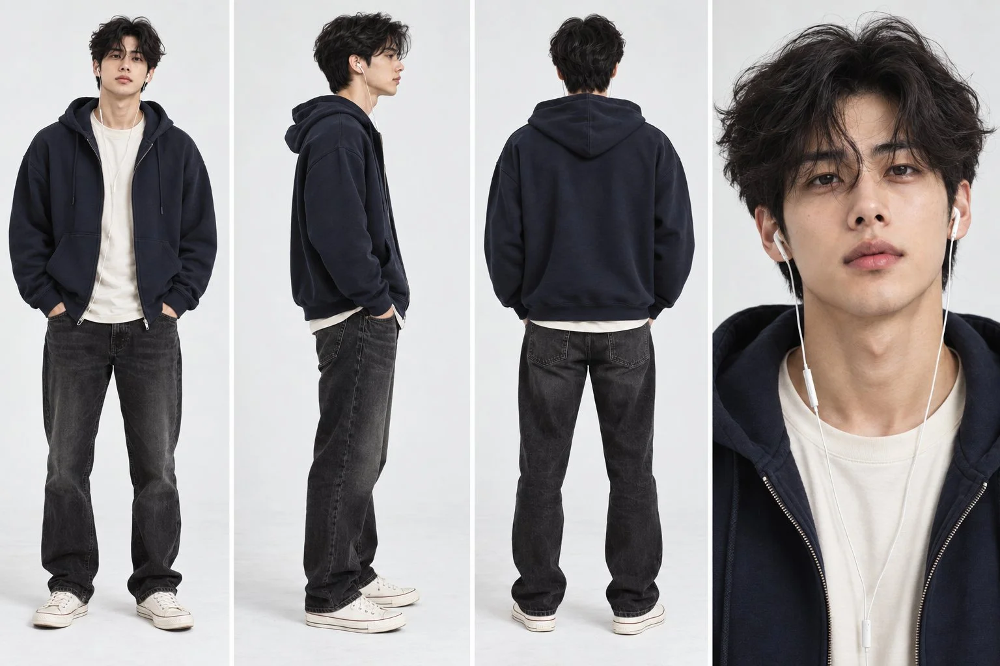

# Photorealistic Four-Panel Character Reference Sheet

**中文标题：** 写实四格角色设定参考图  
**ID:** `gi25-x-1141` · **Mode:** `generate`  
**Categories:** `character-consistency`  
**Tags:** `x-twitter`, `community`, `gpt-image-2.5`, `x-direct`, `en`



### Photorealistic Four-Panel Character Reference Sheet

```text
Create an ultra-photorealistic four-panel character reference sheet of a 26-year-old South Asian man with warm medium-brown skin, an athletic but lean build, naturally wavy black hair falling slightly over his forehead, dark brown eyes, defined cheekbones, a straight nose, and a short neatly trimmed beard. He has a calm, thoughtful expression and natural facial features with realistic pores, subtle skin texture, and no artificial smoothing. He wears an oversized dark navy hoodie over a cream T-shirt, washed black straight-fit jeans, clean off-white canvas sneakers, and white wired earphones hanging naturally from both ears. Arrange the sheet in four equal panels on a clean white studio background: full-body front view, full-body right-side profile, full-body back view, and a close-up portrait showing his facial details clearly. Maintain exactly the same identity, hairstyle, facial proportions, outfit, footwear, and accessories across every panel. Use soft professional studio lighting, natural shadows, realistic cotton fabric textures, sharp focus, true-to-life colors, and professional fashion reference photography. No logos, text, watermarks, duplicate people, or distorted anatomy.
```

- **Recommended model:** `gpt-image-2.5-sunburst`
- **Settings:** _(defaults)_
- **Source:** [community](https://x.com/HeyAbhishek/status/2115155431534543330) — @HeyAbhishek
- **License note:** Original public X post; quoted with attribution — remix with attribution
- **Notes:** Collected directly from X; original post https://x.com/HeyAbhishek/status/2115155431534543330; post text names GPT Image 2.5; discovered via Bin0754/gpt-image-gallery index, prompt re-verified against the original X post via api.fxtwitter.com; verified=True; character-sheet image prompt from a GPT Image 2.5 → Seedance video workflow thread; only this image prompt is kept
- **Preview:** `previews/gi25-x-1141.webp`
