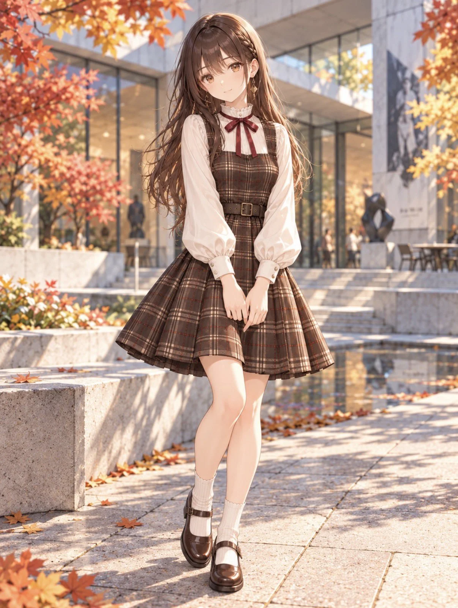

# Character Outfit Swap: Autumn Ribbon Check

**中文标题：** 角色换装·秋日格纹丝带  
**ID:** `gi25-x-1143` · **Mode:** `edit`  
**Categories:** `character-consistency`, `edit-change-preserve`  
**Tags:** `x-twitter`, `community`, `gpt-image-2.5`, `x-direct`, `en`



### Character Outfit Swap: Autumn Ribbon Check

```text
Outfit Name: Autumn Ribbon Check

Dress the provided character in an elegant autumn outfit combining classic feminine fashion with subtle modern preppy influences.

Preserve the character’s original identity, facial features, hairstyle, body proportions, and established art style.

Blouse

An ivory long-sleeved blouse made from soft, lightweight cotton-blend fabric.

A high stand collar with delicate ruffled edges.
A narrow burgundy ribbon tied into a neat bow at the center of the neck, with two hanging ends.
Softly voluminous sleeves with natural draping and gentle gathering at the wrists.
Structured ivory cuffs with small buttons.
Refined proportions without excessive puffiness.

Plaid Pinafore Dress

A dark chocolate-brown plaid pinafore dress layered over the blouse.

A fitted bodice with a gently curved upper edge forming a shallow square neckline.
Two wide plaid shoulder straps.
Continuous plaid fabric across the entire front bodice, from the bust to the waist.
A consistent dark-brown woven check pattern with warm beige and muted burgundy intersecting lines.
Natural shaping seams without unnecessary decorative panels.
No decorative buttons on the front bodice.
A narrow, defined waist transitioning into an above-the-knee flared skirt.
A softly structured A-line flare with natural fabric folds, without rigid pleats or excessive volume.
Matte wool-blend twill fabric with realistic weight and drape.

Waist Belt

A narrow dark-brown belt at the natural waist, featuring a small rectangular antique-gold buckle.

Back Design

Matching plaid shoulder straps and fitted back bodice.
A visible, centered zipper on the back bodice.
Continuous waist belt.
Matching plaid skirt with the same length and flare as the front.

Shoes and Socks

Dark chocolate-brown leather Mary Jane shoes with rounded toes, slender straps, small buckles, and low block heels.
Ivory ribbed socks with softly gathered upper edges.

Design Consistency

Maintain an elegant balance of classic sweetness, autumn warmth, and modern feminine sophistication.

Keep the garment construction realistic and suitable for a fashionable woman in her twenties.

Prioritize the continuous plaid bodice, neckline shape, burgundy neck ribbon, defined waist, and softly flared skirt.

Do not add extra ribbons, decorative bodice buttons, lace panels, oversized frills, rigid pleats, additional garment layers, bags, or unrelated accessories.
```

- **Recommended model:** `gpt-image-2.5-sunburst`
- **Settings:** _(defaults)_
- **Source:** [community](https://x.com/sayo_aym/status/2115196520614289823) — @sayo_aym
- **License note:** Original public X post; quoted with attribution — remix with attribution
- **Notes:** Collected directly from X; prompt posted as the author's own reply https://x.com/sayo_aym/status/2115196520614289823 to https://x.com/sayo_aym/status/2115196516461953218, which carries the images; GPT Image 2.5 is named in the reply; discovered via X search, prompt re-verified against the original X post via api.fxtwitter.com; verified=True; outfit prompt posted as the author's reply; preview from the parent post
- **Preview:** `previews/gi25-x-1143.webp`
