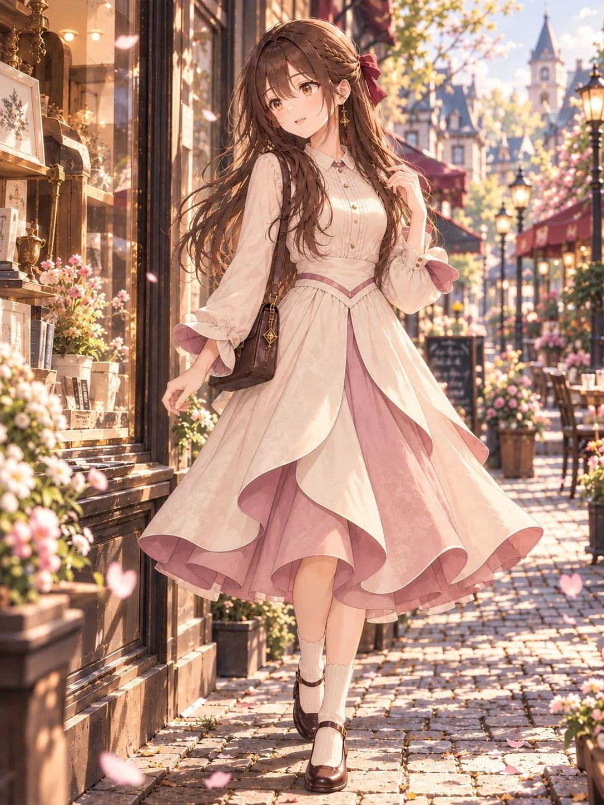

# Character Outfit Swap: Petal Ribbon Dress

**中文标题：** 角色换装·花瓣丝带礼裙  
**ID:** `gi25-x-1144` · **Mode:** `edit`  
**Categories:** `character-consistency`, `edit-change-preserve`  
**Tags:** `x-twitter`, `community`, `gpt-image-2.5`, `x-direct`, `en`



### Character Outfit Swap: Petal Ribbon Dress

```text
Petal Ribbon, an original romantic feminine dress design, elegant and charming, milk ivory and dusty rose color palette.

A fitted milk-ivory bodice with subtle vertical pintucks, a small rounded shirt collar, a neat row of tiny champagne-gold buttons down the upper front, and a delicate dusty-rose V-shaped waist trim.

Soft, slightly voluminous long sleeves, gently gathered toward the wrists. Each sleeve features a single sculptural petal-shaped folded cuff on its outer side, formed from continuous fabric rather than an attached ribbon bow. Milk-ivory outer fabric with dusty-rose inner lining visible along the curved fold. No separate bow knots or dangling ribbon tails on the cuffs.

A flowing fit-and-flare skirt extending below the knees, with three main overlapping petal-shaped outer panels emerging naturally from the waist. One central front panel and two asymmetrically overlapping side panels, creating broad, graceful curved edges. Milk-ivory outer panels fold outward near the hem, revealing a dusty-rose inner layer.

Smooth, elegant fabric draping, softly structured folds, restrained decorative details, refined tailoring, natural garment construction, a graceful silhouette combining delicate petal curves with ribbon-inspired folded fabric.

Optional coordinated accessories: dark-brown Mary Jane shoes, ivory ribbed socks, and a small dark-brown shoulder bag.

Avoid oversized ribbon bows, excessive ruffles, extra skirt layers, detached petal ornaments, and overly elaborate decorations. Preserve the distinctive folded cuffs and overlapping petal skirt design.
```

- **Recommended model:** `gpt-image-2.5-sunburst`
- **Settings:** _(defaults)_
- **Source:** [community](https://x.com/sayo_aym/status/2114837389449592969) — @sayo_aym
- **License note:** Original public X post; quoted with attribution — remix with attribution
- **Notes:** Collected directly from X; prompt posted as the author's own reply https://x.com/sayo_aym/status/2114837389449592969 to https://x.com/sayo_aym/status/2114837386349949196, which carries the images; GPT Image 2.5 is named in the reply; discovered via X search, prompt re-verified against the original X post via api.fxtwitter.com; verified=True; outfit prompt posted as the author's reply; preview from the parent post
- **Preview:** `previews/gi25-x-1144.webp`
