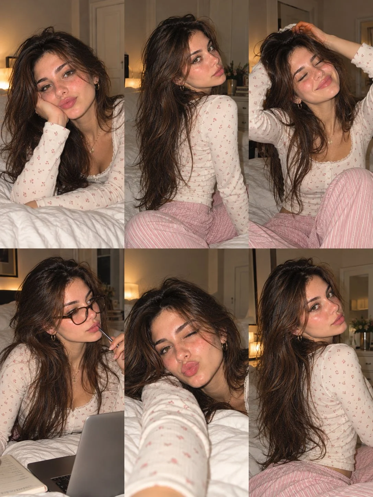

# Cozy Bedroom Photo-Dump 3×2 Portrait Collage

**中文标题：** 温馨卧室生活照 3×2 拼贴  
**ID:** `gi25-x-1156` · **Mode:** `generate`  
**Categories:** `character-consistency`  
**Tags:** `x-twitter`, `community`, `gpt-image-2.5`, `x-direct`, `en`



### Cozy Bedroom Photo-Dump 3×2 Portrait Collage

```text
Create an ultra-realistic 6-photo portrait collage arranged in a seamless 3×2 grid, featuring the same naturally beautiful young European woman in her early 20s. She has warm olive skin, delicate freckles across her cheeks and nose, expressive hazel-brown eyes, long chestnut-brown hair with natural waves, soft face-framing layers, full eyebrows, and naturally glossy pink lips. Maintain identical facial features and identity across all six photographs.

Overall aesthetic: Cozy European Instagram photo dump, authentic compact-camera flash mixed with warm bedside lighting, realistic skin texture, subtle digital grain, candid framing, natural shadows, and a nostalgic point-and-shoot look. The photos should feel like spontaneous moments captured during a relaxed evening at home.

Bedroom setting: A comfortable bedroom with white rumpled bedding, a neutral upholstered headboard, warm bedside lamps, a cream-colored wall, a small vase of flowers, books, and a laptop. Keep the environment consistent throughout the collage.

Outfit: The same modest, cream-colored long-sleeve ribbed henley top with tiny muted pink floral prints and delicate lace trim in every frame, paired with soft pink-and-white striped pajama pants. The top has a comfortable, higher neckline with natural chest coverage. Add small gold hoop earrings and a delicate gold pendant necklace. Minimal everyday makeup, softly flushed cheeks, natural glossy lips, and slightly messy, loose hair.

Six different poses and moments:

1. Relaxed bed portrait: Lying on her stomach on white bedding, resting her cheek against one hand and looking into the camera with a soft, relaxed pout.
2. Over-the-shoulder pose: Sitting sideways on the bed with her legs folded comfortably, turning her head toward the camera with a gentle, confident expression and long hair cascading down her back.
3. Peaceful moment: Sitting with one knee bent, eyes closed and smiling softly, one hand resting on top of her head while her hair falls naturally over her shoulders.
4. Late-night laptop moment: Sitting on the bed wearing simple black-framed glasses, looking thoughtfully toward the laptop screen with a pen in hand and an open notebook nearby.
5. Playful selfie: Holding the camera at arm's length while lying comfortably on the bed, making a playful pout with slightly tousled hair framing her face.
6. Casual side pose: Sitting near the edge of the bed, body angled away from the camera while looking back over her shoulder with a subtle smile.

Identity consistency: The exact same woman must appear in every photograph, with consistent facial proportions, eye color, freckles, skin tone, and hair color. Each frame should have a different pose, expression, head angle, and natural hair arrangement while preserving the same outfit and accessories.

Realism details: Authentic skin pores, fine baby hairs, natural facial asymmetry, realistic hands, believable fabric folds, natural hair strands, subtle exposure variations, and lifelike indoor lighting. Avoid excessive retouching, plastic skin, duplicated expressions, distorted anatomy, malformed fingers, or an overly polished AI-generated appearance.

Output specifications: Vertical 3:4 aspect ratio, exactly six equally sized photographs in a balanced 3-column × 2-row grid, clean alignment, no gutters, no borders, no text, no watermark. Photorealistic, cozy, modest, youthful, spontaneous, and effortlessly stylish.
```

- **Recommended model:** `gpt-image-2.5-sunburst`
- **Settings:** _(defaults)_
- **Source:** [community](https://x.com/john_my07/status/2115092422091026831) — @john_my07
- **License note:** Original public X post; quoted with attribution — remix with attribution
- **Notes:** Collected directly from X; original post https://x.com/john_my07/status/2115092422091026831; post text names GPT Image 2.5; discovered via Bin0754/gpt-image-gallery index, prompt re-verified against the original X post via api.fxtwitter.com; verified=True
- **Preview:** `previews/gi25-x-1156.webp`
