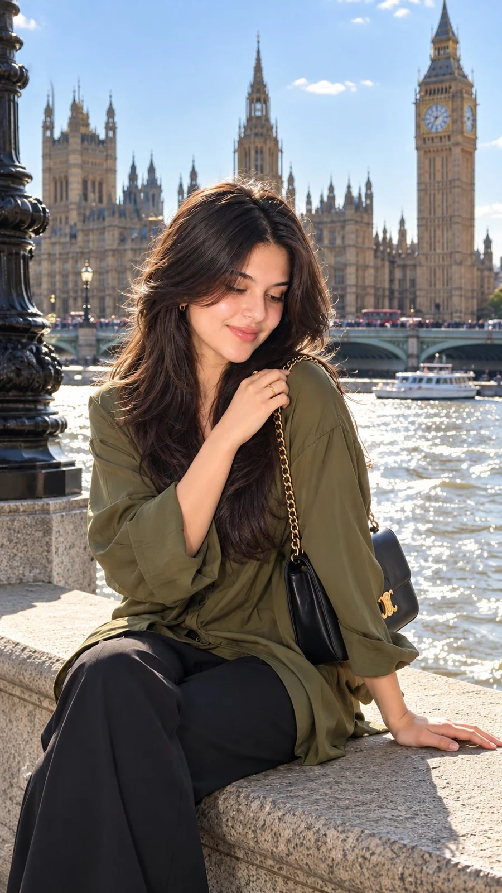

# London Thames Luxury Fashion Photoshoot (2 Shots)

**中文标题：** 伦敦泰晤士河畔奢华时装大片（双图）  
**ID:** `gi25-x-1157` · **Mode:** `generate`  
**Categories:** `character-consistency`  
**Tags:** `x-twitter`, `community`, `gpt-image-2.5`, `x-direct`, `en`



### London Thames Luxury Fashion Photoshoot (2 Shots)

```text
Ultra-Realistic London Luxury Fashion Photoshoot 🇬🇧✨

Create a cohesive set of two ultra-realistic, cinematic fashion photographs featuring the same beautiful young East Asian woman posing beside the River Thames in London, with the iconic Palace of Westminster and Elizabeth Tower (Big Ben) in the background. Both photographs must maintain exactly the same face, hairstyle, outfit, accessories, lighting, and location, as if captured during the same photoshoot.

Appearance: Long, flowing, deep-black hair with soft natural waves, delicate facial features, realistic glowing skin, subtle rosy makeup, softly defined eyebrows, warm brown eyes, and muted coral-pink lips. A few loose strands of hair move naturally in the riverside breeze.

Outfit & Accessories: An elegant olive-green oversized blouse with flowing sleeves and a relaxed silhouette. A luxurious black shoulder bag with a gold chain strap and a gold clasp rests over her shoulder. Small gold hoop earrings and a delicate gold ring complete the look.

Photo 1 — Elegant Riverside Pose: A vertical, three-quarter portrait framed from mid-thigh upward. The woman sits sideways on a stone railing beside the Thames, her body turned slightly away from the camera. One hand rests on the stone railing while her other hand gently touches her shoulder. Her head tilts slightly downward, and her eyes look softly toward the ground. The black handbag is clearly visible at her side. The historic Gothic architecture of the Palace of Westminster rises behind her, with sparkling river water and soft atmospheric depth.

Photo 2 — Close-Up Windblown Portrait: A vertical close-up framed from the chest upward, taken moments later at the same location. The woman raises one arm gracefully in front of her forehead, gently brushing her hair away from her face. Her forearm partially covers her forehead while her other eye looks directly into the camera. Her lips are slightly parted, and her expression is elegant, natural, and dreamy. Her long wavy hair flows in the wind, and the gold earrings and shoulder-bag chain catch the sunlight. The London architecture remains softly blurred in the background.

Lighting & Camera: Bright natural afternoon sunlight, luminous reflections from the River Thames, delicate backlighting around her hair, realistic shadows, professional full-frame camera, 85mm portrait lens, shallow depth of field, natural skin pores, detailed hair strands, refined editorial color grading, luxury fashion campaign aesthetic, candid travel photography.

Consistency Requirements: Both images must feature the same woman, identical facial features, identical olive-green outfit, the same black-and-gold handbag, matching accessories, the same London riverside location, and consistent daylight. Only the camera framing and pose should change. Natural anatomy, realistic hands, anatomically correct fingers, and accurate facial proportions.

Output: Two separate, coordinated photorealistic vertical portraits in 9:16 aspect ratio. No collage, no split screen, no text, no watermark, no social media interface.
```

- **Recommended model:** `gpt-image-2.5-sunburst`
- **Settings:** _(defaults)_
- **Source:** [community](https://x.com/Rose5303508870/status/2115068008075014540) — @Rose5303508870
- **License note:** Original public X post; quoted with attribution — remix with attribution
- **Notes:** Collected directly from X; original post https://x.com/Rose5303508870/status/2115068008075014540; post text names GPT Image 2.5; discovered via Bin0754/gpt-image-gallery index, prompt re-verified against the original X post via api.fxtwitter.com; verified=True
- **Preview:** `previews/gi25-x-1157.webp`
