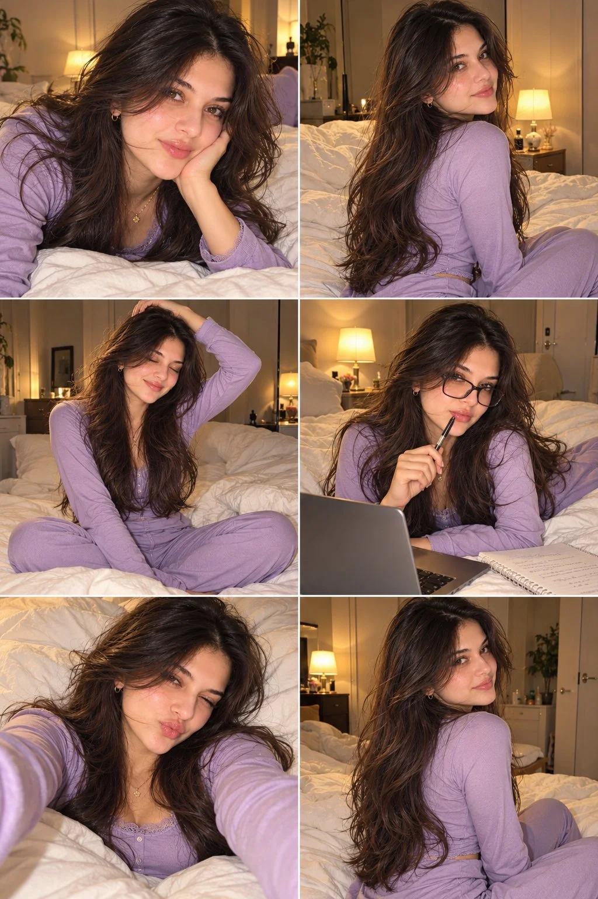

# Cozy Lavender Bedroom Six-Shot Consistent Photoshoot

**中文标题：** 薰衣草紫卧室六连拍一致性写真  
**ID:** `gi25-x-1181` · **Mode:** `generate`  
**Categories:** `character-consistency`, `general`  
**Tags:** `x-twitter`, `community`, `gpt-image-2.5`, `x-direct`, `en`



### Cozy Lavender Bedroom Six-Shot Consistent Photoshoot

```text
Ultra-Realistic Cozy Bedroom Girl Photoshoot 💜📸

Create a cohesive set of six ultra-realistic, aesthetic smartphone photographs featuring the same beautiful young woman in a cozy, softly lit bedroom. All six photos must maintain the exact same face, facial features, hairstyle, outfit, accessories, skin texture, and warm lighting, as if captured during one casual bedroom photoshoot.

Appearance: A beautiful young woman with long, thick, naturally tousled dark brown hair featuring subtle caramel highlights, loose waves, and soft face-framing strands. She has warm, glowing skin with natural freckles across her cheeks and nose, rosy cheeks, glossy pink lips, expressive brown eyes, and naturally defined eyebrows. Her makeup is minimal and fresh, with subtle eyeliner and a soft, dewy finish.

Outfit: A fitted lavender-purple, long-sleeved pajama top with a delicate lace-trimmed neckline and matching high-waisted lavender-purple pajama pants in a smooth, soft fabric. The entire outfit should be a consistent solid lavender shade, with no stripes, floral prints, or contrasting patterns. Add small gold hoop earrings and a delicate gold necklace with a tiny pendant.

Setting: A comfortable, elegant bedroom with white rumpled bedding, fluffy pillows, warm bedside lamps, cream-colored walls, subtle wooden furniture, and a soft, inviting nighttime atmosphere. Use warm tungsten lighting, gentle shadows, natural skin texture, and a subtle vintage digital-camera aesthetic with realistic flash photography.

Create six different poses:

1. Relaxed close-up: Lying on her stomach on the white bed, resting her cheek against one hand while looking directly at the camera with a soft, playful pout.
2. Over-the-shoulder portrait: Sitting sideways on the bed with her long hair cascading over her shoulders, looking back at the camera with a relaxed, confident expression.
3. Cozy candid: Sitting cross-legged on the bed, eyes closed with a gentle smile, one hand resting on top of her head and her hair falling naturally around her face.
4. Study-girl aesthetic: Wearing stylish black rectangular eyeglasses, holding a pen near her lips while sitting beside an open laptop and notebook on the bed, looking thoughtfully toward the camera.
5. Playful selfie: Lying against fluffy white pillows, extending one arm toward the camera for a close-up selfie, winking and making a cute kissy face.
6. Side-profile beauty shot: Sitting on the bed with her back slightly turned toward the camera, looking over her shoulder, showcasing her long, voluminous wavy hair and natural facial features.

Photography style: Photorealistic, candid bedroom selfies, soft warm lighting, direct on-camera flash, authentic smartphone photography, subtle film grain, natural imperfections, realistic pores and freckles, detailed hair strands, cozy Pinterest aesthetic, intimate everyday lifestyle photography, 4K detail, natural proportions, and beautifully balanced composition.

Consistency requirements: All six photographs must feature the exact same woman with identical facial identity, matching hairstyle, the same solid lavender-purple pajama set, identical gold jewelry, and the same bedroom environment. Only the pose, facial expression, and camera angle should change. Preserve the lavender colour consistently across all six photographs. Avoid artificial skin smoothing, excessive retouching, distorted hands, extra fingers, inconsistent facial features, and overly staged model poses.
```

- **Recommended model:** `gpt-image-2.5-sunburst`
- **Settings:** _(defaults)_
- **Source:** [community](https://x.com/Rose5303508870/status/2115414510173343778) — @Rose5303508870
- **License note:** Original public X post; quoted with attribution — remix with attribution
- **Notes:** Collected directly from X; original post https://x.com/Rose5303508870/status/2115414510173343778; post text names GPT Image 2.5; discovered via Bin0754/gpt-image-gallery index, prompt re-verified against the original X post via api.fxtwitter.com; verified=True
- **Preview:** `previews/gi25-x-1181.webp`
