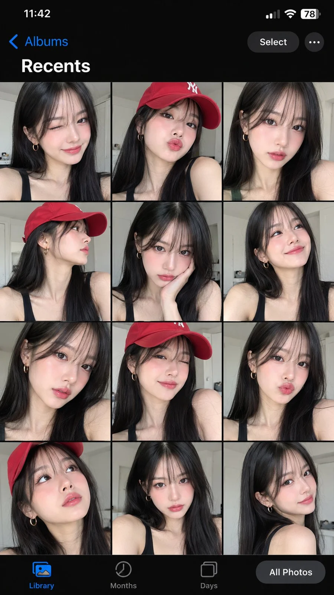

# iPhone Gallery Screenshot Selfie Collage (Red Cap Gen-Z Look)

**中文标题：** iPhone 相册截图自拍合集（红色棒球帽 Gen-Z 风）  
**ID:** `gi25-x-1193` · **Mode:** `generate`  
**Categories:** `character-consistency`, `general`  
**Tags:** `x-twitter`, `community`, `gpt-image-2.5`, `x-direct`, `en`



### iPhone Gallery Screenshot Selfie Collage (Red Cap Gen-Z Look)

```text
Ultra-realistic selfie photo collage displayed inside a modern smartphone gallery interface, showing multiple portrait shots of a beautiful young Asian woman with soft feminine visuals and natural Korean-inspired beauty aesthetics. She has long straight jet-black hair with silky smooth texture, wispy see-through bangs framing her face, glowing fair skin with dewy makeup finish, soft peach-pink blush, glossy nude pink lips, subtle eyeliner, long lashes, and sharp yet delicate facial features.

She is wearing a fitted black sleeveless tank top that exposes her shoulders and collarbone naturally, combined with minimalist gold hoop earrings. In several frames she also wears a vibrant red baseball cap with curved brim, giving a sporty street-style aesthetic.

The collage consists of various selfie poses and expressions: playful wink, pouty duck-face kiss expression, soft smile, confident neutral stare, side-profile angle, upward gaze, and candid cute expressions. Every frame captures slightly different angles and emotions, creating a lively and expressive mood.

Lighting is soft natural daylight entering from a nearby window, producing realistic highlights on the skin, smooth shadows, and subtle reflections on the cheeks and lips. Background is a clean minimal white room interior with soft modern aesthetic, slightly blurred to keep focus on the subject.

Camera style resembles high-end iPhone front camera photography with ultra-sharp facial details, natural skin texture, realistic pores, cinematic exposure, shallow depth of field, crisp focus on eyes and lips, balanced contrast, realistic shadows, and premium social-media influencer aesthetic.

Composition displayed as an iPhone photo gallery screenshot interface with black UI theme, grid layout of portrait photos, visible “Recents” title at the top, and bottom navigation tabs like Library, Months, Days, and All Photos.
Mood and vibe: cute, playful, stylish, sporty, feminine, trendy Gen-Z selfie aesthetic, casual indoor lifestyle photography, soft clean beauty editorial, realistic social media content creator vibe.
```

- **Recommended model:** `gpt-image-2.5-sunburst`
- **Settings:** _(defaults)_
- **Source:** [community](https://x.com/MissDelulu9/status/2116066322031456678) — @MissDelulu9
- **License note:** Original public X post; quoted with attribution — remix with attribution
- **Notes:** Collected directly from X; original post https://x.com/MissDelulu9/status/2116066322031456678; post text names GPT Image 2.5; discovered via X search, prompt re-verified against the original X post via api.fxtwitter.com; verified=True
- **Preview:** `previews/gi25-x-1193.webp`
