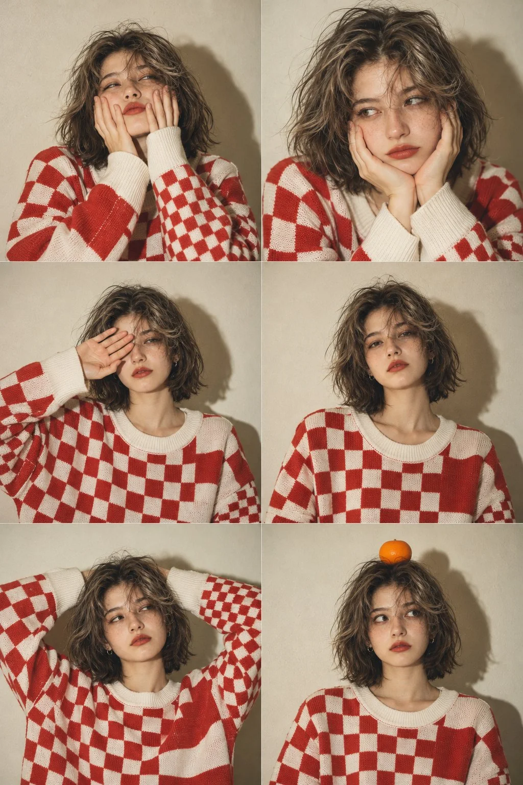

# Checkerboard Sweater Six-Panel Flash Film Portrait Collage

**中文标题：** 棋盘格毛衣六宫格闪光胶片人像  
**ID:** `gi25-x-1199` · **Mode:** `generate`  
**Categories:** `character-consistency`, `general`  
**Tags:** `x-twitter`, `community`, `gpt-image-2.5`, `x-direct`, `en`



### Checkerboard Sweater Six-Panel Flash Film Portrait Collage

```text
Create a highly realistic 6-panel fashion portrait collage arranged in a clean 2-column × 3-row grid. The same young East Asian woman appears consistently in all six photographs, maintaining identical facial features, hairstyle, clothing, and overall appearance.

Subject: A beautiful young woman with a short, naturally styled black bob haircut, soft center-parted bangs, fair natural skin, delicate facial features, subtle makeup, and a calm, slightly playful expression.

Outfit: An oversized red-and-white checkerboard knitted sweater with a bold chessboard pattern, cream-white ribbed neckline, and long loose sleeves. The sweater has a cozy, relaxed vintage streetwear aesthetic.

Six different poses and expressions:

1. Top-left: The woman stands facing the camera, gently pressing both palms against her cheeks, with a few strands of hair falling across her face. A slightly playful, sleepy expression.
2. Top-right: An intimate close-up portrait. She rests her face between both hands, elbows slightly raised, looking directly into the camera with softly pursed lips.
3. Middle-left: A medium portrait with one hand covering part of her forehead and one eye, looking quietly toward the camera.
4. Middle-right: A straight-on upper-body portrait with both arms relaxed, looking directly at the camera with a subtle, natural expression.
5. Bottom-left: A relaxed pose with both arms placed behind her head, elbows extending outward, wearing a calm and confident expression.
6. Bottom-right: A playful straight-on portrait with a small bright orange placed on top of her head, looking directly at the camera with a slightly surprised expression.

Photography and environment: All six photographs are taken against a simple warm beige wall in a minimal indoor setting. Direct on-camera flash creates distinct, slightly hard shadows behind the subject. Soft warm color tones, natural skin texture, subtle film grain, slightly faded colors, gentle analog noise, and authentic 35mm film photography.

Composition: Perfectly aligned six-photo contact sheet, two equal-width columns and three equal-height rows, clean straight panel divisions, consistent camera distance and color grading. Mix close-up portraits and medium shots while keeping the same person recognizable in every frame.

Visual style: Vintage Japanese and Korean fashion editorial photography, nostalgic 1990s film aesthetic, candid studio snapshots, minimalist styling, natural imperfections, realistic facial details, premium analog photography.

Aspect ratio: 2:3 vertical.
Quality: Ultra-photorealistic, high detail, natural proportions, realistic hands, consistent character identity across all six panels.

Important: Generate one complete six-panel collage, not six separate images. No text, no watermarks, no additional people.
```

- **Recommended model:** `gpt-image-2.5-sunburst`
- **Settings:** _(defaults)_
- **Source:** [community](https://x.com/Ziha_ai/status/2116013855700910157) — @Ziha_ai
- **License note:** Original public X post; quoted with attribution — remix with attribution
- **Notes:** Collected directly from X; original post https://x.com/Ziha_ai/status/2116013855700910157; post text names GPT Image 2.5; discovered via X search, prompt re-verified against the original X post via api.fxtwitter.com; verified=True
- **Preview:** `previews/gi25-x-1199.webp`
