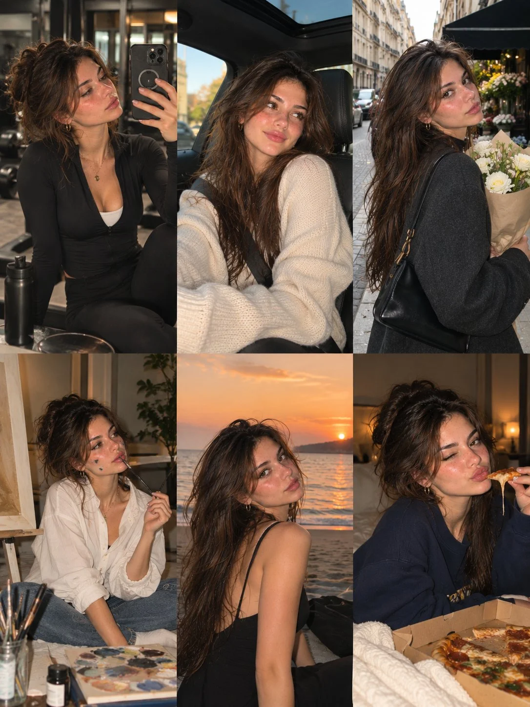

# European Instagram Photo-Dump Six-Scene Lifestyle Collage

**中文标题：** 欧式 Instagram 日常六宫格生活拼贴  
**ID:** `gi25-x-1208` · **Mode:** `generate`  
**Categories:** `character-consistency`, `general`  
**Tags:** `x-twitter`, `community`, `gpt-image-2.5`, `x-direct`, `en`



### European Instagram Photo-Dump Six-Scene Lifestyle Collage

```text
Create an ultra-realistic 6-photo lifestyle collage featuring the same naturally beautiful young European woman in her early 20s, arranged in a seamless 3-column × 2-row grid. She has warm olive skin, natural freckles across her cheeks and nose, expressive hazel-brown eyes, long, tousled chestnut-brown hair with subtle highlights, full eyebrows, and naturally glossy lips; maintain identical facial identity, skin tone, and recognizable features in every photograph.

Visual Style: Authentic European Instagram photo dump, realistic smartphone and compact-camera photography, direct flash mixed with natural ambient light, detailed skin texture, subtle digital grain, candid framing, warm cinematic tones, realistic shadows, and spontaneous expressions. The images should feel like genuine photographs from different moments in her everyday life, not a polished fashion campaign.

Six Different Scenes, Outfits, and Poses:

1. Gym mirror selfie: Sitting on a gym bench after a workout, wearing a black zip-up athletic top, black leggings, and white sneakers. Holding her phone up for a casual mirror selfie, with gym equipment and soft overhead lighting in the background.

2. Passenger-seat moment: Sitting in the passenger seat of a modern car, wearing a chunky cream knit sweater and blue jeans. Looking toward the side window with a relaxed half-smile, natural daylight entering through the glass and city scenery softly blurred outside.

3. European flower-market walk: Standing on a charming city street wearing a charcoal wool coat, carrying a black shoulder bag and a bouquet of white flowers. Looking back over her shoulder toward the camera with a subtle smile, surrounded by stone buildings, café awnings, and soft afternoon light.

4. Creative afternoon: Sitting cross-legged beside an easel in a cozy art studio, wearing an oversized white button-up shirt and relaxed blue jeans. Holding a paintbrush while looking thoughtfully toward her canvas, with paint palettes, brushes, and unfinished artwork nearby.

5. Beach sunset: Sitting sideways on the sand near the shoreline at golden hour, wearing a simple black sleeveless top and relaxed denim. Turning her face toward the camera as the sunset reflects on the water, with a natural breeze moving her hair.

6. Late-night pizza: Relaxing on a sofa in a navy oversized sweatshirt, holding a slice of pizza near her face and giving the camera a playful expression. A partially open pizza box, soft table lighting, and a cozy living-room background create a spontaneous late-night atmosphere.

Identity and Styling Consistency: The same woman must appear in all six photographs, with identical facial proportions, eye color, freckles, skin tone, and hair color. Each scene should have a different outfit, environment, pose, expression, and camera angle while maintaining a recognizable personal style.

Realism Details: Authentic skin pores, fine baby hairs, natural facial asymmetry, realistic hands, believable fabric folds, accurate reflections, lifelike environments, and subtle exposure variations. Avoid excessive retouching, plastic-looking skin, duplicated poses, distorted anatomy, malformed fingers, artificial expressions, or an obviously AI-generated appearance.

Output: Vertical 3:4 aspect ratio, exactly six equally sized photographs in a balanced 3-column × 2-row grid, perfectly aligned panels, no gutters, no borders, no text, and no watermark. Photorealistic, candid, cinematic, youthful, and effortlessly stylish, like a genuine collection of everyday moments shared on Instagram.
```

- **Recommended model:** `gpt-image-2.5-sunburst`
- **Settings:** _(defaults)_
- **Source:** [community](https://x.com/john_my07/status/2115813691874832890) — @john_my07
- **License note:** Original public X post; quoted with attribution — remix with attribution
- **Notes:** Collected directly from X; original post https://x.com/john_my07/status/2115813691874832890; post text names GPT Image 2.5; discovered via Bin0754/gpt-image-gallery index, prompt re-verified against the original X post via api.fxtwitter.com; verified=True
- **Preview:** `previews/gi25-x-1208.webp`
