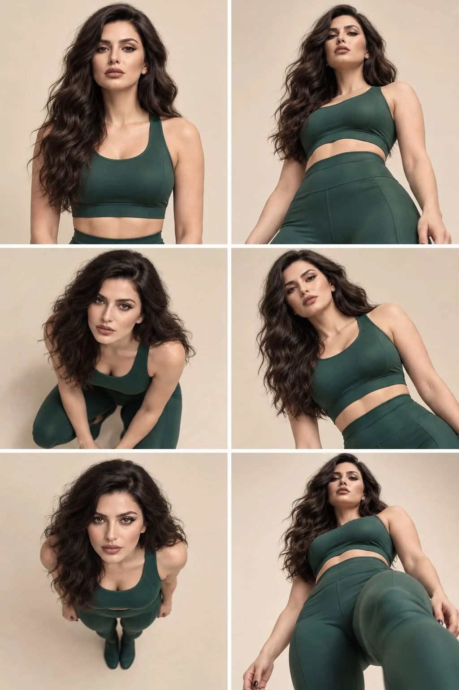

# Six-Angle Emerald Activewear Fashion Reference Sheet

**中文标题：** 六机位翡翠绿运动装时装参考图  
**ID:** `gi25-x-1210` · **Mode:** `edit`  
**Categories:** `character-consistency`, `general`  
**Tags:** `x-twitter`, `community`, `gpt-image-2.5`, `x-direct`, `en`



### Six-Angle Emerald Activewear Fashion Reference Sheet

```text
Create a premium fashion editorial reference sheet featuring the exact same girl from my reference image, arranged in a perfectly aligned 2-column × 3-row grid with six distinct camera angles.

Identity lock: Preserve her exact facial features, skin tone, eye color, hairstyle, age, and body proportions from the reference image. She must remain unmistakably the same person in every panel.

Wardrobe: An elegant emerald-green fitted sports bra and matching high-waisted leggings, premium satin-finish technical fabric, realistic seams, and no logos or accessories.

Six camera perspectives:

1. Front portrait: Eye-level, direct eye contact, relaxed shoulders.
2. Low angle: Camera below the model, looking upward for a powerful runway aesthetic.
3. High angle: Camera above her at 40 degrees, with her gaze lifted toward the lens.
4. Dutch angle: Camera tilted 20 degrees for a contemporary editorial composition.
5. Bird’s-eye view: Camera directly overhead at 90 degrees, model looking up.
6. Floor-level view: Camera almost touching the floor, looking upward for dramatic architectural perspective.

Visual style: Ultra-realistic luxury fashion campaign, seamless warm ivory studio, soft directional lighting, delicate shadows, natural skin texture, detailed hair, realistic fabric reflections, refined magazine-quality color grading, and crisp commercial photography.

Composition: Exactly six equal-sized photographs in a clean 2 × 3 grid, uniform white gutters, consistent lighting and wardrobe, and perfectly aligned panels. Only the camera angle changes; maintain the same identity and believable anatomy throughout.

No text, watermarks, logos, duplicated faces, artificial skin, or inconsistent character features.
```

- **Recommended model:** `gpt-image-2.5-sunburst`
- **Settings:** _(defaults)_
- **Source:** [community](https://x.com/mehvishs25/status/2115803636320358657) — @mehvishs25
- **License note:** Original public X post; quoted with attribution — remix with attribution
- **Notes:** Collected directly from X; original post https://x.com/mehvishs25/status/2115803636320358657; post text names GPT Image 2.5; discovered via Bin0754/gpt-image-gallery index, prompt re-verified against the original X post via api.fxtwitter.com; verified=True
- **Preview:** `previews/gi25-x-1210.webp`
