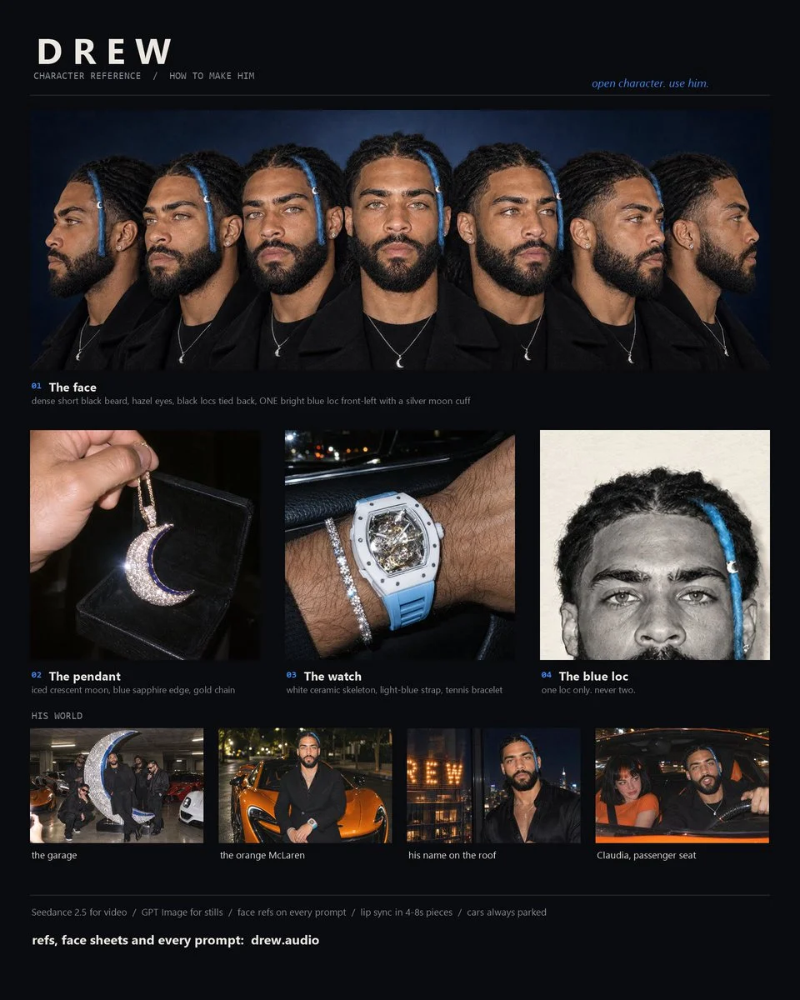

# Recurring AI Character Identity-Lock Prompt Template

**中文标题：** AI 虚拟角色身份锁定提示词模板  
**ID:** `gi25-x-1221` · **Mode:** `edit`  
**Categories:** `character-consistency`  
**Tags:** `x-twitter`, `community`, `gpt-image-2.5`, `x-direct`, `en`



### Recurring AI Character Identity-Lock Prompt Template

```text
Drew, the man from the reference images: dense full beard, black locs tied back, one glacier-blue loc at the front on his left side with a silver moon cuff, iced crescent-moon pendant with a blue sapphire edge, white ceramic skeleton watch on a light-blue strap, black overcoat, black tee. [your scene]. Real 35mm flash film, night, natural grain. No text, no logos.
```

- **Recommended model:** `gpt-image-2.5-sunburst`
- **Settings:** _(defaults)_
- **Source:** [community](https://x.com/drew_rapstar/status/2116047448682410047) — @drew_rapstar
- **License note:** Original public X post; quoted with attribution — remix with attribution
- **Notes:** Collected directly from X; original post https://x.com/drew_rapstar/status/2116047448682410047; post text names GPT Image 2.5; discovered via Bin0754/gpt-image-gallery index, prompt re-verified against the original X post via api.fxtwitter.com; verified=True; needs the author's own face reference images; [your scene] is a placeholder
- **Preview:** `previews/gi25-x-1221.webp`
