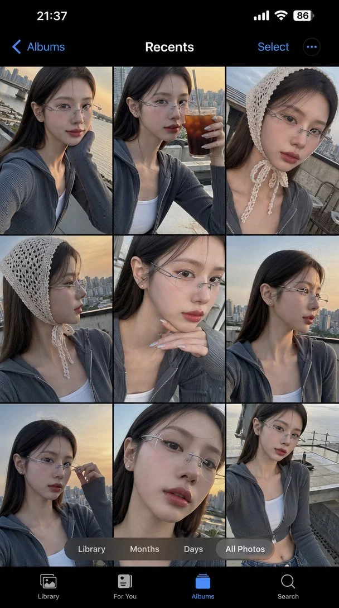

# Smartphone Gallery Selfie Collage (Seoul Street Style)

**中文标题：** 手机相册自拍合集（首尔街头风）  
**ID:** `gi25-x-1225` · **Mode:** `generate`  
**Categories:** `character-consistency`, `general`  
**Tags:** `x-twitter`, `community`, `gpt-image-2.5`, `x-direct`, `en`



### Smartphone Gallery Selfie Collage (Seoul Street Style)

```text
Ultra-realistic selfie photo collage displayed inside a modern smartphone gallery interface, showing multiple portrait shots of a trendy young Korean woman in her early 20s with effortless chic visuals and modern Seoul "hip-street" beauty aesthetics. She has glossy, silky ash-dark-brown straight hair tucked neatly behind her ears, soft wispy baby hairs along the hairline, luminous milky-glass skin with translucent dewy finish, cool-toned muted mauve-plum lip tint, muted soft taupe contouring, faint aegyo-sal (under-eye fullness), and delicate yet sharp feline facial features. She is wearing a charcoal-grey cropped baby-ribbed knit zip-up hoodie partially unzipped, layered over an off-white fitted tank top, accessorized with ultra-thin silver frameless Y2K glasses and subtle silver ball stud earrings. In several frames, she wears a textured crochet ivory knit headscarf (balaclava bandana style) tied under her chin, delivering an effortlessly trendy Hannam-dong street-fashion aesthetic. The collage consists of various selfie poses and signature Korean candid expressions: subtle smirking "cool-girl" half-smile, chin resting on fingers showing clean chrome-silver manicure, candid sideways gaze, holding an iced Americano up near her cheek, adjusting her thin glasses, soft lips slightly parted, and high-angle "0.5x lens" style close-up. Every frame captures subtle shift in angles and cool detached emotions, exuding an effortless influencer feed vibe. Lighting is soft overcast sunset golden-hour light from the Han River reflection, casting pale amber edge-lights along her jaw and glossy reflections on her lips, balanced with cool soft ambient fill light. Background is a trendy rooftop café overlooking Seoul urban skyline with minimalist concrete textures, softly blurred to ensure sharp focus on her face. Camera style resembles high-end iPhone front camera photography with ultra-sharp facial details, realistic pore texture without over-smoothing, natural skin luster, subtle lens flare, shallow depth of field, crisp focus on eyes and lips, balanced cool contrast, and authentic Korean lifestyle social-media aesthetic. Composition displayed as an iPhone photo gallery screenshot interface with black UI theme, grid layout of portrait photos, visible “Recents” title at the top, and bottom navigation tabs like Library, Months, Days, and All Photos. Mood and vibe: cool, effortless, minimalist, trendy Korean Gen-Z aesthetic, Hannam-dong café lifestyle, moody golden hour, authentic K-influencer photo dump, clean glass-skin portraiture.
```

- **Recommended model:** `gpt-image-2.5-sunburst`
- **Settings:** _(defaults)_
- **Source:** [community](https://x.com/yaokict/status/2116101871618457986) — @yaokict
- **License note:** Original public X post; quoted with attribution — remix with attribution
- **Notes:** Collected directly from X; original post https://x.com/yaokict/status/2116101871618457986; post text names GPT Image 2.5; discovered via Bin0754/gpt-image-gallery index, prompt re-verified against the original X post via api.fxtwitter.com; verified=True
- **Preview:** `previews/gi25-x-1225.webp`
