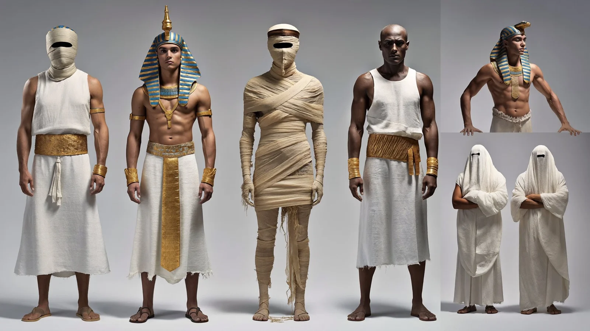

# Four-Character Ancient Egypt Cast Reference Sheet

**中文标题：** 古埃及四角色定妆参考表  
**ID:** `gi25-x-1231` · **Mode:** `generate`  
**Categories:** `character-consistency`, `general`  
**Tags:** `x-twitter`, `community`, `gpt-image-2.5`, `x-direct`, `en`



### Four-Character Ancient Egypt Cast Reference Sheet

```text
Character reference sheet on a light grey studio background, 16:9, photorealistic. Four characters in four columns, each in front, side and back view with a face close-up above.
1. Young pharaoh, slim, tan, clean-shaven, blue and gold striped nemes, shirtless, gold and turquoise beaded collar, white kilt with gold sash, gold cuffs. Plus a small view of him in a long white tunic with a gold belt and blue and white nemes.
2. Mummy wrapped head to toe in aged cream linen bandages, face fully wrapped.
3. Bald temple priest in a white linen tunic.
4. Two attendants fully covered in white linen veils, faces hidden.
No text, no watermark.
```

- **Recommended model:** `gpt-image-2.5-sunburst`
- **Settings:** _(defaults)_
- **Source:** [community](https://x.com/socialwithaayan/status/2116136832270504220) — @socialwithaayan
- **License note:** Original public X post; quoted with attribution — remix with attribution
- **Notes:** Collected directly from X; original post https://x.com/socialwithaayan/status/2116136832270504220; post text names GPT Image 2.5; discovered via Bin0754/gpt-image-gallery index, prompt re-verified against the original X post via api.fxtwitter.com; verified=True; step of a GPT Image 2.5 Sunburst short-film workflow thread
- **Preview:** `previews/gi25-x-1231.webp`
