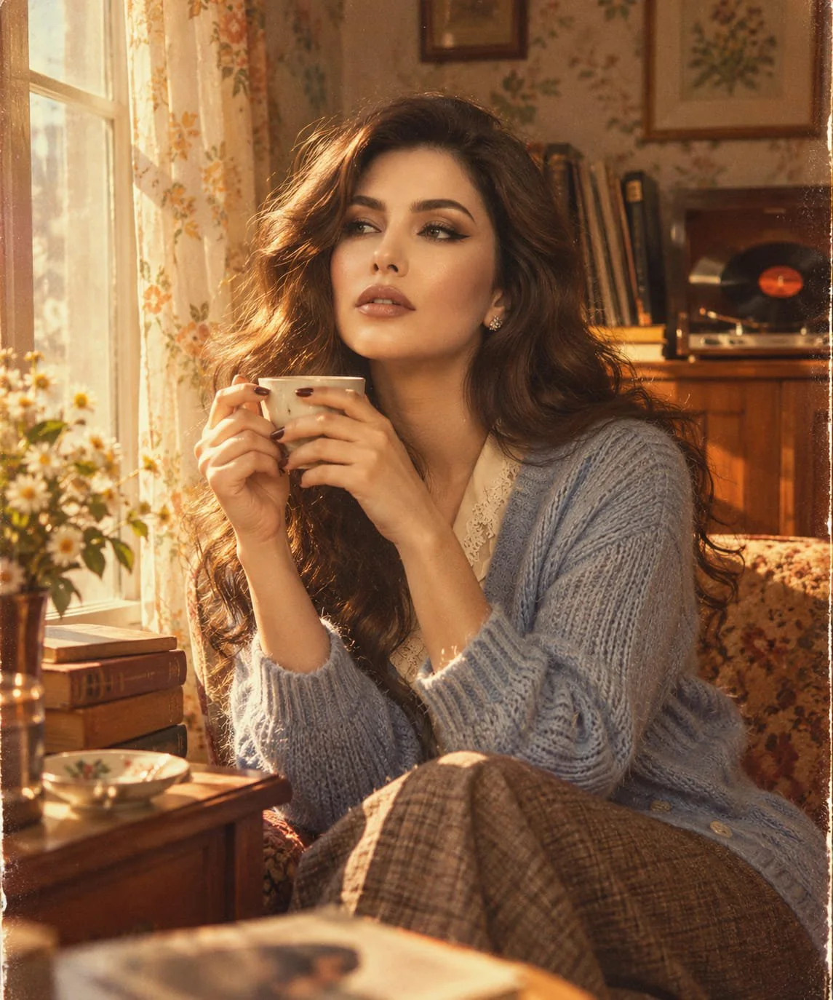

# 1970s Nostalgic Window-Side Portrait From Reference Photo

**中文标题：** 参考照→70 年代怀旧窗边人像  
**ID:** `gi25-x-1235` · **Mode:** `edit`  
**Categories:** `character-consistency`, `edit-change-preserve`  
**Tags:** `x-twitter`, `community`, `gpt-image-2.5`, `x-direct`, `en`



### 1970s Nostalgic Window-Side Portrait From Reference Photo

```text
Create a cinematic, nostalgic 1970s-inspired photograph featuring the exact same girl from my reference image. Preserve her facial identity, distinctive features, skin tone, eye color, and natural appearance with absolute consistency. She is seated beside a large sunlit window in a charming vintage living room, wearing a soft powder-blue knitted cardigan over a delicate ivory blouse, with her hair styled in effortless, voluminous retro waves. A few loose strands frame her face.

She holds a small vintage ceramic coffee cup in both hands, gazing thoughtfully out of the window with a subtle, dreamy smile, as if lost in a beautiful memory. The room is filled with authentic 1970s character: warm wooden furniture, an old record player spinning a vinyl record, a stack of well-loved books, faded botanical wallpaper, and sunlight filtering through sheer floral curtains.

Capture the scene as an intimate candid moment from a forgotten family photo album. Warm amber sunlight falls softly across her face, creating delicate shadows and natural skin texture. Use muted earthy tones, subtle film grain, slightly faded colors, gentle lens softness, and the organic imperfections of analog 35mm photography.

The composition should feel spontaneous, emotionally evocative, and effortlessly beautiful rather than staged. Photorealistic vintage film aesthetic, authentic 1970s atmosphere, natural expression, cinematic color grading, rich environmental details, and timeless editorial photography.

Identity preservation is essential: The girl must look exactly like the reference person, not a reinterpretation or a similar-looking model. Keep her recognizable facial features unchanged.
```

- **Recommended model:** `gpt-image-2.5-sunburst`
- **Settings:** _(defaults)_
- **Source:** [community](https://x.com/mehvishs25/status/2116165922834850142) — @mehvishs25
- **License note:** Original public X post; quoted with attribution — remix with attribution
- **Notes:** Collected directly from X; original post https://x.com/mehvishs25/status/2116165922834850142; post text names GPT Image 2.5; discovered via Bin0754/gpt-image-gallery index, prompt re-verified against the original X post via api.fxtwitter.com; verified=True
- **Preview:** `previews/gi25-x-1235.webp`
