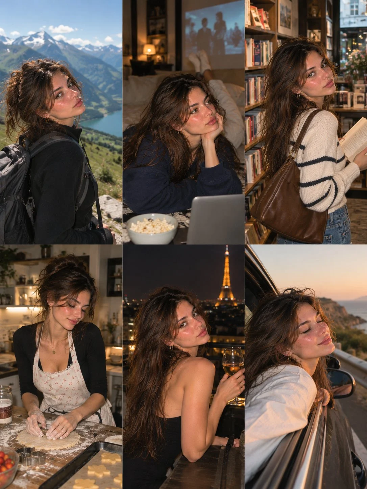

# European Lifestyle 3×2 Photo-Dump Collage

**中文标题：** 欧式生活方式 3×2 六宫格拼贴  
**ID:** `gi25-x-1236` · **Mode:** `generate`  
**Categories:** `character-consistency`, `general`  
**Tags:** `x-twitter`, `community`, `gpt-image-2.5`, `x-direct`, `en`



### European Lifestyle 3×2 Photo-Dump Collage

```text
Create an ultra-realistic 6-photo lifestyle collage in a seamless 3×2 grid, featuring the same beautiful young European woman in her early 20s. She has warm olive skin, natural freckles, hazel-brown eyes, long wavy chestnut hair, and delicate facial features. Maintain identical facial identity across all six photographs.

Concept: A cinematic European adventure and lifestyle photo diary, capturing six completely different experiences with authentic Instagram photo-dump aesthetics.

Six Scenes:

1. Mountain adventure: Wearing a black hiking jacket and backpack, standing beside a breathtaking Alpine lake, looking back at the camera.
2. Movie night: Relaxing on a sofa in an oversized navy sweatshirt, holding popcorn with a movie playing in the background.
3. Bookstore: Browsing books in a charming vintage bookstore, wearing a cream-and-black striped sweater and blue jeans.
4. Baking afternoon: Preparing cookies in a rustic kitchen, wearing a floral apron over a dark top, with flour-covered hands.
5. Paris rooftop: Sitting on a rooftop overlooking the illuminated Eiffel Tower, wearing an elegant black dress and delicate gold jewelry.
6. Coastal road trip: Leaning toward the window of a convertible, wearing a white linen shirt, with ocean cliffs and golden sunset behind her.

Photography: Authentic Canon PowerShot G7 X Mark III aesthetic, realistic skin texture, natural expressions, occasional direct flash, subtle film grain, cinematic lighting, candid framing, and realistic environments.

Consistency: Preserve the exact same face, freckles, eye color, skin tone, and hair color in every frame. Different outfits, poses, camera angles, and environments. Avoid artificial skin, duplicated expressions, distorted anatomy, and excessive retouching.

Output: Vertical 3:4 aspect ratio, exactly six equally sized photographs in a clean 3-column × 2-row grid, no gutters, borders, text, or watermark. Photorealistic, spontaneous, adventurous, and effortlessly stylish.
```

- **Recommended model:** `gpt-image-2.5-sunburst`
- **Settings:** _(defaults)_
- **Source:** [community](https://x.com/john_my07/status/2116167847068184623) — @john_my07
- **License note:** Original public X post; quoted with attribution — remix with attribution
- **Notes:** Collected directly from X; original post https://x.com/john_my07/status/2116167847068184623; post text names GPT Image 2.5; discovered via Bin0754/gpt-image-gallery index, prompt re-verified against the original X post via api.fxtwitter.com; verified=True
- **Preview:** `previews/gi25-x-1236.webp`
