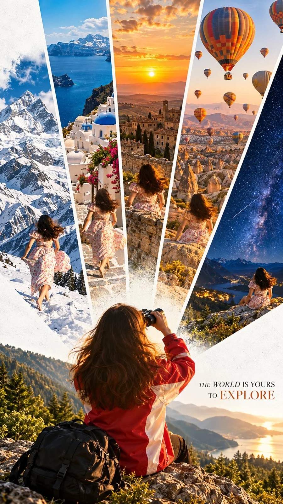

# Cinematic Radial Travel Portrait Collage From Photo

**中文标题：** 照片→电影感放射状旅行人像拼贴  
**ID:** `gi25-x-1252` · **Mode:** `edit`  
**Categories:** `character-consistency`, `poster-typography`  
**Tags:** `x-twitter`, `community`, `gpt-image-2.5`, `x-direct`, `en`



### Cinematic Radial Travel Portrait Collage From Photo

```text
UNIVERSAL PROMPT - CINEMATIC RADIAL TRAVEL PORTRAIT COLLAGE | 9:16

Create an 8K ultra-realistic cinematic travel poster using the uploaded photograph of the person as the exact identity reference. Preserve the person's facial features, identity, natural appearance, and distinctive characteristics with maximum accuracy.

1. MAIN COMPOSITION — RADIAL TRAVEL COLLAGE

Create an elegant radial collage composed of multiple cinematic travel portraits arranged in diagonal, fan-shaped panels. Each panel should showcase a breathtaking travel destination or atmospheric landscape, forming a visually striking and harmonious radial composition.

Include a beautiful variety of travel scenes featuring:

- Majestic snow-covered mountains beneath dramatic skies.
- Magical star-filled night skies with an enchanting atmosphere.
- Glowing golden sunsets illuminating breathtaking landscapes.
- Colorful hot-air balloons floating gracefully above scenic destinations.

Each panel should have its own distinctive photographic atmosphere, lighting, and visual character while maintaining a cohesive cinematic aesthetic.

2. MAIN SUBJECT — CINEMATIC BACK VIEW

At the bottom of the poster, prominently feature the person from behind, wearing a distinctive red-and-white jacket and looking through a pair of binoculars towards the breathtaking landscapes.

Maintain realistic body proportions, natural posture, authentic clothing textures, and convincing environmental integration.

The person should serve as the visual anchor of the entire composition, creating the feeling of discovering and exploring extraordinary destinations around the world.

3. DESIGN & BACKGROUND

- Clean white textured background with a refined premium editorial aesthetic.
- Distinct, precise separators between individual diagonal collage panels.
- Beautifully balanced fan-shaped radial arrangement.
- Seamless visual flow between the different travel scenes.
- Vibrant yet sophisticated cinematic color grading.
- Rich contrast, realistic lighting, atmospheric depth, and exceptional photographic detail.
- Elegant negative space surrounding the composition for a clean, uncluttered appearance.

4. TYPOGRAPHY & TRAVEL TAGLINE

Add the phrase "THE WORLD IS YOURS TO EXPLORE" at the bottom-right corner of the poster.

Use elegant, refined uppercase typography with subtle warm-orange accents. Keep the tagline small, sophisticated, perfectly legible, and naturally integrated into the white textured background.

Avoid signatures, watermarks, logos, or unnecessary decorative text.

5. FINAL OUTPUT & QUALITY

Premium cinematic travel photography aesthetic, breathtaking landscapes, hyperrealistic details, sophisticated editorial poster design, professional photographic composition, crisp textures, realistic depth, beautiful atmospheric lighting, and exceptional 8K visual quality.

Aspect Ratio: 9:16 — Vertical Portrait Format.
```

- **Recommended model:** `gpt-image-2.5-sunburst`
- **Settings:** _(defaults)_
- **Source:** [community](https://x.com/Goodmanprotocol/status/2116484288816570546) — @Goodmanprotocol
- **License note:** Original public X post; quoted with attribution — remix with attribution
- **Notes:** Collected directly from X; original post https://x.com/Goodmanprotocol/status/2116484288816570546; post text names GPT Image 2.5; discovered via Bin0754/gpt-image-gallery index, prompt re-verified against the original X post via api.fxtwitter.com; verified=True
- **Preview:** `previews/gi25-x-1252.webp`
