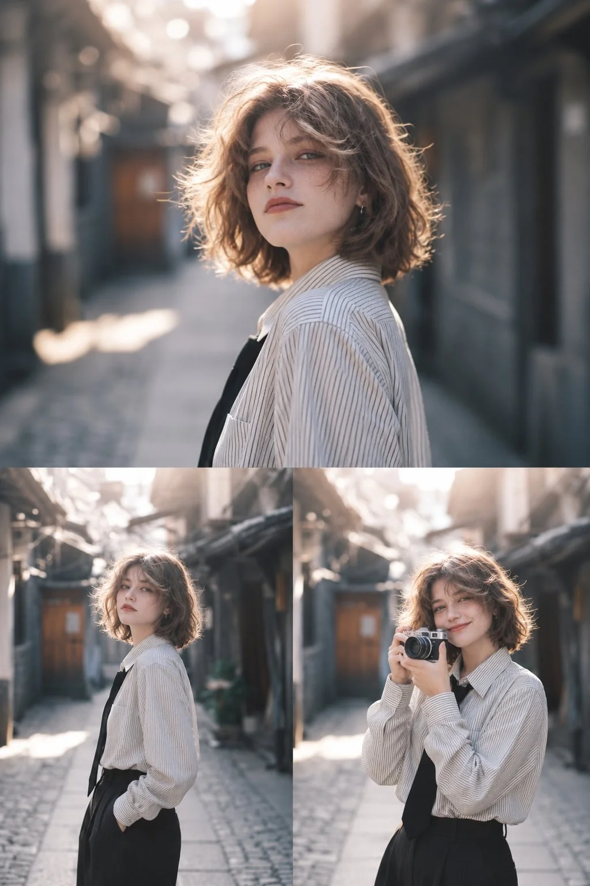

# Cinematic Three-Panel Editorial Portrait Collage

**中文标题：** 电影感三联编辑人像拼贴  
**ID:** `gi25-x-1253` · **Mode:** `edit`  
**Categories:** `character-consistency`  
**Tags:** `x-twitter`, `community`, `gpt-image-2.5`, `x-direct`, `en`



### Cinematic Three-Panel Editorial Portrait Collage

```text
Create a highly photorealistic, cinematic 3-panel editorial portrait collage featuring the same young woman from the reference image, with short, tousled, wavy light brown hair, delicate facial features, subtle freckles, small hoop earrings, and a confident, slightly playful expression.

Composition: A vertical 3:4 canvas divided into two sections. The upper half features a large cinematic waist-up portrait of the woman looking over her shoulder toward the camera. The lower half is divided into two equal vertical photographs. In the bottom-left image, she stands casually in a narrow old urban alley with one hand in her pocket. In the bottom-right image, she smiles softly while holding a vintage film camera near her face.

Outfit: An oversized white button-up shirt with fine black vertical pinstripes, loosely worn with a black necktie, black high-waisted trousers, and small silver hoop earrings. Natural fabric folds and realistic textures.

Environment: A charming, narrow old Japanese-style urban alley with traditional wooden doors, weathered buildings, overhead structures, and a textured stone pavement. Soft sunlight streams through the alley, creating beautiful warm highlights and atmospheric depth.

Lighting: Golden-hour backlighting, glowing rim light around her hair, soft sunlight illuminating her face, subtle lens bloom, natural shadows, and creamy cinematic bokeh.

Photography style: Professional fashion editorial photography, shot on a full-frame camera with an 85mm portrait lens, shallow depth of field, realistic skin texture, natural facial proportions, muted cinematic colors, subtle film grain, soft contrast, and a dreamy nostalgic atmosphere.

Maintain consistent facial features, hairstyle, outfit, and lighting across all three panels. Clean panel divisions, no borders, no text, no watermark. Ultra-realistic, high-resolution photography.
```

- **Recommended model:** `gpt-image-2.5-sunburst`
- **Settings:** _(defaults)_
- **Source:** [community](https://x.com/Ziha_ai/status/2116501008255992104) — @Ziha_ai
- **License note:** Original public X post; quoted with attribution — remix with attribution
- **Notes:** Collected directly from X; original post https://x.com/Ziha_ai/status/2116501008255992104; post text names GPT Image 2.5; discovered via Bin0754/gpt-image-gallery index, prompt re-verified against the original X post via api.fxtwitter.com; verified=True
- **Preview:** `previews/gi25-x-1253.webp`
