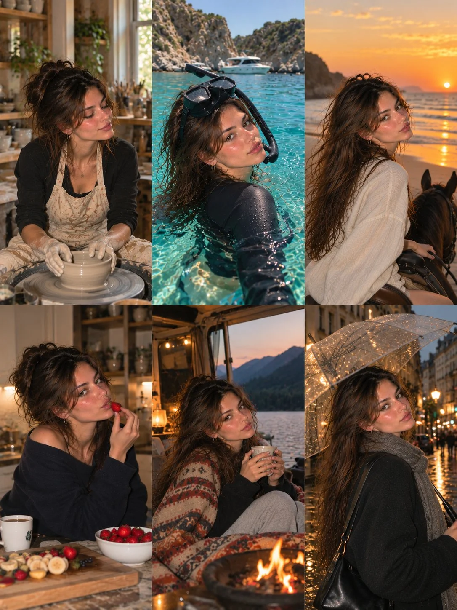

# Freckled Olive-Skin Lifestyle 3×2 Photo Collage

**中文标题：** 雀斑橄榄肤色生活方式六宫格  
**ID:** `gi25-x-1278` · **Mode:** `generate`  
**Categories:** `character-consistency`, `general`  
**Tags:** `x-twitter`, `community`, `gpt-image-2.5`, `x-direct`, `en`



### Freckled Olive-Skin Lifestyle 3×2 Photo Collage

```text
Create an ultra-realistic 6-photo lifestyle collage featuring the same naturally beautiful young European woman in her early 20s, arranged in a seamless 3-column × 2-row grid. She has warm olive skin, delicate freckles, hazel-brown eyes, long wavy chestnut-brown hair, naturally full eyebrows, and glossy pink lips. Preserve identical facial identity across all six photographs.

Concept: An adventurous, creative lifestyle photo diary featuring six completely different experiences, with authentic Instagram photo-dump aesthetics.

Six Different Scenes:

1. Pottery Studio: Sitting at a pottery wheel in a cozy artistic studio, wearing a dark long-sleeve top and a beige floral apron, shaping a clay pot with flourished hands while looking down with a gentle smile.

2. Mediterranean Snorkeling: Floating in crystal-clear turquoise Mediterranean water near rocky coastal cliffs and a yacht. Wearing a modest black long-sleeve rash guard with full chest coverage and snorkeling goggles, looking naturally toward the camera.

3. Horseback Riding: Riding a beautiful dark horse along a beach during sunset, wearing a loose white linen shirt and dark trousers. Looking back over her shoulder as golden sunlight illuminates her hair.

4. Kitchen Moment: Standing in a warm, modern kitchen wearing an oversized navy knit sweater, holding a fresh strawberry near her lips. A bowl of strawberries and fruit sits on the counter.

5. Lakeside Camping: Relaxing beside a lakeside camper van, wrapped in a cozy patterned blanket and holding a warm coffee mug. Mountains, pine trees, and a glowing campfire create a peaceful evening atmosphere.

6. Rainy City Walk: Walking through a beautiful European street at night, wearing a charcoal coat, knitted scarf, and carrying a black shoulder bag. Holding a transparent umbrella as city lights reflect on the wet pavement.

Photography Style: Authentic Canon PowerShot G7 X Mark III aesthetic, realistic skin texture, natural expressions, direct flash mixed with cinematic ambient lighting, subtle film grain, imperfect candid framing, realistic shadows, and beautiful environmental details.

Consistency: The exact same woman must appear in all six photographs, with identical facial features, freckles, eye color, skin tone, and hair color. Each frame should have a different outfit, pose, environment, and camera angle.

Realism: Visible skin pores, fine baby hairs, natural facial asymmetry, realistic hands, believable clothing textures, and lifelike environments. Avoid plastic-looking skin, excessive retouching, duplicated expressions, distorted anatomy, or artificial AI aesthetics.

Output: Vertical 3:4 aspect ratio, exactly six equally sized photographs in a balanced 3-column × 2-row grid, clean alignment, no gutters, no borders, no text, no watermark. Photorealistic, adventurous, cinematic, youthful, and effortlessly stylish.
```

- **Recommended model:** `gpt-image-2.5-sunburst`
- **Settings:** _(defaults)_
- **Source:** [community](https://x.com/john_my07/status/2116531161665302895) — @john_my07
- **License note:** Original public X post; quoted with attribution — remix with attribution
- **Notes:** Collected directly from X; original post https://x.com/john_my07/status/2116531161665302895; post text names GPT Image 2.5; discovered via X search, prompt re-verified against the original X post via api.fxtwitter.com; verified=True
- **Preview:** `previews/gi25-x-1278.webp`
