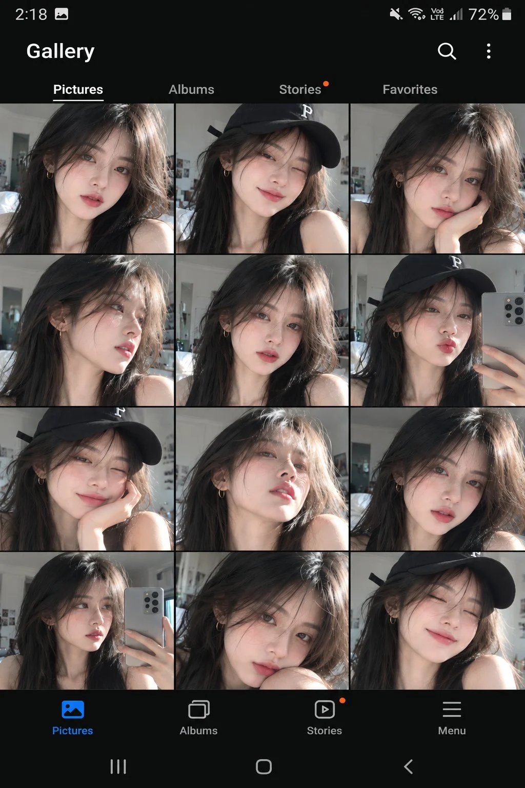

# Phone Gallery Screenshot Selfie Collage From Reference

**中文标题：** 参考照→手机相册截图自拍合集  
**ID:** `gi25-x-1282` · **Mode:** `edit`  
**Categories:** `character-consistency`, `ui-mockup`  
**Tags:** `x-twitter`, `community`, `gpt-image-2.5`, `x-direct`, `en`



### Phone Gallery Screenshot Selfie Collage From Reference

```text
Create a photorealistic Samsung smartphone Gallery screenshot featuring a stylish young Asian woman with a soft Korean-inspired beauty aesthetic.
Use the uploaded reference image to maintain her exact facial identity, delicate facial features, long silky jet-black hair, wispy bangs, fair glowing skin, glossy pink lips, subtle eyeliner and natural dewy makeup. She wears a fitted black sleeveless top with minimal gold hoop earrings. In selected selfies, she wears a stylish black baseball cap with a small white embroidered logo.
Display a collection of expressive selfies in a neatly organized 3-column photo grid. Include different natural poses and expressions such as a playful wink, gentle smile, cute pout, relaxed neutral expression, side profile, looking upward, resting her cheek on her hand, and a casual mirror selfie holding a Samsung smartphone.
All images should feel like authentic front-camera photographs taken in a bright, cozy bedroom. Use soft window daylight, realistic skin texture, natural shadows, detailed hair strands, subtle facial imperfections and crisp eye focus.
The overall composition should resemble an actual Samsung One UI Gallery screenshot in dark mode. Include a clean black interface, a realistic status bar with time and battery percentage, the “Gallery” heading, Pictures, Albums, Stories and Favorites tabs, search and menu icons, a photo grid, and Samsung-style bottom navigation with Pictures, Albums, Stories and Menu.
Maintain consistent facial identity, hairstyle, outfit and realistic photography across every selfie. The black baseball cap must remain black in all images where it appears.
Vertical 9:16 smartphone screenshot, premium social media influencer aesthetic, realistic Samsung interface, high-resolution details.
Avoid iPhone interface elements, white gallery backgrounds, inconsistent faces, distorted hands, duplicate poses, excessive beauty filters, cartoon effects and artificial-looking skin.
```

- **Recommended model:** `gpt-image-2.5-sunburst`
- **Settings:** _(defaults)_
- **Source:** [community](https://x.com/Aqsahere_/status/2116732827115151451) — @Aqsahere_
- **License note:** Original public X post; quoted with attribution — remix with attribution
- **Notes:** Collected directly from X; original post https://x.com/Aqsahere_/status/2116732827115151451; post text names GPT Image 2.5; discovered via X search, prompt re-verified against the original X post via api.fxtwitter.com; verified=True
- **Preview:** `previews/gi25-x-1282.webp`
