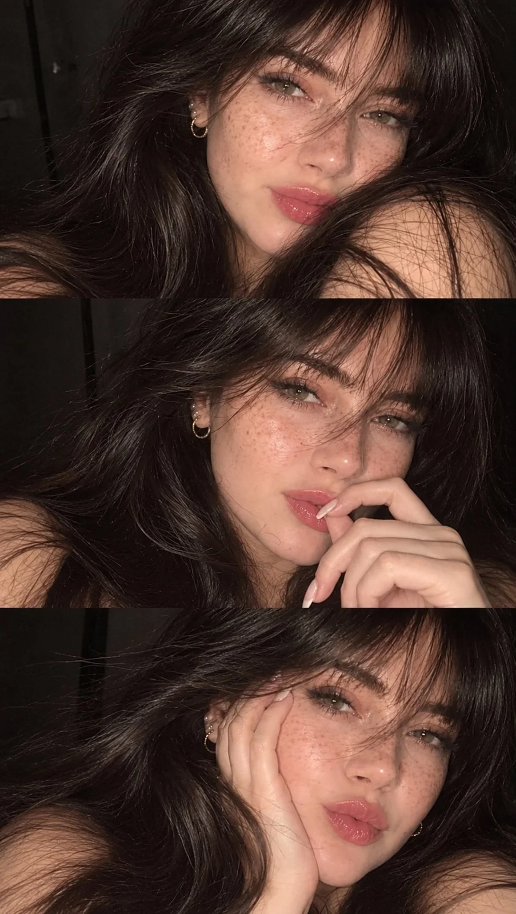

# Three-Panel Cute Selfie Collage

**中文标题：** 三联可爱自拍拼贴  
**ID:** `gi25-x-1293` · **Mode:** `generate`  
**Categories:** `character-consistency`, `general`  
**Tags:** `x-twitter`, `community`, `gpt-image-2.5`, `x-direct`, `en`



### Three-Panel Cute Selfie Collage

```text
Create a vertical 3-photo collage featuring a beautiful young girl in three different cute selfie poses. Give her a completely different, naturally beautiful face with soft facial features, expressive hazel-green eyes, naturally thick eyelashes, a cute nose, and glossy rosy-pink lips. Add realistic tiny freckles and scattered natural beauty spots across her cheeks and nose.

She has long, thick, voluminous dark brown hair with soft layers and wispy curtain bangs. She wears subtle eye makeup, small silver hoop earrings, and has a cute, effortless aesthetic.

Photo 1: Close-up selfie with a soft, dreamy gaze, slightly messy hair falling across her face.

Photo 2: Playful expression with one hand near her lips, looking directly at the camera.

Photo 3: Resting her cheek on her palm with a cute pout and relaxed expression.

Keep all three photos in equal horizontal panels stacked vertically. Maintain consistent facial identity across all three panels.
```

- **Recommended model:** `gpt-image-2.5-sunburst`
- **Settings:** _(defaults)_
- **Source:** [community](https://x.com/MissDelulu9/status/2116793013774975408) — @MissDelulu9
- **License note:** Original public X post; quoted with attribution — remix with attribution
- **Notes:** Collected directly from X; original post https://x.com/MissDelulu9/status/2116793013774975408; post text names GPT Image 2.5; discovered via X search, prompt re-verified against the original X post via api.fxtwitter.com; verified=True
- **Preview:** `previews/gi25-x-1293.webp`
