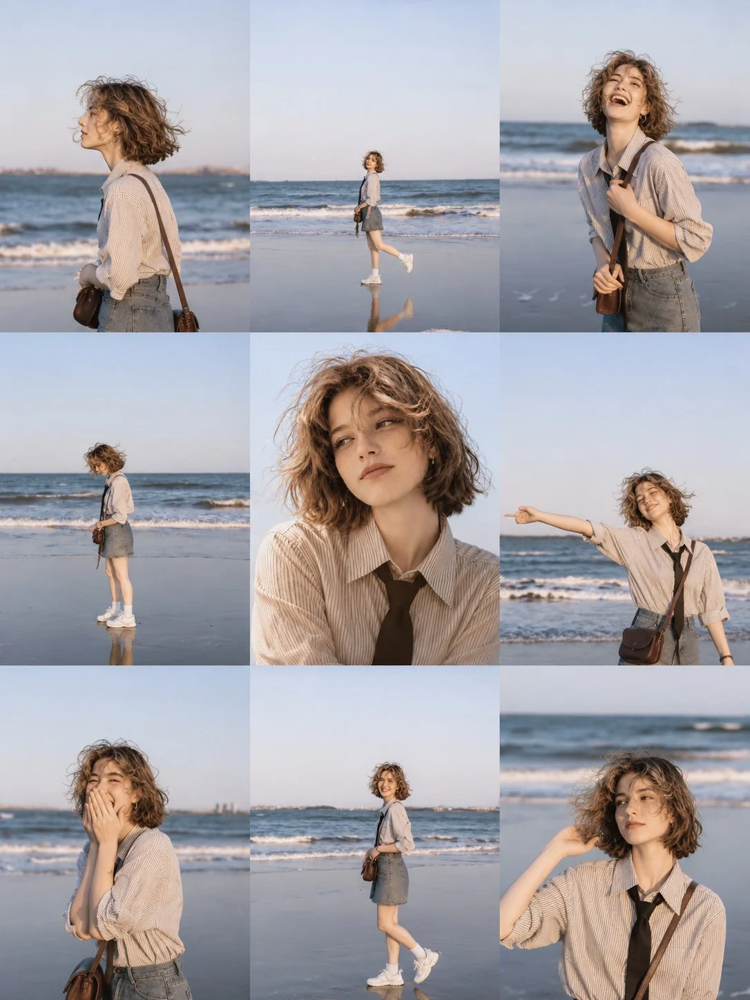

# Korean Beach Vintage Film 3×3 Collage

**中文标题：** 韩系海滩复古胶片九宫格  
**ID:** `gi25-x-1308` · **Mode:** `generate`  
**Categories:** `character-consistency`, `general`  
**Tags:** `x-twitter`, `community`, `gpt-image-2.5`, `x-direct`, `en`



### Korean Beach Vintage Film 3×3 Collage

```text
Aesthetic Korean Beach Photo Collage | Vintage Film Photography

Create a realistic 3×3 photo collage featuring the same beautiful young Korean woman enjoying a peaceful day at the beach. Each of the nine frames should capture a different candid moment, with consistent facial features, outfit, hairstyle, and accessories throughout.

Character: A young Korean woman with long, naturally wavy black hair, soft facial features, fair skin, and a gentle, cheerful expression.

Outfit: A relaxed white oversized long-sleeve T-shirt tucked into a light blue denim mini skirt, white sneakers, a muted blue baseball cap, and a small brown crossbody shoulder bag.

Setting: A beautiful seaside beach with gentle ocean waves, wet reflective sand, a pale blue sky, and a distant coastline during soft late-afternoon daylight.

Photo Composition: A 3×3 grid of nine separate candid photographs:

1. Side profile looking toward the ocean, hair blowing in the sea breeze.
2. Full-body shot standing near the water, one foot slightly raised.
3. Smiling naturally while holding her shoulder bag.
4. Walking barefoot along the wet shoreline.
5. A close-up portrait looking directly at the camera.
6. Playfully stretching one arm toward the sea.
7. Laughing shyly with one hand covering her mouth.
8. A full-body candid walking pose with a gentle smile.
9. A close-up portrait looking down as the wind blows her hair.

Photography Style: Authentic vintage film photography, soft natural lighting, subtle film grain, slightly faded colors, gentle blue tones, warm skin tones, natural imperfections, and a dreamy nostalgic Korean aesthetic.

Layout: Strict 3×3 photo grid, each frame independently composed with clean rectangular edges, consistent proportions, no gaps between photographs, and a cohesive color palette.

Aspect Ratio: 9:16 vertical composition.

Quality: High-resolution, realistic facial details, natural body proportions, candid expressions, and consistent character identity across all nine frames.
```

- **Recommended model:** `gpt-image-2.5-sunburst`
- **Settings:** _(defaults)_
- **Source:** [community](https://x.com/Ziha_ai/status/2116886100509880528) — @Ziha_ai
- **License note:** Original public X post; quoted with attribution — remix with attribution
- **Notes:** Collected directly from X; original post https://x.com/Ziha_ai/status/2116886100509880528; post text names GPT Image 2.5; discovered via X search, prompt re-verified against the original X post via api.fxtwitter.com; verified=True
- **Preview:** `previews/gi25-x-1308.webp`
