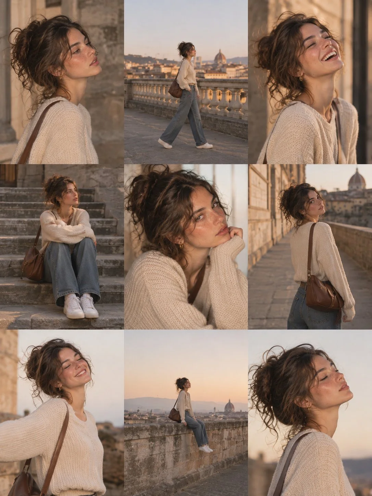

# European Lifestyle 3×3 Photo-Dump Collage

**中文标题：** 欧式生活方式九宫格拼贴  
**ID:** `gi25-x-1319` · **Mode:** `generate`  
**Categories:** `character-consistency`, `general`  
**Tags:** `x-twitter`, `community`, `gpt-image-2.5`, `x-direct`, `en`



### European Lifestyle 3×3 Photo-Dump Collage

```text
Create an ultra-realistic 9-photo lifestyle collage arranged in a seamless 3×3 grid, featuring the same naturally beautiful young European woman in her early 20s. She has warm olive skin, delicate freckles, hazel-brown eyes, long chestnut-brown wavy hair styled in a loose messy bun with face-framing strands, and naturally delicate facial features. Maintain identical facial identity across all nine photographs.

Outfit: The same outfit in every frame: an oversized ivory cable-knit sweater, relaxed-fit blue jeans, white sneakers, small gold hoop earrings, and a brown leather crossbody shoulder bag. Casual, modest, effortlessly elegant European styling.

Concept: A nostalgic golden-hour European city photo diary, capturing spontaneous moments while exploring charming old streets, historic architecture, stone staircases, and beautiful rooftop viewpoints.

Nine Different Poses:

1. Side-profile portrait against an old stone wall, looking thoughtfully into the distance.
2. Walking along a historic rooftop terrace with a beautiful city skyline behind her.
3. Laughing naturally with her head slightly tilted back, eyes closed.
4. Sitting comfortably on wide stone steps, knees bent, looking away from the camera.
5. Intimate close-up portrait, resting her chin against her sweater sleeve with a gentle expression.
6. Walking along a narrow European street, looking back over her shoulder.
7. Standing outdoors with eyes closed, enjoying the warm evening breeze.
8. Sitting on a stone terrace wall overlooking the city, legs relaxed and a peaceful expression.
9. Close-up side portrait with her head tilted slightly upward, hair softly illuminated by sunset.

Photography Style: Authentic European Instagram photo dump, Canon PowerShot G7 X Mark III aesthetic, direct natural sunlight, warm golden-hour highlights, subtle film grain, realistic skin pores, soft shadows, natural facial expressions, candid compositions, and shallow depth of field.

Consistency: Preserve exactly the same face, freckles, eye color, skin tone, hairstyle, outfit, and accessories in all nine photographs. Each panel must have a different pose, expression, camera angle, and composition.

Output: Vertical 3:4 aspect ratio, exactly nine equally sized photographs in a clean 3-column × 3-row grid, seamless alignment, no gutters, no borders, no text, no watermark. Photorealistic, cinematic, youthful, spontaneous, and effortlessly stylish.
```

- **Recommended model:** `gpt-image-2.5-sunburst`
- **Settings:** _(defaults)_
- **Source:** [community](https://x.com/john_my07/status/2117106098943803566) — @john_my07
- **License note:** Original public X post; quoted with attribution — remix with attribution
- **Notes:** Collected directly from X; original post https://x.com/john_my07/status/2117106098943803566; post text names GPT Image 2.5; discovered via X search, prompt re-verified against the original X post via api.fxtwitter.com; verified=True
- **Preview:** `previews/gi25-x-1319.webp`
