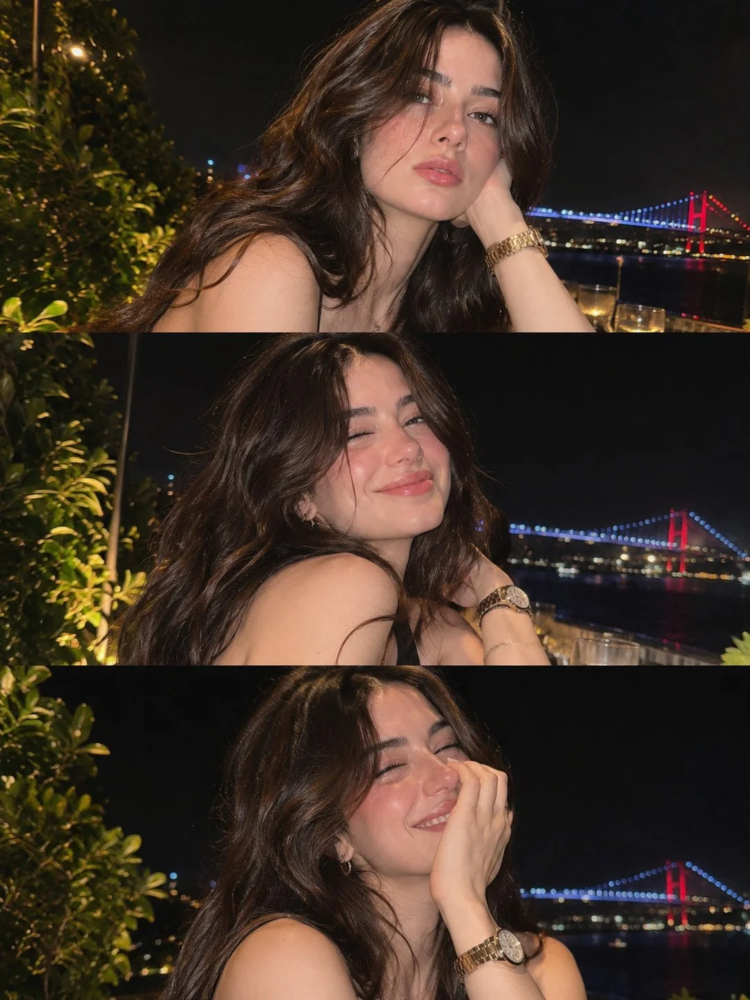

# Rooftop Dinner Candid Triptych (Consistent Character)

**中文标题：** 天台晚餐抓拍三联图（角色一致）  
**ID:** `gi25-x-1320` · **Mode:** `generate`  
**Categories:** `character-consistency`  
**Tags:** `x-twitter`, `community`, `gpt-image-2.5`, `x-direct`, `en`



### Rooftop Dinner Candid Triptych (Consistent Character)

```text
Create an absolutely photorealistic, premium-quality vertical triptych featuring the exact same beautiful 23-year-old woman in three different candid photographs, captured during one evening at a luxurious waterfront rooftop restaurant.

CHARACTER CONSISTENCY

A naturally beautiful young woman with long, voluminous, slightly messy dark chocolate-brown wavy hair, soft face-framing strands, striking gray-green eyes, naturally thick eyebrows, delicate facial features, a softly defined jawline, naturally full rosy-pink lips, subtle freckles across her cheeks and nose, and realistic fair skin with warm undertones.

Authentic skin pores, natural facial asymmetry, fine baby hairs, subtle under-eye texture, realistic makeup, and healthy natural skin shine.

OUTFIT & ACCESSORIES

Elegant black sleeveless evening dress, delicate gold hoop earrings, a beautiful gold wristwatch on her left wrist, and minimal fine jewelry. Natural glossy nude-pink lips, softly flushed cheeks, subtle eyeliner, and lightly defined eyelashes.

LOCATION & LIGHTING

A sophisticated open-air rooftop restaurant overlooking a wide river at night. A magnificent suspension bridge illuminated with blue lights and red towers stretches across the background. Warm decorative restaurant lights, leafy green plants on the left, subtle candlelight, and beautiful reflections shimmering on the dark water.

Photographed with a real smartphone using direct flash, creating authentic nighttime party photography. Natural flash falloff, warm skin tones, softly illuminated hair, realistic shadows, deep black night sky, and slightly blurred distant lights.

THREE DISTINCT PHOTOGRAPHS

PHOTO 1 — THE EFFORTLESS BEAUTY

Close-up three-quarter portrait. She sits sideways at the restaurant table, resting the side of her head gently against her left hand. Her gold watch is visible. Her long, loose hair falls naturally over her shoulders. She gazes directly toward the camera with relaxed, slightly parted lips and a calm, confident expression. The illuminated bridge appears behind her right shoulder.

PHOTO 2 — THE PLAYFUL SMILE

Same woman, same outfit, same location. She turns slightly over her shoulder toward the camera, giving a spontaneous playful wink with a soft closed-lip smile. Her cheeks lift naturally, her hair shifts slightly, and her left hand rests near her neck. A genuine, unposed moment captured between conversations.

PHOTO 3 — THE SHY LAUGH

Same woman, photographed a few seconds later. She laughs naturally with her eyes gently closed, raising her left hand to partially cover her smile. Her gold watch is visible, her hair falls loosely around her face, and her expression feels completely spontaneous and joyful.

CAMERA & IMAGE QUALITY

Authentic high-end smartphone flash photography, realistic 35mm-equivalent perspective, ultra-detailed natural skin texture, individual hair strands, subtle film grain, realistic depth of field, sharp eyes, natural colors, beautiful nighttime contrast, and true-to-life anatomy.

COMPOSITION

Three equally sized horizontal photographs stacked vertically into one seamless portrait-oriented collage. Thin, clean separators between images. Exactly the same woman, hairstyle, outfit, accessories, and background in all three photographs.

STRICT NEGATIVE PROMPT

No AI-generated appearance, no plastic skin, no beauty-filter smoothing, no exaggerated facial symmetry, no CGI, no 3D rendering, no artificial glamour lighting, no distorted hands, no extra fingers, no unnatural smiles, no excessive retouching, no inconsistent facial identity, no different outfits, no text, no watermark.

FINAL GOAL

The result must look like three genuinely candid photographs taken by a friend during an unforgettable rooftop dinner, not a professional fashion photoshoot or AI-generated artwork.
```

- **Recommended model:** `gpt-image-2.5-sunburst`
- **Settings:** _(defaults)_
- **Source:** [community](https://x.com/frametheory058/status/2117106809907695738) — @frametheory058
- **License note:** Original public X post; quoted with attribution — remix with attribution
- **Notes:** Collected directly from X; original post https://x.com/frametheory058/status/2117106809907695738; post text names GPT Image 2.5; discovered via X search, prompt re-verified against the original X post via api.fxtwitter.com; verified=True; post says it was made with GPT Image 2.5 on ImagineArt
- **Preview:** `previews/gi25-x-1320.webp`
