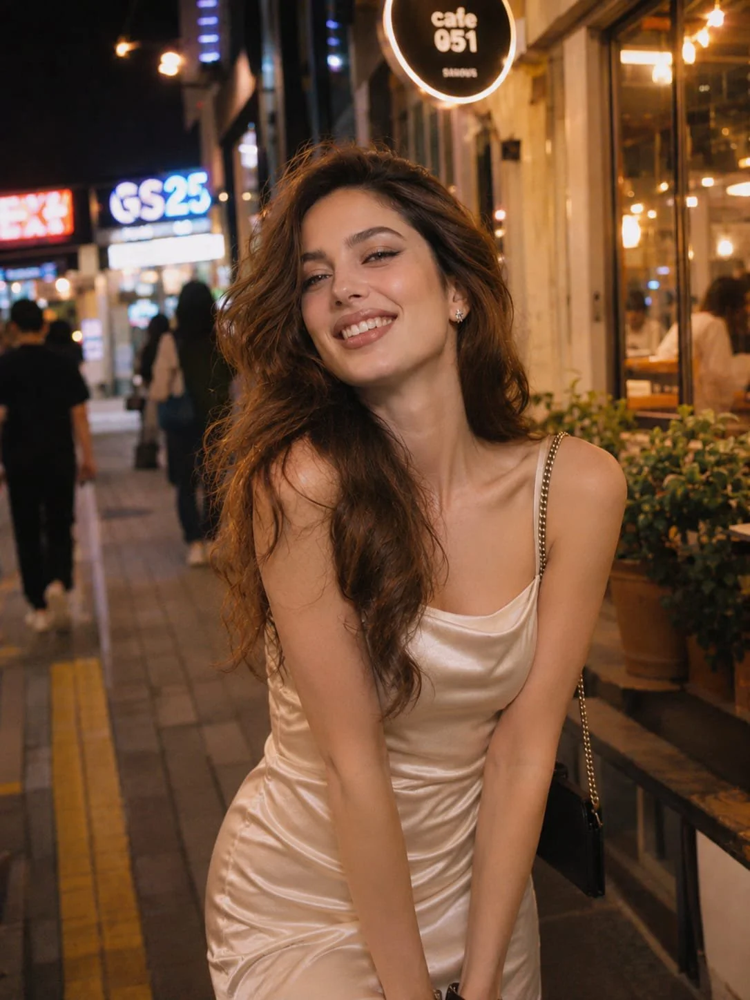

# Cinematic Night Street Photo of the Same Woman (Reference Lock)

**中文标题：** 参考人物锁定·电影感夜街人像  
**ID:** `gi25-x-1345` · **Mode:** `edit`  
**Categories:** `character-consistency`, `edit-change-preserve`  
**Tags:** `x-twitter`, `community`, `gpt-image-2.5`, `x-direct`, `en`



### Cinematic Night Street Photo of the Same Woman (Reference Lock)

```text
Create an ultra-realistic, cinematic nighttime street photograph featuring the exact same woman from the provided reference image. Preserve her facial identity, distinctive features, bone structure, face shape, skin tone, and natural proportions with absolute consistency. She must remain unmistakably the same person.

Scene & Atmosphere: Capture her strolling through a charming, bustling Seoul neighborhood after dark, surrounded by glowing convenience store signs, cozy cafés, passing cars, and softly illuminated storefronts. She is caught mid-laugh, looking slightly away from the camera with a carefree, spontaneous expression, as if enjoying an unforgettable summer evening with friends.

Appearance & Styling: Long, naturally flowing chestnut-brown hair with loose, effortless waves. Fresh dewy makeup, softly flushed cheeks, subtle glossy lips, and luminous natural skin texture. She wears an elegant ivory satin slip dress with delicate straps, understated jewelry, and a relaxed, effortless summer look.

Photography & Visual Style: Authentic Japanese 35mm film photography aesthetic, nostalgic cinematic color grading, warm amber streetlights contrasting with subtle cool blue night tones, gentle halation around light sources, beautifully rendered background bokeh, natural shadows, and organic film grain.

Camera Details: Shot on a Leica M11, 85mm portrait lens, f/1.8, ISO 1600, handheld candid photography, shallow depth of field, imperfect spontaneous framing, realistic motion and natural expressions.

Quality: Ultra-photorealistic 8K RAW photograph, exceptional skin detail, authentic photographic imperfections, editorial street photography, atmospheric and effortlessly beautiful. Avoid artificial-looking skin, excessive retouching, exaggerated posing, or AI-generated aesthetics.

Aspect Ratio: 3:4 vertical.
```

- **Recommended model:** `gpt-image-2.5-sunburst`
- **Settings:** _(defaults)_
- **Source:** [community](https://x.com/mehvishs25/status/2117250832047689923) — @mehvishs25
- **License note:** Original public X post; quoted with attribution — remix with attribution
- **Notes:** Collected directly from X; original post https://x.com/mehvishs25/status/2117250832047689923; post text names GPT Image 2.5; discovered via X search, prompt re-verified against the original X post via api.fxtwitter.com; verified=True
- **Preview:** `previews/gi25-x-1345.webp`
