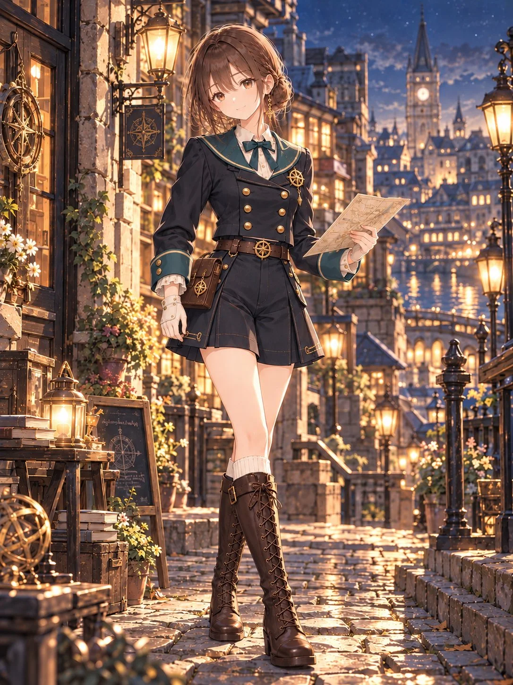

# "Compass Nocturne" Vintage Navigator Outfit for Your Character

**中文标题：** 「Compass Nocturne」复古领航员服装（角色换装）  
**ID:** `gi25-x-1357` · **Mode:** `edit`  
**Categories:** `character-consistency`, `edit-change-preserve`  
**Tags:** `x-twitter`, `community`, `gpt-image-2.5`, `x-direct`, `en`



### "Compass Nocturne" Vintage Navigator Outfit for Your Character

```text
Dress the character in “Compass Nocturne,” an elegant vintage navigator outfit in midnight navy, deep teal, ivory, antique gold, and dark brown leather.

Jacket: A fitted midnight-navy double-breasted jacket with six antique-gold buttons in two columns, long sleeves, deep-teal cuffs with gold trim, and a wide deep-teal sailor collar edged in gold. A delicate gold compass brooch decorates the wearer’s left chest. The back collar features a large embroidered gold compass rose.

Blouse: An ivory high-collar blouse with small gold buttons and a neatly tied deep-teal ribbon at the neckline.

Bottoms: High-waisted midnight-navy tailored culottes with structured pleats, gently flared short hems, and subtle gold-trimmed side details. Preserve the two separate leg openings; do not turn them into a skirt.

Belt and pouch: A dark-brown leather waist belt with a prominent antique-gold compass-rose buckle. A compact dark-brown leather navigation pouch with a flap, brass clasp, and small hanging compass charm is secured directly to the wearer’s right hip by short belt attachments. No shoulder or crossbody strap.

Accessories: Ivory fingerless gloves with delicate cuffs and dark leather wrist straps. Ivory ribbed socks and dark-brown knee-high lace-up leather boots with side buckles and sturdy low heels.

Overall style: Refined vintage tailoring, balanced proportions, elegant maritime details, and realistic fabric folds. Keep the costume’s distinctive silhouette and compass decorations without adding oversized accessories.

Apply the outfit naturally to the user’s character while preserving their original face, hairstyle, body proportions, and personal accessories. Do not specify or alter the background, pose, or expression.
```

- **Recommended model:** `gpt-image-2.5-sunburst`
- **Settings:** _(defaults)_
- **Source:** [community](https://x.com/sayo_aym/status/2117369607568957877) — @sayo_aym
- **License note:** Original public X post; quoted with attribution — remix with attribution
- **Notes:** Collected directly from X; prompt posted as the author's own reply https://x.com/sayo_aym/status/2117369607568957877 to https://x.com/sayo_aym/status/2117369603559202889, which carries the images; GPT Image 2.5 is named in the reply; discovered via X search, prompt re-verified against the original X post via api.fxtwitter.com; verified=True; outfit-only prompt applied to your own character image
- **Preview:** `previews/gi25-x-1357.webp`
