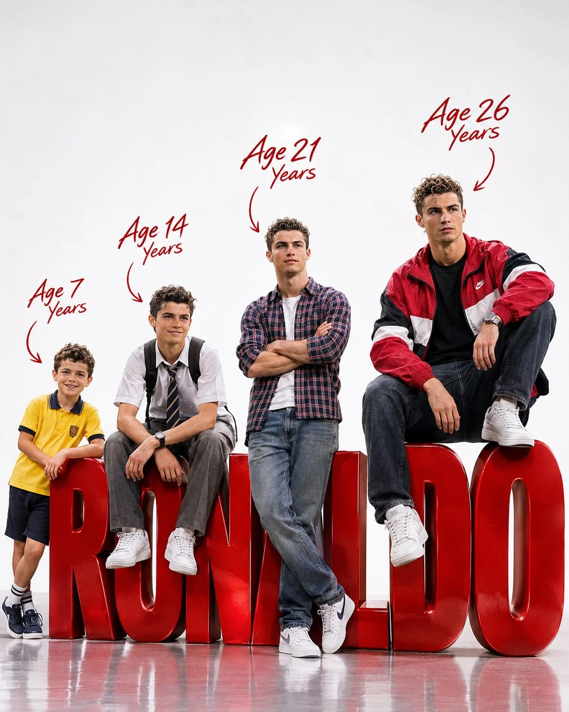

# Four Life Stages Cinematic 3D Portrait Poster

**中文标题：** 四个人生阶段电影感3D肖像海报  
**ID:** `gi25-x-1369` · **Mode:** `edit`  
**Categories:** `character-consistency`, `edit-change-preserve`  
**Tags:** `x-twitter`, `community`, `gpt-image-2.5`, `x-direct`, `en`



### Four Life Stages Cinematic 3D Portrait Poster

```text
FOUR LIFE STAGES - ULTRA-REALISTIC 3D CINEMATIC PORTRAIT

Create an ultra-realistic, 8K-quality, cinematic 3D poster in a 4:5 vertical portrait ratio, featuring four different age versions of the same person: 7, 14, 21, and 26 years old, arranged from smallest to largest.

Use the uploaded photograph as the sole identity reference. Carefully analyse the person's facial structure, eyes, nose, lips, hairstyle, skin tone, and distinctive features. Maintain strong facial resemblance and consistent identity across all four age versions, with realistic and natural age progression. Each version must clearly look like the same person at a different stage of life.

1. FOUR AGE VERSIONS & OUTFITS

- 7 Years: A cute, cheerful little child wearing a yellow casual school outfit, with a playful and innocent expression.
- 14 Years: A school-going teenager wearing a neat white school uniform with a backpack, sitting casually with a confident smile.
- 21 Years: A young adult wearing a stylish checkered shirt, blue jeans, and casual sneakers, standing confidently with arms crossed.
- 26 Years: The largest and most prominent version, wearing the exact red, black, and white jacket from the uploaded reference photograph, paired with a black T-shirt, jeans, and white sneakers.

2. COMPOSITION & POSES

Arrange all four versions from left to right in increasing order of height and age, creating a visually balanced composition.

Feature enormous, bold, glossy red 3D letters spelling "[NAME]" across the lower half of the composition.

Make each age version interact playfully with the oversized letters:

- The 7-year-old stands beside or leans against the first letter.
- The 14-year-old sits casually in front of the letters.
- The 21-year-old stands confidently, leaning against the lettering.
- The 26-year-old sits stylishly on top of the final letters, with one leg relaxed and the other naturally positioned.

Ensure all four figures are fully visible, with natural body proportions, realistic anatomy, and distinct poses.

3. AGE LABELS & TYPOGRAPHY

Above each individual version, add elegant, handwritten-style dark red text indicating their age:

- Age 7 Years
- Age 14 Years
- Age 21 Years
- Age 26 Years

Connect each age label to its corresponding character using a thin, curved, hand-drawn arrow. Position the labels naturally without overlapping the subjects.

4. BACKGROUND & LIGHTING

- Pure white professional studio background.
- Clean, seamless white environment.
- Glossy, reflective studio floor.
- Realistic contact shadows beneath all characters and 3D letters.
- Premium cinematic studio lighting.
- Soft, natural highlights and realistic skin textures.
- Highly detailed facial expressions, hair, clothing fabrics, and footwear.
- Subtle reflections on the oversized red lettering.

5. FINAL RENDERING QUALITY

Ultra-photorealistic 3D rendering, professional advertising-poster quality, cinematic composition, realistic human anatomy, detailed facial features, physically accurate lighting, sharp focus, premium materials, natural proportions, and exceptional 8K-level detail.

IMPORTANT: All four characters must unmistakably represent the same person at different ages. Preserve the uploaded person's recognizable identity rather than generating four unrelated faces. Ensure the age progression is believable, the outfits match their respective stages of life, and the name "[NAME]" is spelled correctly in large, glossy red 3D typography.

Final output: 4:5 vertical portrait, high-resolution, ultra-realistic cinematic 3D poster.
```

- **Recommended model:** `gpt-image-2.5-sunburst`
- **Settings:** _(defaults)_
- **Source:** [community](https://x.com/Goodmanprotocol/status/2117513564957360509) — @Goodmanprotocol
- **License note:** Original public X post; quoted with attribution — remix with attribution
- **Notes:** Collected directly from X; original post https://x.com/Goodmanprotocol/status/2117513564957360509; post text names GPT Image 2.5; discovered via X search, prompt re-verified against the original X post via api.fxtwitter.com; verified=True
- **Preview:** `previews/gi25-x-1369.webp`
