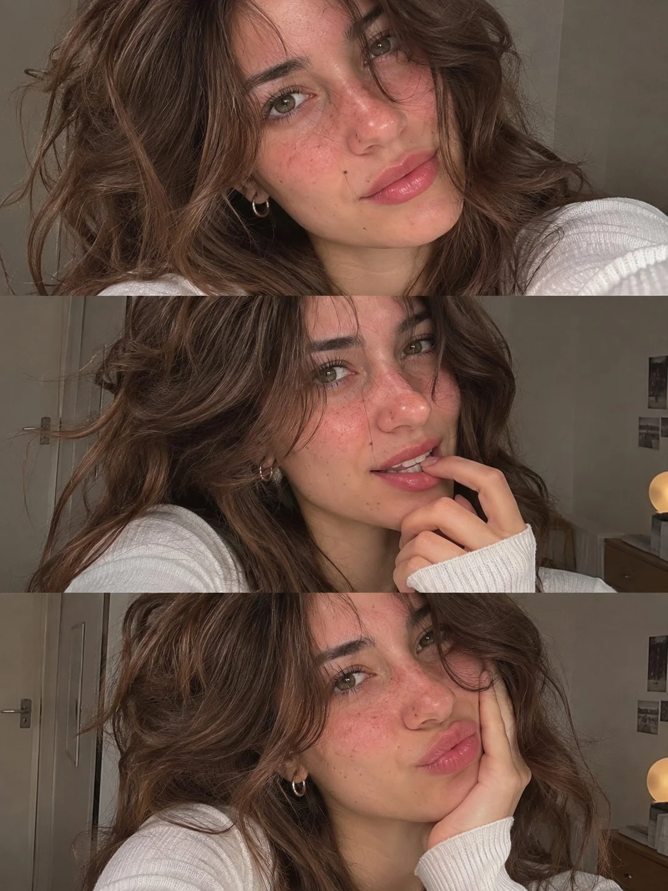

# Three Candid Selfies Vertical Collage of the Same Woman

**中文标题：** 同一女孩三张随手自拍竖版拼贴  
**ID:** `gi25-x-1379` · **Mode:** `generate`  
**Categories:** `character-consistency`, `general`  
**Tags:** `x-twitter`, `community`, `gpt-image-2.5`, `x-direct`, `en`



### Three Candid Selfies Vertical Collage of the Same Woman

```text
Create an aesthetically pleasing vertical collage composed of three candid smartphone selfies of the same young woman, each capturing a different charming mood and personality. Her appearance should feel fresh, distinctive, and naturally attractive, with delicate facial features, captivating hazel-green eyes, long curled lashes, a petite nose, and soft, plump lips with a sheer rosy gloss. Add subtle freckles and a few tiny beauty marks naturally scattered over her nose and cheeks for a realistic touch.

Hair & Styling: Long, dense chocolate-brown hair with naturally flowing layers, soft volume, and wispy face-framing curtain bangs. Minimal everyday makeup, delicate silver mini-hoop earrings, and a relaxed, effortlessly pretty aesthetic.

Three Selfie Moments:

- Top Frame: An intimate face-close selfie, her head slightly tilted, gazing into the lens with a gentle, dreamy expression. A few loose strands casually fall over her forehead and cheeks.
- Middle Frame: A playful candid shot, making a subtle teasing expression with her fingertips resting near her lower lip while maintaining eye contact with the camera.
- Bottom Frame: A cozy selfie with her face leaning into one palm, lips slightly puckered, and a calm, adorable expression.

Composition & Quality: Arrange the three photographs as equally sized, full-width horizontal strips, stacked neatly from top to bottom. Keep the same facial structure, hairstyle, skin tone, and identity in every frame while allowing natural variations in expression and pose. Use realistic front-camera smartphone photography, soft natural lighting, authentic skin texture, gentle imperfections, and subtle photographic grain. The final collage should feel like three genuine selfies from the same personal photo album, not a staged photoshoot or artificial AI portrait.
```

- **Recommended model:** `gpt-image-2.5-sunburst`
- **Settings:** _(defaults)_
- **Source:** [community](https://x.com/john_my07/status/2117623266735239650) — @john_my07
- **License note:** Original public X post; quoted with attribution — remix with attribution
- **Notes:** Collected directly from X; original post https://x.com/john_my07/status/2117623266735239650; post text names GPT Image 2.5; discovered via X search, prompt re-verified against the original X post via api.fxtwitter.com; verified=True
- **Preview:** `previews/gi25-x-1379.webp`
