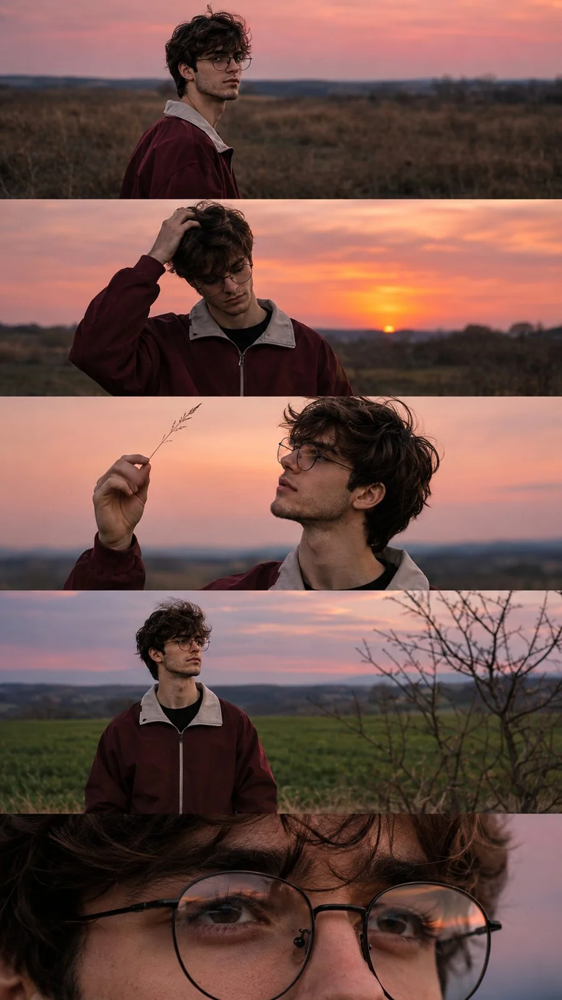

# Cinematic Sunset Five-Frame Portrait Series (9:16)

**中文标题：** 电影感日落五联人像（9:16）  
**ID:** `gi25-x-1384` · **Mode:** `generate`  
**Categories:** `character-consistency`, `general`  
**Tags:** `x-twitter`, `community`, `gpt-image-2.5`, `x-direct`, `en`



### Cinematic Sunset Five-Frame Portrait Series (9:16)

```text
CINEMATIC SUNSET PORTRAIT PHOTO SERIES | 9:16 VERTICAL

Create a cinematic, photorealistic vertical editorial photography composition featuring the same young man across five seamlessly stacked horizontal frames. The entire composition captures a quiet, introspective moment in an open rural landscape during a beautiful pink and orange sunset.

Subject & Appearance: A young man with medium-length, naturally messy brown hair, round black eyeglasses, a youthful face, and a thoughtful expression. He wears a burgundy oversized zip-up jacket with a light gray collar over a dark shirt. His hair moves gently in the evening breeze.

Frame 1: Medium-wide side profile portrait of the young man standing in a vast field of dry grass. He turns his head slightly toward the camera, looking over his shoulder with a calm, contemplative expression. A soft pink sky stretches across the distant horizon.

Frame 2: Medium shot of the young man gently running one hand through his messy hair, his head slightly tilted downward. Behind him, a glowing peach and coral sunset illuminates the open countryside, creating a warm and dreamy atmosphere.

Frame 3: Side-profile medium close-up of the young man raising a thin grass stem between his fingers and observing it against the pastel sunset sky. His glasses catch subtle reflections of the fading light. The background is softly blurred.

Frame 4: Medium-wide frontal portrait of the young man standing in a green rural field, looking thoughtfully toward the right side of the frame. A bare tree occupies the foreground on the right, with distant hills and a muted blue-pink evening sky behind him.

Frame 5: Extreme close-up portrait focusing on the young man's eyes behind his round eyeglasses. His natural skin texture, subtle eye reflections, individual hair strands, and the delicate reflections on his lenses are captured in exceptional detail.

Photography & Color Grading: Shot on a professional full-frame camera using a 50mm lens for environmental portraits and an 85mm lens for close-ups. Natural ambient sunset lighting, soft cinematic shadows, shallow depth of field, subtle film grain, muted burgundy tones, pastel peach skies, cool blue shadows, realistic skin texture, and authentic analog film aesthetics.

Composition: Exactly five horizontal cinematic frames stacked vertically, each occupying approximately 20% of the total vertical composition. Clean horizontal transitions, no borders, no text, no logos, no additional subjects.

Overall Mood: Nostalgic, melancholic, intimate, youthful, and poetic. A quiet coming-of-age film still captured during the last moments of daylight.

Ultra-photorealistic, cinematic color grading, natural imperfections, realistic photography, 9:16 vertical aspect ratio, high detail.
```

- **Recommended model:** `gpt-image-2.5-sunburst`
- **Settings:** _(defaults)_
- **Source:** [community](https://x.com/harboriis/status/2117579451458551866) — @harboriis
- **License note:** Original public X post; quoted with attribution — remix with attribution
- **Notes:** Collected directly from X; original post https://x.com/harboriis/status/2117579451458551866; post text names GPT Image 2.5; discovered via X search, prompt re-verified against the original X post via api.fxtwitter.com; verified=True
- **Preview:** `previews/gi25-x-1384.webp`
