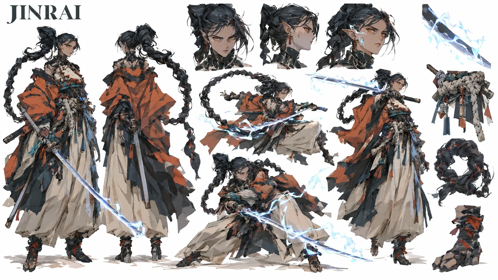

# Gouache Character Concept Design Sheets (Storm Ronin & Void Asura)

**中文标题：** 水粉风角色设定稿（风暴浪人与虚空阿修罗）  
**ID:** `gi25-x-1389` · **Mode:** `edit`  
**Categories:** `character-consistency`, `general`  
**Tags:** `x-twitter`, `community`, `gpt-image-2.5`, `x-direct`, `en`



### Gouache Character Concept Design Sheets (Storm Ronin & Void Asura)

```text
JINRAI (THE STORM RONIN):
Create a premium, organic studio CHARACTER CONCEPT DESIGN SHEET in a 16:9 widescreen layout on a pure solid white background. THE ATTACHED REFERENCE IMAGE DEFINES THE ART STYLE — treat it as a strict style bible and reproduce its exact rendering technique in every figure on this sheet.

[STYLE — MIRROR THE REFERENCE EXACTLY]: Replicate the reference image's rendering verbatim: painterly matte digital gouache with flat posterized color blocks, shapes defined purely by value and color cuts with NO outlines and NO lineart of any kind, hard-edged brush shapes, muted desaturated palette identical to the reference, identical overall brightness and contrast (light, airy, pure white background — do NOT darken).

[PROPORTIONS & FEMININE ANATOMY LOCK]: Extremely tall adult woman in her early 20s, towering fashion-model anatomy, strictly 10 heads tall. Sculpted athletic feminine frame, defined bust contours, narrow waist, long athletic legs, elongated neck, mature sharp jawline.

[SUBJECT_DESCRIPTION]: High-fashion storm ronin with a colossal coiled black dragon-tail hair braid, pointed ears, amber eyes, cybernetic neck collar. Wears a draped oversized terracotta-orange haori over layered off-white hakama trousers, a thick knotted rope shimenawa belt with hanging charms, and wrapped tabi boots. Holds a katana crackling with flat-painted cyan lightning.
Composition layout:
1. Turnarounds on left: neutral standing stance with katana drawn, and full rear view showing the massive coiled dragon braid and billowing haori drape.
2. Top area features three head studies: cold focused amber glare, profile showing pointed ear and braid root, and intense battle gaze with electric sparks on cheekbones.
3. Center and right showcase dynamic martial stances: low battoujutsu drawing crouch with cyan lightning trails, mid-air spin whipping the heavy braid like a flail, and an upright one-handed parry.
4. Floating isolated detail cutouts on the right: cyan lightning arcing along katana steel, thick knotted rope belt with hanging charms, dragon braid loop structure, wrapped tabi boot with red ties.

[TEXT & PROHIBITIONS — INLINE]: Pure white seamless ground. The ONLY text allowed on the sheet is "JINRAI" in clean bold typography in one corner. Absolutely no metadata boxes, no labels, no bullet points, no panel borders, no outlines, no cel-shading, no 3D render look. BANNED: male chest, flat pectorals, teenager, petite, short stature, cute expressions, photorealism, glossy CGI render. 100% stylized 2D gouache painting.

------

MADAME MURASAKI (THE VOID ASURA):
Create a premium, organic studio CHARACTER CONCEPT DESIGN SHEET in a 16:9 widescreen layout on a pure solid white background. THE ATTACHED REFERENCE IMAGE DEFINES THE ART STYLE — treat it as a strict style bible and reproduce its exact rendering technique in every figure on this sheet.

[STYLE — MIRROR THE REFERENCE EXACTLY]: Replicate the reference image's rendering verbatim: painterly matte digital gouache with flat posterized color blocks, shapes defined purely by value and color cuts with NO outlines and NO lineart of any kind, hard-edged brush shapes, muted desaturated palette identical to the reference, identical overall brightness and contrast (light, airy, pure white background — do NOT darken).

[PROPORTIONS & FEMININE ANATOMY LOCK]: Extremely tall adult woman in her early 20s, towering statuesque build, strictly 10 heads tall. Sculpted feminine bust and core, long slender legs, elongated neck, pale lavender-indigo skin.

[SUBJECT_DESCRIPTION]: Four-eyed asura demon sorceress with pale lavender skin, four glowing red eyes, pointed ears with mechanical earrings, and a high architectural black topknot. Wears an open off-white draped kimono robe with torn trailing hems, a flame-patterned inner sash, a thick dark bead-garland rope belt with hanging miniature mask charms, and black high-heeled geta sandals with red ankle ribbons. Channels an arcing ribbon of flat-painted violet lightning from her left hand.
Composition layout:
1. Turnarounds on left: neutral standing pose channeling violet lightning, and full rear view showing the high topknot, back drapes, and torn kimono train.
2. Top area features three head studies: cold four-eyed sneer, sharp profile showing ear piercings and cheek eyes, and laughing unhinged combat expression.
3. Center and right showcase dynamic sorcery poses: floating mid-air spellcasting stance whipping violet lightning, low evasive side-glide with robes flaring, and summoning a spectral violet asura claw.
4. Floating isolated detail cutouts on the right: four glowing red eyes on lavender face, violet lightning ribbon wrapping clawed hand, hanging miniature noh mask charms, high-heeled geta sandal with red ribbons.

[TEXT & PROHIBITIONS — INLINE]: Pure white seamless ground. The ONLY text allowed on the sheet is "MURASAKI" in clean bold typography in one corner. Absolutely no metadata boxes, no labels, no bullet points, no panel borders, no outlines, no cel-shading, no 3D render look. BANNED: male chest, flat pectorals, teenager, petite, short stature, cute expressions, photorealism, glossy CGI render. 100% stylized 2D gouache painting.
```

- **Recommended model:** `gpt-image-2.5-sunburst`
- **Settings:** _(defaults)_
- **Source:** [community](https://x.com/itsPixieVerse/status/2117884541172150399) — @itsPixieVerse
- **License note:** Original public X post; quoted with attribution — remix with attribution
- **Notes:** Collected directly from X; prompt posted as the author's own reply https://x.com/itsPixieVerse/status/2117884541172150399 to https://x.com/itsPixieVerse/status/2117884530933805225, which carries the images; GPT Image 2.5 is named in the parent post; discovered via X search, prompt re-verified against the original X post via api.fxtwitter.com; verified=True; two character-sheet prompts from the GPT Image 2.5 part of a Seedance 2.5 + Midjourney v8.2 + GPT Image 2.5 workflow; needs an attached style-reference image; the Seedance/Midjourney prompts in the thread are not quoted; preview is image 1 of the reply
- **Preview:** `previews/gi25-x-1389.webp`
