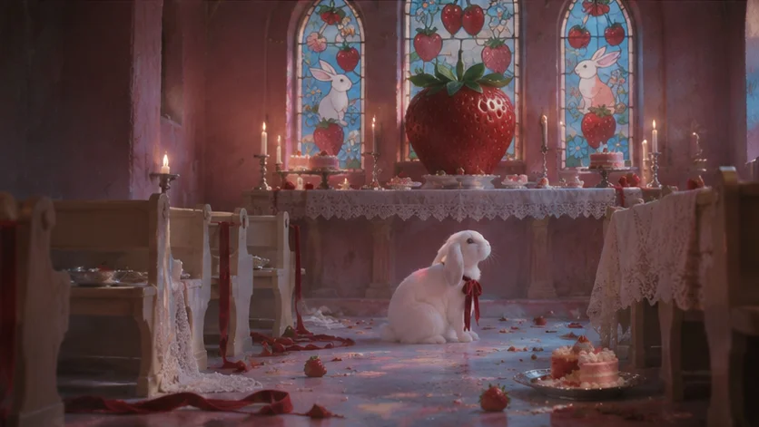

# White Rabbit Strawberry Chapel Analog Film Series

**中文标题：** 白兔草莓小教堂胶片电影系列  
**ID:** `gi25-x-1400` · **Mode:** `generate`  
**Categories:** `character-consistency`, `general`  
**Tags:** `x-twitter`, `community`, `gpt-image-2.5`, `x-direct`, `en`



### White Rabbit Strawberry Chapel Analog Film Series

```text
1. The Strawberry Altar

Create a cinematic 16:9 analog-film photograph inside a tiny pastel-pink chapel.

The main subject is the exact same adorable white lop-eared rabbit used throughout the series, with soft fluffy fur, long drooping ears, round dark eyes, and a small deep-red velvet ribbon tied loosely around its neck.

The rabbit sits alone in the center aisle, facing an altar at the far end of the chapel.

The chapel is extremely small and intimate, with pale pink plaster walls, ivory wooden pews, white candles, silver communion plates, tiny strawberry cakes, red velvet ribbons, and subtle lace details.

At the center of the altar sits one enormous, perfectly ripe strawberry, dramatically oversized but rendered with believable photographic texture.

Behind it are tall stained-glass windows depicting white rabbits, strawberries, cherries, and small flowers instead of traditional religious imagery.

Soft sunlight passes through the stained glass and creates patches of blue, red and rose-colored light across the pink floor and the rabbit’s white fur.

The rabbit is small compared with the chapel and altar, creating a strange sense of ceremony.

The scene should feel sacred, absurd, adorable and slightly unsettling at the same time.

PHOTOGRAPHY:
1970s European cult-film still,
Ektachrome-inspired color,
soft diffusion filter,
slightly hazy lens,
gentle film grain,
subtle halation,
creamy highlights,
saturated strawberry reds,
cool stained-glass blues,
ivory whites,
faded chapel pink,
slight underexposure in the corners,
no digital sharpness,
no glossy commercial look.
COLOR PALETTE:
ivory white,
dusty chapel pink,
strawberry red,
stained-glass blue,
soft silver,
small touches of pale green.
COMPOSITION:
symmetrical but slightly imperfect,
rabbit centered low in frame,
large altar and giant strawberry dominating the background,
strong depth through rows of pews,
cinematic 16:9 framing.
No people.
No text.
No logo.
No cartoon style.
Photorealistic analog photography.

2. Communion Table
Create a cinematic 16:9 close editorial photograph inside the same tiny pink chapel.
The exact same white lop-eared rabbit sits at a miniature ceremonial table covered with ivory lace.
Its long ears fall naturally beside its face.
The same deep-red velvet ribbon is tied around its neck.
In front of the rabbit are:
a small silver plate,
a tiny silver goblet filled with strawberry milk,
several ripe strawberries,
a miniature pink cake with white cream,
one white candle,
a folded ivory napkin,
and one tiny red ribbon.
The rabbit is not anthropomorphic and does not behave like a human.
It simply sits naturally beside the table, quietly observing the objects.
The setting should feel like someone prepared an elaborate religious ceremony specifically for the rabbit and then disappeared.
Behind the rabbit, the same pink chapel remains visible in soft focus.
Stained-glass windows depicting rabbits and fruit cast colored light across the wall.
One narrow shaft of soft sunlight catches the rabbit’s fur, making it glow creamy white while the surrounding chapel remains slightly darker.

The image should feel intimate, sacred, sweet and inexplicably strange.
PHOTOGRAPHY:
1970s European cult cinema,
vintage Ektachrome slide-film character,
shallow depth of field,
soft diffusion,
visible natural grain,
slight lens bloom,
rich but restrained reds,
creamy whites,
faded pink shadows,
soft blue reflections from stained glass,
gentle analog imperfection.
Avoid:
modern food photography,
commercial pet photography,
cute advertisement styling,
bright digital clarity.
The atmosphere should feel like a frame from a forgotten surreal European film.
16:9 horizontal composition.

3. The Stained-Glass Rabbit
Create a cinematic 16:9 analog photograph inside the same tiny pastel-pink chapel.

The exact same white lop-eared rabbit sits directly beside a tall stained-glass window.
The window depicts a stylized white rabbit surrounded by oversized strawberries, cherries, leaves and pale blue flowers.
The real rabbit looks upward toward the rabbit figure in the glass.
Its pose is natural and quiet, almost as if it recognizes itself.
Strong afternoon sunlight passes through the stained glass.
Colored light falls across the rabbit’s white fur in patches of:

strawberry red,
soft cyan-blue,
pale rose,
and muted gold.
The surrounding chapel remains dim and dusty pink.
Several empty ivory pews appear in the background.
Small white candles and silver objects are visible only as soft blurred shapes.
The rabbit should remain the main emotional focus while the stained-glass imagery creates an uncanny visual echo.

The mood is tender, devotional, surreal and slightly cult-like.

PHOTOGRAPHY:
70s European art-house film still,
Ektachrome color response,
soft-focus vintage lens,
slight blooming highlights,
gentle grain,
mild color bleed,
subtle film haze,
slightly faded blacks,
delicate lens flare from the stained-glass sunlight.

COLOR PALETTE:
ivory fur,
dusty rose walls,
deep strawberry red,
stained-glass cyan,
muted gold,
dark burgundy ribbon.

The image should not feel horror.
It should feel beautiful enough to be comforting, but strange enough that the viewer keeps looking.

16:9 horizontal cinematic framing.

4. After the Ceremony

Create a cinematic 16:9 wide analog-film photograph inside the same tiny pink chapel after an unknown ceremony has ended.

The exact same white lop-eared rabbit sits alone near the altar.
The chapel is now slightly messier than before.
Several red ribbons have fallen onto the floor.
A few strawberries are scattered between the pews.
One tiny pink cake has been partially eaten.
White candles have burned down unevenly.
Small silver plates sit abandoned on the benches.

At the altar, the enormous strawberry remains untouched.
The stained-glass windows still depict rabbits and fruit, but the light outside has become softer and slightly cooler.

The rabbit sits quietly near the center of the chapel, looking sideways toward the empty pews.

It should appear small and innocent inside a space that feels as though many invisible guests have just left.

No frightening elements.
No blood.
No damage.
The strangeness should come purely from absence and ritual.

The atmosphere should feel:
sweet,
lonely,
ceremonial,
nostalgic,
slightly melancholic,
and inexplicably sacred.

PHOTOGRAPHY:
1970s European cult-film photography,
expired Ektachrome feel,
slightly stronger grain,
soft diffusion,
low contrast,
faded rose shadows,
creamy candle highlights,
deep strawberry-red accents,
cool blue light beginning to enter through the windows,
slight underexposure,
subtle analog color shifts,
realistic photographic texture.

COMPOSITION:
wide 16:9 frame,
slightly asymmetrical,
rabbit positioned off-center,
empty pews and scattered ceremonial objects creating depth,
large areas of negative space.
The final image should feel like the closing shot of a strange, beautiful cult film about a rabbit and a strawberry religion.
No people.
No text.
No logo.
No cartoon or illustration aesthetic.
Photorealistic analog cinema still.
```

- **Recommended model:** `gpt-image-2.5-sunburst`
- **Settings:** _(defaults)_
- **Source:** [community](https://x.com/veynmotion/status/2117927337618812967) — @veynmotion
- **License note:** Original public X post; quoted with attribution — remix with attribution
- **Notes:** Collected directly from X; original post https://x.com/veynmotion/status/2117927337618812967; post text names GPT Image 2.5; discovered via X search, prompt re-verified against the original X post via api.fxtwitter.com; verified=True; multi-shot series prompt with the same rabbit across frames; preview is image 1
- **Preview:** `previews/gi25-x-1400.webp`
