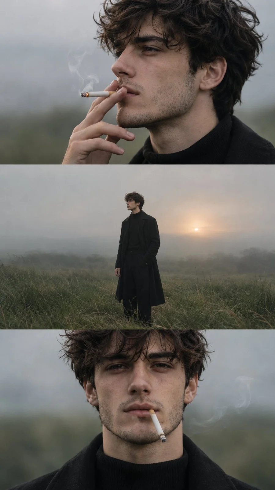

# Cinematic Moody Editorial Three-Frame Portrait (9:16)

**中文标题：** 电影感情绪编辑三联人像（9:16）  
**ID:** `gi25-x-1403` · **Mode:** `generate`  
**Categories:** `character-consistency`, `general`  
**Tags:** `x-twitter`, `community`, `gpt-image-2.5`, `x-direct`, `en`



### Cinematic Moody Editorial Three-Frame Portrait (9:16)

```text
CINEMATIC MOODY EDITORIAL PORTRAIT SERIES | 9:16 VERTICAL

Create a cinematic, photorealistic vertical editorial photography composition featuring the same young man across three seamlessly stacked horizontal frames. The entire composition captures a quiet, introspective, melancholic moment in an open rural grassland during a misty, overcast golden hour.

Subject & Appearance: A young man with medium-length, naturally messy, wavy black hair, pale skin with natural freckles across his nose and cheeks, slightly tired reddish eyes, a defined jawline, and a calm, melancholic expression. He has a small natural beauty mark near his lower lip and subtle black tattoos extending along the side of his neck. His ears, nose, and lips are completely free of all metal accessories, piercings, jewelry, or ornaments. No earrings, no nose rings, no septum rings, no lip rings, no facial piercings.

Clothing: An all-black minimalist outfit consisting of a long black tailored overcoat, a black high-neck sweater, black tailored trousers, and a black belt. Elegant, understated, dark fashion aesthetic.

Frame 1, Top Panel: Extreme close-up side profile portrait of the young man smoking a cigarette, held naturally between his fingers near his lips. His slightly tired eyes gaze into the distance. His messy black hair falls naturally around his face. Freckles, realistic skin texture, subtle neck tattoos, and soft cigarette smoke are visible. No metal accessories or piercings anywhere on his face or ears. Soft, diffused natural light, shallow depth of field, muted cool tones.

Frame 2, Middle Panel: Wide cinematic full-body shot of the same young man standing alone in a vast open field of tall, windblown grass. He wears the same long black overcoat and all-black outfit. One hand rests casually inside his coat pocket while the other hangs naturally by his side. His body faces slightly sideways, with his gaze directed toward the distant horizon. A pale golden sun glows softly through the mist behind him, creating a subtle atmospheric backlight. The landscape feels empty, peaceful, and melancholic. Natural wind gently moves the grass and his hair.

Frame 3, Bottom Panel: Front-facing extreme close-up portrait of the same young man, looking directly toward the camera with a tired, introspective expression. His messy black hair frames his face naturally. His freckles, slightly reddish eyes, natural skin texture, and subtle neck tattoos remain consistent. A cigarette hangs naturally from his lips with a faint trail of smoke. His black overcoat and high-neck sweater are visible at the bottom of the frame. Absolutely no metal accessories, earrings, nose rings, septum rings, lip rings, or facial piercings.

Photography & Atmosphere: Ultra-photorealistic cinematic photography, authentic human skin texture, natural freckles, realistic hair strands, subtle film grain, soft atmospheric fog, muted desaturated green and blue-gray color palette, gentle golden sunlight, shallow depth of field, moody editorial fashion photography, natural lighting, realistic shadows, subtle film texture, emotionally expressive composition.

Composition: Three equally sized horizontal cinematic frames stacked vertically within one 9:16 vertical image. Clean horizontal divisions, no borders, no text, no typography, no logos. Maintain the exact same facial features, hairstyle, clothing, body proportions, and tattoos across all three frames.

Negative Prompt: earrings, nose rings, septum rings, lip rings, facial piercings, metal accessories, jewelry, necklaces, bracelets, additional people, inconsistent facial features, different hairstyles, plastic skin, excessive retouching, cartoon, illustration, CGI, artificial lighting, oversaturated colors, text, watermark, logos, extra fingers, distorted hands, blurry face.
```

- **Recommended model:** `gpt-image-2.5-sunburst`
- **Settings:** _(defaults)_
- **Source:** [community](https://x.com/harboriis/status/2117945431791669712) — @harboriis
- **License note:** Original public X post; quoted with attribution — remix with attribution
- **Notes:** Collected directly from X; original post https://x.com/harboriis/status/2117945431791669712; post text names GPT Image 2.5; discovered via X search, prompt re-verified against the original X post via api.fxtwitter.com; verified=True
- **Preview:** `previews/gi25-x-1403.webp`
