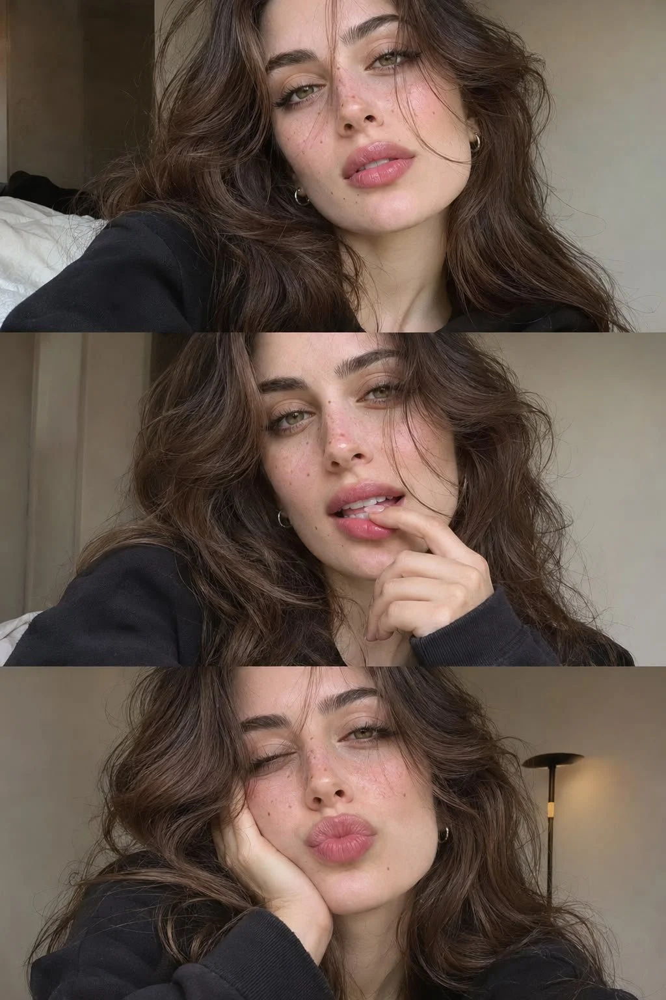

# Vertical Triptych of Three Candid Selfies from Reference

**中文标题：** 参考照片生成三张随手自拍竖版三联  
**ID:** `gi25-x-1408` · **Mode:** `edit`  
**Categories:** `character-consistency`, `edit-change-preserve`  
**Tags:** `x-twitter`, `community`, `gpt-image-2.5`, `x-direct`, `en`



### Vertical Triptych of Three Candid Selfies from Reference

```text
Create a beautifully composed vertical triptych featuring three authentic, spontaneous smartphone selfies of the same young woman shown in the reference photograph. Preserve her recognizable facial identity, facial proportions, natural beauty, and distinctive features throughout all three photographs.

HER APPEARANCE

She has an effortlessly captivating appearance, with expressive hazel-green eyes, softly defined eyebrows, naturally long eyelashes, a petite elegant nose, and beautifully shaped, softly full lips with a subtle pink tint. Her complexion is natural and luminous, with delicate freckles across the bridge of her nose and a few tiny beauty marks on her cheeks.

Her hair is long, thick, deep chocolate brown, with abundant natural volume, loose cascading waves, soft layered ends, and delicate curtain bangs framing her face. She wears tiny silver hoop earrings and understated everyday makeup. Her overall appearance should feel youthful, feminine, relaxed, and effortlessly beautiful.

THREE DIFFERENT CANDID MOMENTS

FIRST PHOTO — QUIET MORNING: A close-up selfie captured slightly above eye level. She is sitting comfortably near a bedroom window, looking directly into the front camera with a soft, thoughtful half-smile. Her head is gently tilted, and her wavy hair falls loosely over one shoulder. A few strands naturally frame her face.

SECOND PHOTO — PLAYFUL PERSONALITY: A spontaneous angled selfie taken from slightly below her eye level. She has a mischievous little smile, one eyebrow subtly raised, and her index finger gently touching her cheek. Her eyes are looking straight into the lens. Her expression feels spontaneous and charming rather than deliberately posed.

THIRD PHOTO — COZY EVENING: A relaxed close-up with her head resting against the back of her hand, her cheek slightly squished against her palm. She gives the camera a gentle closed-mouth smile, with slightly narrowed eyes and a peaceful expression. Her hair falls loosely around her shoulders.

PHOTOGRAPHIC DIRECTION

All three images must look like separate photographs captured casually on the same smartphone, not professional portraits. Use realistic front-facing camera perspective, slightly imperfect framing, natural skin pores, subtle facial texture, delicate flyaway hairs, realistic eye reflections, and authentic smartphone image processing.

Use soft diffused daylight for the first two images and warmer ambient bedroom lighting for the third. Keep the background understated, featuring subtle bedroom details, neutral bedding, and softly blurred surroundings.

COLLAGE LAYOUT

Create one seamless vertical canvas with exactly three equally sized, full-width horizontal photographs stacked vertically. Each photograph should occupy precisely one-third of the canvas. No gaps, borders, frames, captions, typography, or decorative elements.

IDENTITY AND CONSISTENCY

The exact same girl must appear in all three photographs. Maintain consistent facial structure, eye color, nose, lips, skin tone, hairstyle, and recognizable identity. Only her expression, camera angle, and hand positioning should change.

The final result should resemble an authentic collection of personal smartphone selfies taken on different moments of an ordinary day — intimate, natural, charming, and convincingly photorealistic. Avoid excessive beauty filters, plastic skin, exaggerated facial features, artificial symmetry, or an obvious AI-generated appearance.
```

- **Recommended model:** `gpt-image-2.5-sunburst`
- **Settings:** _(defaults)_
- **Source:** [community](https://x.com/mehvishs25/status/2117979907137704383) — @mehvishs25
- **License note:** Original public X post; quoted with attribution — remix with attribution
- **Notes:** Collected directly from X; original post https://x.com/mehvishs25/status/2117979907137704383; post text names GPT Image 2.5; discovered via X search, prompt re-verified against the original X post via api.fxtwitter.com; verified=True; needs an uploaded reference photo
- **Preview:** `previews/gi25-x-1408.webp`
