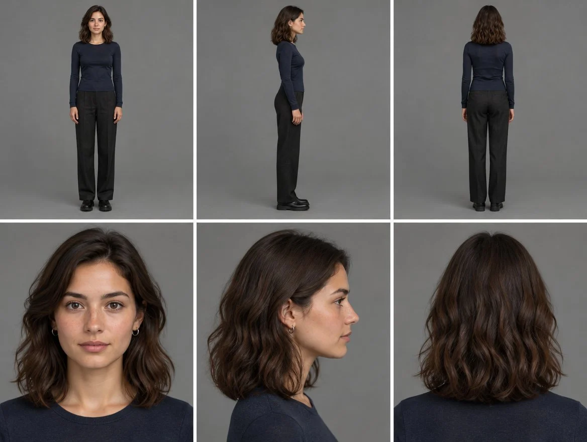

# Six-View Photoreal Character Turnaround Contact Sheet

**中文标题：** 六视图写实角色转面设定表  
**ID:** `gi25-x-1409` · **Mode:** `generate`  
**Categories:** `character-consistency`  
**Tags:** `x-twitter`, `community`, `gpt-image-2.5`, `x-direct`, `en`



### Six-View Photoreal Character Turnaround Contact Sheet

```text
Create a photorealistic CHARACTER TURNAROUND CONTACT SHEET for an original fictional adult female AI presenter, age 26.

Create a clean 3-column by 2-row grid with SIX equally sized panels, separated by thin white gutters.

TOP ROW:
Full-body front view.
Full-body 90-degree side profile.
Full-body back view.

BOTTOM ROW:
4. Close-up frontal portrait.
5. Close-up side profile.
6. Close-up back-of-head and shoulders.
CHARACTER DESIGN:
An attractive but natural-looking adult woman with warm light-olive skin, subtle freckles across the nose, deep brown eyes, gently defined cheekbones and natural rose lips.
Shoulder-length dark chestnut brown hair with soft layered waves, a slightly off-centre part and natural flyaways.
Small silver hoop earrings. Fitted charcoal-navy long-sleeve crew-neck top, dark straight-leg trousers and minimal black shoes.

PRESENTATION:
Neutral matte medium-gray studio background across all six panels. Soft, even studio lighting, realistic skin texture, natural proportions and premium casting-reference photography.
Maintain exactly the same face, hairstyle, body proportions, outfit and accessories in every panel.

No text, labels, numbers, watermarks or extra panels.
```

- **Recommended model:** `gpt-image-2.5-sunburst`
- **Settings:** _(defaults)_
- **Source:** [community](https://x.com/Heliosastra/status/2118021348337352950) — @Heliosastra
- **License note:** Original public X post; quoted with attribution — remix with attribution
- **Notes:** Collected directly from X; original post https://x.com/Heliosastra/status/2118021348337352950; post text names GPT Image 2.5; discovered via X search, prompt re-verified against the original X post via api.fxtwitter.com; verified=True; step 2 of a GPT Image 2.5 + Seedance 2.5 AI-presenter workflow on Higgsfield; only the GPT Image 2.5 character-sheet prompt is quoted
- **Preview:** `previews/gi25-x-1409.webp`
