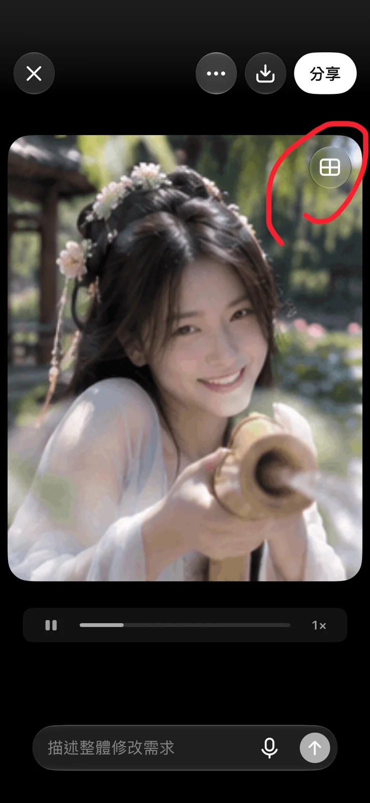

# Lotus-Pond Summer Play Keyframe Series (荷风嬉夏)

**中文标题：** 荷风嬉夏·荷塘戏水分镜关键帧  
**ID:** `gi25-x-1418` · **Mode:** `edit`  
**Categories:** `character-consistency`, `edit-change-preserve`  
**Tags:** `x-twitter`, `community`, `gpt-image-2.5`, `x-direct`, `zh`



### Lotus-Pond Summer Play Keyframe Series (荷风嬉夏)

```text
视频1：

《荷风嬉夏》｜古代荷塘戏水 MV

个人脸部 ID × 江南荷塘 × 汉服内搭 × 双手撩水 × 俏皮互动 × 日系青春 MV

【人物与身份】

使用我在 ChatGPT 账户中保存的个性化「You」参考照片作为人物脸部身份参考，保留五官、脸型、面部比例和个人辨识特征。

人物为同一位成年东亚女性，面容、发型及服装在所有镜头中保持一致。气质清新甜美、古灵精怪，表情自然灵动。

【造型与场景】

女主穿浅色轻盈汉服内搭，柔软的交领中衣、贴身内搭与飘逸长裙自然叠穿，衣料轻薄透气，局部被水沾湿，呈现可信的湿润褶皱和垂坠感。

长发部分挽起，搭配简洁花簪和自然散落的发丝。

盛夏江南古典园林，清澈的浅水荷塘，大片荷叶、盛开的荷花、垂柳与曲廊。阳光透过树叶洒在水面，形成明亮自然的波光。

女主赤脚站在荷塘边缘的浅水中，水面没过脚踝，能够自然弯腰、蹲下、撩水和嬉戏。

【10秒青春MV分镜】

0至1.5秒：
低机位贴近水面，镜头上的水滴逐渐滑落。女主蹲在荷塘浅水处，突然发现摄影者，抬头露出惊喜笑容。

1.5至3.5秒：
面部近景，女主低头看着水面，嘴角扬起调皮的笑意。她用双手捧起清凉的池水，突然抬眼看向镜头。

3.5至5.5秒：
正面动态近景，她双手从水面向前上方轻快撩起一大片水花。水流沿真实的抛物轨迹飞向镜头，水珠在阳光下晶莹闪烁。

5.5至7.5秒：
快速切至侧面中景，女主笑着后退两步，裙摆轻轻掠过水面，带起细碎涟漪。她回头看向镜头，笑得更加开心。

7.5至10秒：
镜头重新贴近水面，女主突然俯身，双手再次捧水向摄影者泼来。水花迅速靠近镜头，部分水滴直接打湿镜头表面。她在水珠后调皮眨眼，最后水花覆盖整个画面，与开场形成自然循环。

【摄影与表演】

Japanese Youth MV × Chinese Summer Garden × Candid Cinematic Montage。

以真实夏日玩水为核心，融合日本青春电影的明亮色彩、轻快节奏和自然抓拍感。

镜头自由切换近景、特写、低机位与动态中景，动作衔接自然。

人物的注意力与摄影者形成亲密互动，偶尔偷笑、突然泼水、被水溅到时自然眯眼、忍不住大笑。

水花由双手真实拨动池水产生，具有自然的飞行方向、重力轨迹、飞溅形态和镜头遮挡。衣料、发丝和水面根据人物动作自然响应。

原创轻快日系青春流行音乐，约160 BPM，人物动作与音乐节奏呼应。保留少量水珠飞溅的瞬间慢动作。

真实皮肤纹理，清透夏日阳光，柔和高光，色彩干净自然。画面轻松、活泼、具有身临其境的夏日快乐。

【输出】

9:16竖版，10秒，目标30fps。
以高质量动态视频为母版，可另外制作无声循环GIF。

首尾利用水珠遮挡实现视觉闭环。
无字幕和额外装饰文字。

左下签名：深蓝色实心圆点在前，白色手写体 DeepBlue 在后
```

- **Recommended model:** `gpt-image-2.5-sunburst`
- **Settings:** _(defaults)_
- **Source:** [community](https://x.com/DeepBlueX0/status/2118286112347263157) — @DeepBlueX0
- **License note:** Original public X post; quoted with attribution — remix with attribution
- **Notes:** Collected directly from X; original post https://x.com/DeepBlueX0/status/2118286112347263157; post text names GPT Image 2.5; discovered via X search, prompt re-verified against the original X post via api.fxtwitter.com; verified=True; needs a saved ChatGPT personalization/You face reference; written as MV keyframe prompt for GPT Image 2.5
- **Preview:** `previews/gi25-x-1418.webp`
