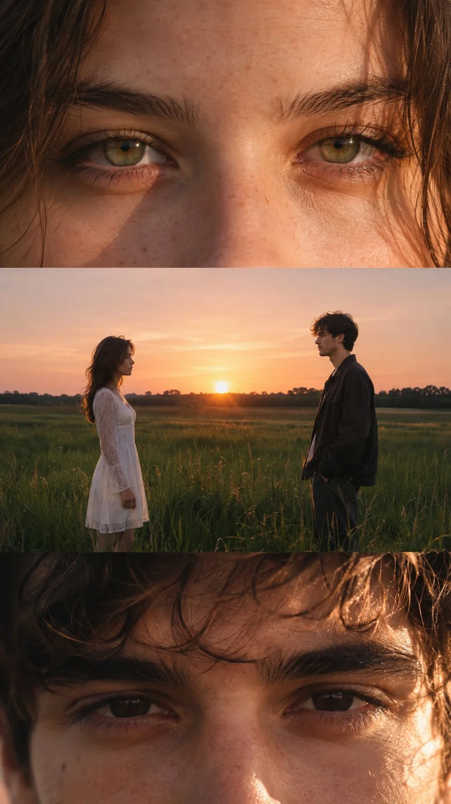

# Cinematic Romantic Sunset Couple Portrait Series (9:16)

**中文标题：** 电影感金色夕阳情侣三联人像（9:16）  
**ID:** `gi25-x-1424` · **Mode:** `generate`  
**Categories:** `character-consistency`, `general`  
**Tags:** `x-twitter`, `community`, `gpt-image-2.5`, `x-direct`, `en`



### Cinematic Romantic Sunset Couple Portrait Series (9:16)

```text
CINEMATIC ROMANTIC SUNSET PORTRAIT SERIES | 9:16 VERTICAL

Create a cinematic, photorealistic vertical editorial photography composition featuring a young couple in an open rural grassland during a warm golden hour sunset. The composition consists of three seamlessly stacked horizontal frames, capturing an intimate, dreamy, and nostalgic moment between two people.

Subject & Appearance:

A young woman with long, naturally flowing dark brown hair, delicate facial features, expressive hazel-green eyes, and a soft, thoughtful expression. She wears a simple white romantic dress with delicate lace sleeves.

A young man with naturally messy dark brown hair, subtle facial stubble, expressive dark eyes, and a calm, introspective expression. He wears a dark oversized jacket over a simple shirt.

Maintain consistent facial features, hairstyles, clothing, and natural proportions throughout all frames.

Frame 1: Extreme Close-Up of the Woman's Eyes

An extreme close-up photograph focusing entirely on the young woman's hazel-green eyes. Her eyes are positioned symmetrically across the frame, with delicate eyelashes, natural eyebrows, and realistic skin texture.

Warm golden sunlight illuminates one side of her face while the opposite side falls into soft, cinematic shadow. A subtle reflection of the sunset is visible in her eyes.

Frame 2: Wide Romantic Landscape Shot

A wide cinematic shot of the young couple standing several feet apart in a vast green meadow, facing each other quietly.

The woman stands on the left wearing her flowing white dress. The young man stands on the right wearing his dark jacket and trousers.

Tall grass surrounds them, with a distant tree line stretching across the horizon. The setting sun casts a soft golden glow across the landscape, creating a beautiful contrast between the warm sky and the darker foreground.

The couple remains still, sharing a quiet and emotional moment.

Frame 3: Extreme Close-Up of the Young Man's Eyes

An extreme close-up portrait focusing on the young man's eyes, eyebrows, and upper face.

His dark eyes look directly toward the camera with a subtle, emotional expression. His naturally messy dark hair falls gently across his forehead.

Warm golden sunlight highlights individual hair strands, natural skin texture, and delicate reflections in his eyes. The background remains completely out of focus.

Photography & Color Grading:

Professional full-frame cinematic photography, 85mm portrait lens for close-ups, 50mm lens for the wide landscape frame, natural golden-hour lighting, soft film grain, shallow depth of field, warm amber highlights, muted green grass, deep cinematic shadows, subtle analog film texture, realistic skin details, and natural imperfections.

Composition:

Exactly three horizontal cinematic frames stacked vertically within a single 9:16 vertical canvas.

Top frame: 25% extreme close-up of the woman's eyes.

Middle frame: 40% wide landscape shot of the couple facing each other.

Bottom frame: 35% extreme close-up of the man's eyes.

Clean horizontal transitions, no borders, no text, no logos, no additional subjects.

Overall Mood: Romantic, nostalgic, intimate, emotional, dreamy, and poetic. A quiet moment between two people captured in the final light of sunset, like a still from an independent romantic film.

Ultra-photorealistic, cinematic composition, natural lighting, realistic photography, high detail, 9:16 vertical aspect ratio.
```

- **Recommended model:** `gpt-image-2.5-sunburst`
- **Settings:** _(defaults)_
- **Source:** [community](https://x.com/harboriis/status/2118360664016404630) — @harboriis
- **License note:** Original public X post; quoted with attribution — remix with attribution
- **Notes:** Collected directly from X; original post https://x.com/harboriis/status/2118360664016404630; post text names GPT Image 2.5; discovered via X search, prompt re-verified against the original X post via api.fxtwitter.com; verified=True
- **Preview:** `previews/gi25-x-1424.webp`
